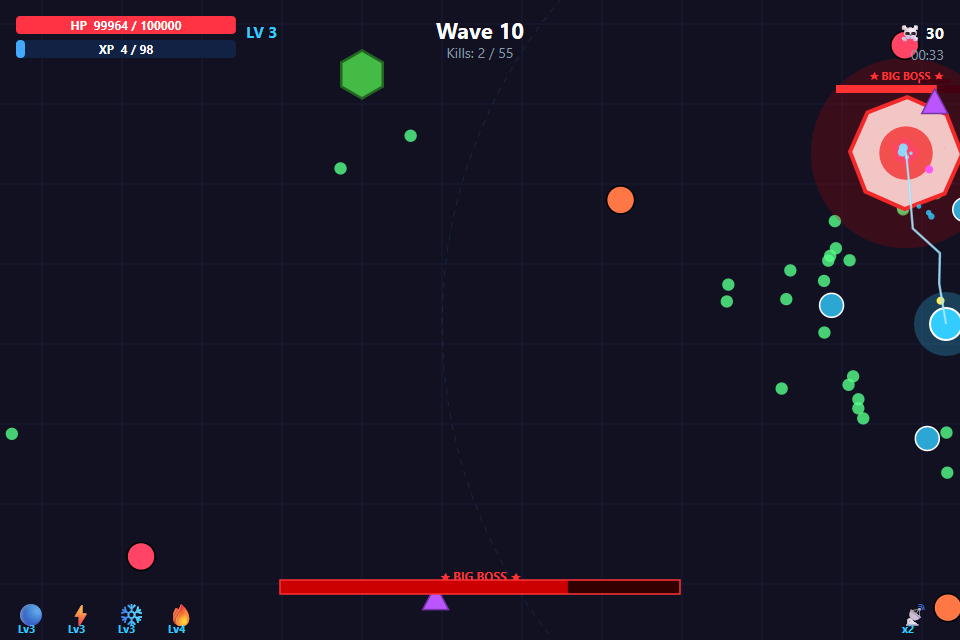

# OIDA

Eine Programmiersprache im österreichischen Dialekt, die zu echtem Maschinencode übersetzt wird.
Jede Anweisung hört mit `OIDA` auf.

```
# Fakultät, rekursiv gerechnet

FUNKTIAUN fakultaet(n ZOI) GIBT ZRUCK ZOI
    WENN n <= 1 DAUN
        GIB ZRUCK 1 OIDA
    PASST SCHO
    GIB ZRUCK n * fakultaet(n - 1) OIDA
PASST SCHO

SOG AU i = 1 OIDA
SOLONG i <= 10 TUA
    SCHREIB(KETTN(i) + "! =", fakultaet(i)) OIDA
    i = i + 1 OIDA
PASST SCHO
```

```
> oida beispiele\fakultaet.oida
Passt! beispiele\fakultaet.exe is fertig.
> beispiele\fakultaet.exe
1! = 1
2! = 2
...
10! = 3628800
```

Der Compiler heißt `oida`, ist in Rust geschrieben und erzeugt über LLVM ein normales Programm
für Windows oder Linux (rund 340 KB; unter Windows eine `.exe`, die ohne zusätzliche DLLs läuft). OIDA ist die große Schwester von
[OIDA-SQL](https://github.com/lelewithheart/oida-sql).

**Stand: v0.22.** Zahlen, Texte, Strukturen, Listen, Verzeichnisse, Klassen mit Vererbung, Vorlagen
(Generics), Funktionen als Werte, fehlende Werte (`NIX`), Fehler ohne Absturz, Programme aus
mehreren Dateien, eine mitgelieferte Bibliothek, ein eigenes
[Fenster](#ein-fenster-zeichnen-tasten-und-maus) zum Zeichnen mit Tasten und Maus,
[Töne](#töne) und [Dateien](#dateien) sind da, und damit ist ein ganzes Spiel geschrieben,
[RogueWave](#ein-ganzes-spiel-roguewave), rund 7500 Zeilen OIDA. Neu: Ordner, Pfade, große
Dateien Zeile für Zeile, Bytes, und [das Programm selbst](#das-programm-und-seine-umgebung):
Argumente von der Kommandozeile, Umgebungsvariablen, andere Programme starten. Neu: [JSON](#json),
direkt aus einer `STRUKTUR` und zurück, ohne dass man dafür etwas schreiben muss. Und OIDA läuft
jetzt auch unter [Linux](#windows-und-linux), und für beide Systeme gibt es [Installer](#installieren).
Zuletzt dazugekommen: [Texte mit eingesetzten Werten](#texte-mit-eingesetzten-werten)
(`$"Servas {nam}"`), `==` für Strukturen und Listen, und das [Netzwerk](#netzwerk): Seiten holen
über HTTP und HTTPS und eigene Verbindungen über TCP. Und zuletzt: [Aufzählungen](#aufzählungen)
und die Verzweigung nach Fällen, [`JE NOCHDEM`](#nach-fällen-je-nochdem).
Wohin es geht, steht unten im [Fahrplan](#fahrplan).
Für VS Code gibt es eine [Erweiterung](#in-vs-code-programmieren).
Für Windows und Linux (64 Bit). Fenster und Ton gibt es derzeit nur unter Windows.


## Installieren

Am einfachsten kommt OIDA mit einem Installer auf den Rechner. Es gibt drei; sie entstehen aus
diesem Projekt (siehe [Installer bauen](#installer-bauen)) und landen in `installer/aus/`.
Wer OIDA lieber selbst baut, liest bei [Was man braucht](#was-man-braucht) weiter.

### Windows

`oida-<version>-windows-x86_64-setup.exe` starten (Doppelklick oder im Terminal). Der Installer

1. legt OIDA nach `%LOCALAPPDATA%\Programs\oida`: nur für dich, ohne Admin-Rechte,
2. trägt diesen Ordner in deinen PATH ein, damit man überall einfach `oida` tippen kann,
3. schaut, ob `clang` aus llvm-mingw da ist. Fehlt es, fragt er und holt es dann von
   [GitHub](https://github.com/mstorsjo/llvm-mingw/releases): rund 190 MB, ausgepackt 720 MB.
   Die geholte Datei wird mit ihrer Prüfsumme (SHA-256) verglichen, bevor etwas ausgepackt wird,
4. baut, wenn VS Code da ist und du ja sagst, die OIDA-Erweiterung ein.

Danach in einem neuen Terminal: `oida --version`.

| Option | |
|---|---|
| `--jo` | nichts fragen, überall "ja" |
| `--ordner <pfad>` | dorthin statt nach `%LOCALAPPDATA%\Programs\oida` |
| `--ohne-pfad`, `--ohne-llvm`, `--ohne-vscode` | diesen Schritt auslassen |
| `--weg` | OIDA wieder entfernen |

Entfernen geht auch in den Einstellungen von Windows unter "Installierte Apps" (Eintrag OIDA).
Weg kommt genau das, was der Installer hingelegt hat; eigene Dateien im Ordner, llvm-mingw und
die VS-Code-Erweiterung bleiben.

Der Installer ist nicht signiert. Kommt er aus dem Internet, warnt Windows beim ersten Start
("Der Computer wurde durch Windows geschützt"); weiter geht es mit "Weitere Informationen" und
"Trotzdem ausführen".

### Linux

Eine Datei, die sich selbst auspackt und auf jeder Distribution geht:

```
sh oida-<version>-linux-x86_64.sh                 # nur für dich, nach ~/.local
sudo sh oida-<version>-linux-x86_64.sh --system   # für alle, nach /usr/local
```

Sie legt den Compiler nach `bin/oida` und Beispiele samt Anleitung nach `share/oida/`, fragt, ob
sie `~/.local/bin` in dein `~/.profile` eintragen soll (wenn es noch nicht im PATH ist), und
schaut nach `clang`. Fehlt es, zeigt sie den Befehl für deine Paketverwaltung und führt ihn auf
Wunsch aus. Dieselben Optionen wie unter Windows gibt es hier auch (`--jo`, `--ordner`,
`--ohne-pfad`, `--ohne-clang`, `--ohne-vscode`, `--weg`).

Unter Ubuntu und Debian geht es auch als Paket, das `clang` gleich mitholt:

```
sudo apt install ./oida_<version>_amd64.deb
```

Entfernen: `sh ~/.local/share/oida/deinstalliern.sh --weg` beziehungsweise `sudo apt remove oida`.

Der Compiler in beiden hängt von keiner Bibliothek des Systems ab und läuft darum auf alten wie
auf neuen Distributionen. Die Programme, die er baut, sind gewöhnliche Linux-Programme und
brauchen die übliche C-Bibliothek (glibc); auf Alpine geht es darum nicht.


## Was man braucht

### Unter Windows

Zwei Dinge, kein Visual Studio:

1. **Rust** mit der Toolchain `x86_64-pc-windows-gnullvm`
2. **llvm-mingw** (bringt `clang` mit, das aus dem LLVM-Code die `.exe` macht)

Einrichten:

```
winget install Rustlang.Rustup
rustup default stable-x86_64-pc-windows-gnullvm
```

Dann von <https://github.com/mstorsjo/llvm-mingw/releases> die Datei
`llvm-mingw-...-ucrt-x86_64.zip` herunterladen und nach
`%LOCALAPPDATA%\Programs\llvm-mingw` entpacken (so, dass dort der Ordner `bin` liegt).
Dort sucht `oida` von selbst nach `clang`.

Damit auch Rust ohne Visual Studio linken kann, kommt in die Datei `%USERPROFILE%\.cargo\config.toml`
(den Pfad an den eigenen Benutzernamen anpassen):

```toml
[target.x86_64-pc-windows-gnullvm]
linker = "C:/Users/DEINNAME/AppData/Local/Programs/llvm-mingw/bin/x86_64-w64-mingw32-clang.exe"
```

Liegt llvm-mingw woanders, entweder den `bin`-Ordner in den `PATH` geben oder die
Umgebungsvariable `OIDA_CLANG` auf die `clang.exe` setzen.

### Unter Linux

Auch zwei Dinge: **Rust** und **clang** aus der Paketverwaltung.

```
curl --proto '=https' --tlsv1.2 -sSf https://sh.rustup.rs | sh
sudo apt install clang          # Ubuntu, Debian
```

Unter Fedora heißt es `sudo dnf install clang`, unter Arch `sudo pacman -S clang`. Einen `gcc`
braucht man nicht: In [`.cargo/config.toml`](.cargo/config.toml) steht, dass `clang` auch für Rust
linkt. `oida` sucht `clang` im `PATH` (und nimmt sonst das neueste `clang-<nummer>`); mit
`OIDA_CLANG` gibt man ein bestimmtes an.

Gebaut und getestet ist das unter Ubuntu 26.04 auf x86_64 (in WSL). Andere Distributionen und
ARM sollten gehen, sind aber nicht ausprobiert.


## Bauen

Im Projektordner:

```
cargo build --release
```

Danach liegt der Compiler in `target\release\oida.exe` (unter Linux `target/release/oida`). Die
Laufzeitbibliothek wird dabei mitgebaut und steckt im Compiler drin; man braucht also nur diese
eine Datei (plus `clang`).

Die Tests:

```
cargo test
```

### Installer bauen

```
installer\bauen.ps1 -Linux       # unter Windows: alle drei (die für Linux baut es im WSL)
installer\testen.ps1             # probiert den Windows-Installer aus
bash installer/linux/bauen.sh    # unter Linux: die beiden für Linux
bash installer/linux/testen.sh   # probiert die selbstauspackende Datei aus
sudo bash installer/linux/testen.sh --deb
```

Die Tests installieren in einen Probe-Ordner: Unter Windows landen PATH und App-Eintrag unter
einem eigenen Schlüssel in der Registry, unter Linux gibt es einen nachgemachten Home-Ordner.
Nur der Test für das `.deb` installiert das Paket wirklich (und entfernt es wieder). Mit
`installer\testen.ps1 -Laden` holt der Installer llvm-mingw einmal echt von GitHub.

Welche Ausgabe von llvm-mingw der Windows-Installer holt, steht samt Prüfsumme oben in
[`installer/windows/src/ablauf.rs`](installer/windows/src/ablauf.rs). Die VS-Code-Erweiterung baut
derzeit nur `vscode\bauen.ps1`; die Linux-Installer nehmen sie mit, wenn sie in `installer/aus/` liegt.


## Ein Programm übersetzen

```
target\release\oida beispiele\fizzbuzz.oida
beispiele\fizzbuzz.exe
```

Oder in einem Schritt übersetzen und gleich starten:

```
target\release\oida beispiele\fizzbuzz.oida --renn
```

Unter Linux genauso, nur mit `/`. Ohne `-o` heißt das Programm wie die Datei: unter Windows mit
`.exe`, unter Linux ohne Endung.

```
target/release/oida beispiele/fizzbuzz.oida -o fizzbuzz
./fizzbuzz
```

| Option                  | Bedeutung                                                    |
|-------------------------|--------------------------------------------------------------|
| `-o <datei>`            | so soll das Programm heißen (sonst wie die `.oida`-Datei)    |
| `--renn`                | das Programm nach dem Übersetzen gleich starten              |
| `--ir`                  | das LLVM-IR als `.ll`-Datei daneben speichern (zum Anschauen)|
| `--ohne-optimierung`    | schneller übersetzen, dafür ein langsameres Programm         |
| `--woerterbuch <datei>` | dieses Wörterbuch verwenden                                  |
| `--woerter`             | die Wörter der Sprache anzeigen                              |
| `--hilfe`, `--version`  |                                                              |

`.oida`-Dateien müssen als UTF-8 gespeichert sein.


## In VS Code programmieren

Im Ordner [`vscode`](vscode) liegt eine Erweiterung für VS Code. Einmal `vscode/installieren.bat`
doppelklicken, das baut sie und installiert sie. Danach in VS Code eine `.oida`-Datei aufmachen:

- Die Wörter sind eingefärbt, Fehler werden schon beim Tippen rot unterstrichen.
- **F5** (oder der Pfeil rechts oben) übersetzt das Programm und lässt es unten im Terminal laufen.
- **Strg+Umschalt+B** legt die `.exe` neben die Datei.
- Beim Tippen kommen Vorschläge für die Wörter der Sprache, dazu Schnipsel wie `wenn` und `solong`.
- Vorgeschlagen werden auch die eigenen Funktionen (samt Parametern), Klassen, Strukturen, Aufzählungen und
  Variablen (nur dort, wo sie gelten), und alles aus Dateien und Bibliotheken, die mit `BRAUCH` dazugeholt
  sind. Hinter einem Punkt kommen die Felder und Methoden von dem, was davor steht (`hund.ort.` zeigt die
  Felder des Punkts), hinter `Ampl.` die Werte der Aufzählung.
  Wer lieber klein schreibt (`wenn x > 3 daun ... passt scho`, der Compiler nimmt beides), bekommt
  sie auch klein; die Einstellung `oida.schreibweise` legt es auf Wunsch fest.

Die Erweiterung fragt für alles den Compiler, sie richtet sich also nach dem Wörterbuch.
Gebaut und getestet wird sie derzeit nur unter Windows; unter Linux ist sie nicht ausprobiert.
Mehr dazu in [`vscode/README.md`](vscode/README.md).


## Die Sprache (v0.22)

### Typen

| Typ        | Bedeutung             | Beispiel             |
|------------|-----------------------|----------------------|
| `ZOI`      | ganze Zahl, 64 Bit    | `17`, `-3`           |
| `KOMMAZOI` | Kommazahl, 64 Bit     | `3.14` (mit Punkt)   |
| `JONA`     | Wahrheitswert         | `WOAHR`, `FOISCH`    |
| `KETTN`    | Text                  | `"Servas"`, `'Oida'` |

Dazu kommen eigene [Strukturen](#strukturen) und [Listen](#listen) (`LISTN VON ZOI`).

Zahlen kann man auch so schreiben:

| Schreibweise | Bedeutung |
|---|---|
| `1_000_000` | Unterstriche zum Gliedern (zwischen zwei Ziffern); die Zahl ist dieselbe |
| `0xFF`, `0b1010` | mit sechzehn Ziffern (0-9, A-F) oder mit zwei (0 und 1): `255` und `10` |
| `1e9`, `2.5e-3` | mal zehn hoch so viel; das ist immer eine `KOMMAZOI` |

Die Typen sind fest, aber man muss sie fast nie hinschreiben: Der Compiler erkennt sie am Wert.

### Variablen

```
SOG AU alter = 17 OIDA            # alter ist eine ZOI
SOG AU name = "Franz" OIDA        # name ist eine KETTN
SOG AU schnitt KOMMAZOI = 2 OIDA  # Typ dazuschreiben geht auch: aus 2 wird 2.0
alter = alter + 1 OIDA
```

Eine Variable behält ihren Typ. `alter = "siebzehn" OIDA` ist ein Fehler.
Eine Variable gilt nur in dem Block (`WENN`, `SOLONG`, Funktion), in dem sie angesagt wurde.
Eine Funktion sieht also nicht, was außerhalb von ihr angesagt wurde. Was überall gelten soll
und sich nie ändert, sagt man mit `FIX` an:

### Feste Werte: FIX

```
FIX BREITE = 960 OIDA
FIX HÖHE = 640 OIDA
FIX MITTE_X = BREITE / 2 OIDA               # aus anderen festen Werten gerechnet
FIX TEMPO KOMMAZOI = 200 OIDA               # Typ dazuschreiben geht auch: 200.0
FIX TITL = "Mei Spü" OIDA

FUNKTIAUN is_drin(x KOMMAZOI) GIBT ZRUCK JONA
    GIB ZRUCK x >= 0 UND x < BREITE OIDA    # gilt auch hier, ohne dass man es übergibt
PASST SCHO

SCHREIB(TITL, MITTE_X, TEMPO, is_drin(1000)) OIDA    # Mei Spü 480 200.0 FOISCH
```

- `FIX` steht ganz außen (nicht in einer Funktion) und gilt im ganzen Programm, auch in
  Funktionen, Methoden und in Dateien, die mit `BRAUCH` zusammengehören. Die Reihenfolge ist egal.
- Der Wert muss schon beim Übersetzen feststehen: Zahlen, Texte, `WOAHR`/`FOISCH`, Rechnen damit,
  andere feste Werte und Rechenfunktionen wie `WURZL`. Eine Eingabe oder `ZUFOI()` geht nicht.
- Ändern kann man ihn nicht (`BREITE = 5 OIDA` ist ein Fehler). Es geht nur `ZOI`, `KOMMAZOI`,
  `JONA` und `KETTN`.
- Eine Variable oder ein Parameter mit demselben Namen verdeckt den festen Wert dort, wo sie gilt.

### Rechnen und Vergleichen

- Rechnen: `+  -  *  /  %` (Rest). Trifft eine `ZOI` auf eine `KOMMAZOI`, wird mit Kommazahlen gerechnet.
  `7 / 2` ist `3` (ganze Zahlen), `7 / 2.0` ist `3.5`.
- Texte zusammenhängen: `"Servas " + name`
- Vergleichen: `=` oder `==`, `!=` oder `<>`, `<`, `<=`, `>`, `>=`
- Gleich oder nicht (`==`, `!=`) geht auch mit ganzen Strukturen, Listen und Verzeichnissen: Zwei
  sind gleich, wenn alles darin gleich ist. `Punkt(1, 2) == Punkt(1, 2)` und `[1, 2] == [1, 2]`
  sind `WOAHR`, `liste == []` fragt, ob sie leer ist. Bei einem Verzeichnis zählt die Reihenfolge
  der Einträge nicht. Objekte von Klassen sind nur gleich, wenn es dasselbe Objekt ist.
  Was eine Funktion enthält, lässt sich nicht vergleichen; größer und kleiner gibt es nur für
  Zahlen und Texte.
- Verknüpfen: `UND`, `ODA`, `NED`. Die rechte Seite wird nur ausgerechnet, wenn sie gebraucht wird.
- Umwandeln: `ZOI(...)`, `KOMMAZOI(...)`, `KETTN(...)`, zum Beispiel `"I bin " + KETTN(alter)`
  oder `ZOI("17") + 1`.
- Rechnen und gleich zuweisen: `x += 1`, ebenso `-=`, `*=`, `/=`, `%=`. Bei Texten hängt `+=` an.

Rangfolge von schwach zu stark: `ODA`, `UND`, `NED`, Vergleiche, `+ -`, `* / %`, Minus als Vorzeichen.
Klammern gehen immer.

### Verzweigung

```
WENN alter >= 18 DAUN
    SCHREIB("erwachsen") OIDA
SUNST WENN alter >= 14 DAUN
    SCHREIB("mündig") OIDA
SUNST
    SCHREIB("Kind") OIDA
PASST SCHO
```

`SUNST` und `SUNST WENN` sind freiwillig. Nach `PASST SCHO` darf ein `OIDA` stehen, muss aber nicht.

`SUNST WENN` gehört nur zusammen, wenn beides in derselben Zeile steht; dann reicht ein
`PASST SCHO` für die ganze Kette. Steht das `WENN` in der Zeile nach `SUNST`, ist es eine eigene
Anweisung im `SUNST`-Teil und braucht sein eigenes `PASST SCHO`.

#### Nach Fällen: JE NOCHDEM

Hängt es von einem Wert ab, was passiert, schreibt man statt einer langen Kette aus
`SUNST WENN` die Fälle untereinander:

```
JE NOCHDEM punkte
    BEI 90 BIS 100 DAUN
        SCHREIB("Sehr gut") OIDA
    BEI 80 BIS 89 DAUN
        SCHREIB("Gut") OIDA
    BEI 0, 1, 2 DAUN
        SCHREIB("Host di vatippt?") OIDA
    SUNST
        SCHREIB("Do geht no wos") OIDA
PASST SCHO
```

- Hinter `BEI` stehen ein oder mehrere Werte mit Beistrich dazwischen, oder ein Bereich
  `von BIS bis` (beide Enden gehören dazu). Es geht mit Zahlen, Texten und
  [Aufzählungen](#aufzählungen).
- Es gilt der erste Fall, der passt; danach geht es hinter `PASST SCHO` weiter (ein `break` wie
  in anderen Sprachen braucht es nicht, und nichts "fällt durch" in den nächsten Fall).
- `SUNST` steht ganz hinten und gilt für alles andere. Ohne `SUNST` passiert dann einfach nichts.
- Der Wert hinter `JE NOCHDEM` wird nur einmal ausgerechnet.
- Bei einer Aufzählung prüft der Compiler, dass **kein Wert vergessen** ist (oder ein `SUNST`
  dasteht): `Bei dem JE NOCHDEM fehlt no: Ampl.GÖB.` Kommt später ein Wert dazu, zeigt er
  jede Stelle, an der er noch fehlt.

### Schleifen

Solange eine Bedingung gilt:

```
SOG AU i = 1 OIDA
SOLONG i <= 10 TUA
    SCHREIB(i) OIDA
    i += 1 OIDA
PASST SCHO
```

Zählen von einer Zahl bis zu einer anderen (beide gehören dazu):

```
FIA i VON 1 BIS 10 TUA
    SCHREIB(i) OIDA
PASST SCHO

FIA i VON 10 BIS 0 SCHRITT -2 TUA      # 10, 8, 6, 4, 2, 0
    SCHREIB(i) OIDA
PASST SCHO
```

Die Zählvariable gilt nur in der Schleife. `VON`, `BIS` und `SCHRITT` werden einmal am Anfang
ausgerechnet und müssen ganze Zahlen sein.

Mit `HAU OB` verlässt man die innerste Schleife, mit `WEIDA` geht es gleich zum nächsten Durchlauf:

```
SOLONG WOAHR TUA
    SOG AU eingabe = LIES("Zoi (leer zum Aufhören): ") OIDA
    WENN eingabe = "" DAUN
        HAU OB OIDA
    PASST SCHO
    WENN ZOI(eingabe) < 0 DAUN
        WEIDA OIDA
    PASST SCHO
    SCHREIB(WURZL(ZOI(eingabe))) OIDA
PASST SCHO
```

### Funktionen

```
FUNKTIAUN schnitt(a ZOI, b ZOI) GIBT ZRUCK KOMMAZOI
    GIB ZRUCK KOMMAZOI(a + b) / 2 OIDA
PASST SCHO

FUNKTIAUN gruess(wen KETTN)          # ohne GIBT ZRUCK: gibt nichts zurück
    SCHREIB("Servas " + wen + "!") OIDA
PASST SCHO

gruess("Resi") OIDA
SCHREIB(schnitt(1, 2)) OIDA
```

Bei den Parametern steht erst der Name, dann der Typ. Funktionen stehen ganz außen (nicht in
anderen Blöcken), die Reihenfolge ist egal, und sie dürfen sich selbst aufrufen.
Alles, was außerhalb von Funktionen steht, ist das Hauptprogramm. Funktionen sehen die
Variablen des Hauptprogramms nicht; was sie brauchen, bekommen sie als Parameter.

### Strukturen

Eine Struktur fasst mehrere Werte unter einem Namen zusammen:

```
STRUKTUR Punkt
    x KOMMAZOI
    y KOMMAZOI
PASST SCHO

SOG AU p = Punkt(1.5, 2) OIDA     # die Felder der Reihe nach
p.x += 10 OIDA
SCHREIB(p.x, p) OIDA              # 11.5 Punkt(11.5, 2.0)
```

- Eine Struktur ist ein **Wert**, der direkt in der Variable liegt. Zuweisen heißt kopieren:
  Nach `SOG AU q = p OIDA` sind `p` und `q` unabhängig. Auch eine Funktion bekommt eine Kopie.
- Felder können alles sein: Zahlen, Texte, andere Strukturen, Listen. Nur sich selbst kann eine
  Struktur nicht enthalten (über eine Liste geht es).
- Strukturen stehen ganz außen wie Funktionen, die Reihenfolge ist egal.

### Aufzählungen

Eine Aufzählung ist ein eigener Typ mit genau den Werten, die man hinschreibt:

```
AUFZÖHLUNG Ampl
    ROT, GÖB, GRÜN          # mit Beistrich oder untereinander
PASST SCHO

FUNKTIAUN nächste(a Ampl) GIBT ZRUCK Ampl
    JE NOCHDEM a
        BEI Ampl.ROT DAUN
            GIB ZRUCK Ampl.GRÜN OIDA
        BEI Ampl.GRÜN DAUN
            GIB ZRUCK Ampl.GÖB OIDA
        BEI Ampl.GÖB DAUN
            GIB ZRUCK Ampl.ROT OIDA
    PASST SCHO
PASST SCHO

SOG AU ampl = Ampl.ROT OIDA
ampl = nächste(ampl) OIDA
SCHREIB(ampl, ampl == Ampl.GRÜN) OIDA          # GRÜN WOAHR
```

- Einen Wert schreibt man `Ampl.ROT`. Eine `Ampl` kann nie etwas anderes sein als einer ihrer
  Werte: Eine Zahl oder ein Text passt dort nicht hinein, und "bauen" lässt sich keiner.
- Vergleichen geht mit `==` und `!=`. `SCHREIB` und `$"{ampl}"` geben den Namen aus.
- `KETTN(ampl)` ist der Name (`"ROT"`), `ZOI(ampl)` die Stelle in der Liste, gezählt ab 0.
- Als [JSON](#json) steht der Name da (`"ROT"`); beim Lesen muss es einer der Werte sein.
- Zusammen mit [`JE NOCHDEM`](#nach-fällen-je-nochdem) prüft der Compiler, dass jeder Wert
  bedacht ist. Im Beispiel oben weiß er darum auch, dass jeder Weg etwas zurückgibt.

Ein Beispiel: [`beispiele/ampl.oida`](beispiele/ampl.oida).

### Klassen

Eine Klasse hat Felder wie eine Struktur und dazu **Methoden**: Funktionen, die zu ihr gehören.

```
KLASSE Wesen
    name KETTN
    lebn ZOI = 100                # mit Wert: muss man beim Anlegen nicht angeben

    FUNKTIAUN sog() GIBT ZRUCK KETTN
        GIB ZRUCK "I bin " + SÖWA.name OIDA
    PASST SCHO

    FUNKTIAUN kriag(schaden ZOI)
        SÖWA.lebn -= schaden OIDA
    PASST SCHO
PASST SCHO

SOG AU hansi = Wesen("Hansi") OIDA    # die Felder ohne Wert, der Reihe nach
hansi.kriag(30) OIDA
SCHREIB(hansi.sog(), hansi.lebn) OIDA # I bin Hansi 70
```

- In einer Methode ist `SÖWA` (auch: `MEI`) das Objekt, an dem sie aufgerufen wurde. Felder und
  andere Methoden erreicht man nur darüber: `SÖWA.lebn`, `SÖWA.sog()`.
- Ein Objekt ist ein **Verweis**, anders als eine Struktur: Nach `SOG AU a = hansi OIDA` meinen `a`
  und `hansi` dasselbe Wesen, und eine Funktion, die ein Objekt bekommt, ändert das Original.
  `a == hansi` fragt, ob es dasselbe Objekt ist.
- Klassen stehen ganz außen, die Reihenfolge ist egal.

**Erben.** Eine Klasse kann von einer anderen erben. Sie hat dann deren Felder und Methoden, kann
eigene dazugeben und geerbte Methoden durch eine eigene Fassung ersetzen:

```
KLASSE Gegner ERBT VON Wesen
    staerke ZOI

    FUNKTIAUN sog() GIBT ZRUCK KETTN              # ersetzt sog() von Wesen
        GIB ZRUCK "Grr! " + DE OIDN.sog() OIDA    # DE OIDN: die Fassung der Elternklasse
    PASST SCHO
PASST SCHO

SOG AU sepp = Gegner("Sepp", 30) OIDA             # erst die geerbten Felder, dann die eigenen
SOG AU olle LISTN VON Wesen = [hansi, sepp] OIDA
FIA JEDE w IN olle TUA
    SCHREIB(w.sog()) OIDA                         # I bin Hansi / Grr! I bin Sepp
PASST SCHO
```

- Wo ein `Wesen` verlangt ist, passt auch ein `Gegner` (in einer Variable, als Parameter, in einer
  Liste). Umgekehrt nicht.
- Welche Fassung einer Methode läuft, richtet sich danach, was das Objekt wirklich ist, nicht nach
  dem Typ der Variable: `w.sog()` ruft bei einem Gegner die Fassung von `Gegner`.
- Eine ersetzte Methode muss dieselben Parameter und denselben Rückgabetyp haben wie die geerbte.
- Über eine Variable vom Typ `Wesen` erreicht man nur, was jedes Wesen hat (`w.staerke` geht nicht).
- `SCHREIB(sepp)` gibt `Gegner("Sepp", 100, 30)` aus.
- Um den Speicher kümmert sich OIDA: Ein Objekt wird freigegeben, sobald es niemand mehr braucht.
  Eine Ausnahme gibt es noch: Zeigen zwei Objekte gegenseitig aufeinander, bleiben beide bis zum
  Ende des Programms liegen, außer man trennt den Kreis selbst auf (ein Feld auf `NIX` setzen).

**Was ist es wirklich?** In einer `LISTN VON Wesen` können auch Gegner stecken. Mit `OIS` holt
man sich ein Objekt als das, was es wirklich ist:

```
FIA JEDE w IN olle TUA
    SOG AU gegner = w OIS Gegner OIDA          # VIELLEICHT Gegner: NIX, wenn es keiner ist
    WENN gegner != NIX DAUN
        SCHREIB(gegner.staerke) OIDA           # hier ist es sicher ein Gegner
    PASST SCHO
    WENN w IS A Gegner DAUN ... PASST SCHO     # nur die Frage: WOAHR oder FOISCH
PASST SCHO
```

Weil `OIS` ein `VIELLEICHT` ergibt, kann man nicht vergessen nachzuschauen: Ein Absturz wie bei
einer falschen Umwandlung in anderen Sprachen ist so nicht möglich. Es gilt auch für alles, was
von der Klasse erbt (ein `Dackl` ist ein `Hund`). Bei zwei Klassen, die nichts miteinander zu
tun haben, sagt schon der Compiler, dass das nie zutreffen kann.

**`GHEIM` in einer Klasse:** Ein Feld oder eine Methode mit `GHEIM` davor gehört nur der Klasse
selbst. Von außen und auch aus einer Klasse, die von ihr erbt, kommt man nicht dazu.

```
KLASSE Konto
    inhaba KETTN
    GHEIM stand ZOI = 0

    FUNKTIAUN zoih_ei(betrog ZOI)
        MEI.stand += MEI.prüf(betrog) OIDA
    PASST SCHO

    FUNKTIAUN wia_vü() GIBT ZRUCK ZOI
        GIB ZRUCK MEI.stand OIDA
    PASST SCHO

    GHEIM FUNKTIAUN prüf(betrog ZOI) GIBT ZRUCK ZOI     # negative Beträge zählen nicht
        WENN betrog < 0 DAUN
            GIB ZRUCK 0 OIDA
        PASST SCHO
        GIB ZRUCK betrog OIDA
    PASST SCHO
PASST SCHO

SOG AU k = Konto("Franz") OIDA
k.zoih_ei(50) OIDA
SCHREIB(k.wia_vü()) OIDA        # 50
k.stand = 1000000 OIDA          # Des Föd 'stand' is GHEIM: Do kumman nur de Methodn von 'Konto' söwa dazua.
```

So kann niemand den Kontostand ändern, ohne dass `prüf` gefragt wird. Die Methoden der Klasse
kommen auch an das `GHEIME` eines anderen Objekts derselben Klasse (`aundas.stand`).

Ein größeres Beispiel steht in [`beispiele/arena.oida`](beispiele/arena.oida).

### Schnittstellen

Eine Schnittstelle sagt, was etwas können muss, ohne zu sagen, was es ist. Eine Funktion kann
dann alles annehmen, was das kann, auch Klassen, die sonst nichts miteinander zu tun haben.

```
SCHNITTSTÖ Bella
    FUNKTIAUN bell(wia_oft ZOI) GIBT ZRUCK KETTN       # nur der Kopf, kein Inhalt
    FUNKTIAUN nam() GIBT ZRUCK KETTN
PASST SCHO

KLASSE Hund KAUN Bella                                 # verspricht: Ich hab diese Methoden
    ruaf KETTN
    FUNKTIAUN bell(wia_oft ZOI) GIBT ZRUCK KETTN
        GIB ZRUCK wiederhoi("Wau", wia_oft) OIDA
    PASST SCHO
    FUNKTIAUN nam() GIBT ZRUCK KETTN
        GIB ZRUCK MEI.ruaf OIDA
    PASST SCHO
PASST SCHO

KLASSE Robota KAUN Bella                               # hat mit Hunden nichts zu tun
    ...
PASST SCHO

FUNKTIAUN loss_belln(wer Bella, wia_oft ZOI)           # nimmt Hund, Robota und alles andere, das bellt
    SCHREIB(wer.nam(), wer.bell(wia_oft)) OIDA
PASST SCHO

SOG AU olle LISTN VON Bella = [Hund("Rex"), Robota(7)] OIDA
```

- Hinter `KAUN` können mehrere Schnittstellen stehen: `KLASSE Hund ERBT VON Viech KAUN Bella, Schwimma`.
- Der Compiler prüft, dass die Klasse jede Methode der Schnittstelle hat, mit denselben Werten
  und demselben Ergebnis: `'Stumm' kaun 'Bella' no ned: De Methode 'bell' fehlt.`
- Wer von einer Klasse erbt, die etwas kann, kann es auch; seine eigene Fassung einer Methode zählt.
- An einem Wert vom Typ `Bella` gehen nur die Methoden der Schnittstelle. Was dahintersteckt,
  fragt man wie bei Klassen: `wer IS A Hund`, `wer OIS Hund`, auch quer zu einer anderen
  Schnittstelle (`wer OIS Schwimma`).
- Eine Schnittstelle selbst lässt sich nicht bauen (`Bella()` geht nicht), und Felder hat sie keine.
- `VIELLEICHT Bella`, `LISTN VON Bella`, Felder und Rückgabewerte vom Typ `Bella` gehen wie bei Klassen.

Das ganze Beispiel: [`beispiele/schnittstön.oida`](beispiele/schnittstön.oida).

**Struktur oder Klasse?** Eine Struktur für kleine Werte, die man kopiert (ein Punkt, eine Farbe);
eine Klasse für Dinge, die es einmal gibt und die sich ändern (ein Spieler, ein Gegner), und
überall, wo man erben will.

### Listen

```
SOG AU zahlen = [3, 1, 4] OIDA                  # eine LISTN VON ZOI
SOG AU namen LISTN VON KETTN = [] OIDA          # leer: den Typ dazusagen

HAU EINE(zahlen, 5) OIDA                        # hinten anhängen
zahlen[0] = 30 OIDA                             # gezählt wird ab 0
HAU AUSSE(zahlen, 1) OIDA                       # die Stelle 1 herausnehmen
SCHREIB(zahlen, LÄNGN(zahlen), zahlen[0]) OIDA  # [30, 4, 5] 3 30

FIA JEDE z IN zahlen TUA
    SCHREIB(z) OIDA
PASST SCHO
```

- In einer Liste haben alle Elemente denselben Typ. Der Typ heißt `LISTN VON <typ>`, zum Beispiel
  `LISTN VON Punkt` oder `LISTN VON LISTN VON ZOI`.
- Eine Liste ist ein **Verweis**: Nach `SOG AU b = a OIDA` meinen `a` und `b` dieselbe Liste, und
  eine Funktion, die eine Liste bekommt, ändert das Original.
- Strukturen liegen direkt in der Liste, ohne Umweg. `punkte[0].x = 5 OIDA` ändert das Element.
- In `FIA JEDE` ist die Variable eine Kopie des Elements. Wer Elemente ändern will, zählt mit
  `FIA i VON 0 BIS LÄNGN(liste) - 1` und schreibt `liste[i]`.
- Greift man auf eine Stelle zu, die es nicht gibt, bricht das Programm mit einer Meldung ab.
  Wer das nicht will, gibt einen Ersatz an: `liste[5] ODA HOID 0` ist das Element an der Stelle 5,
  und `0`, wenn es die Stelle nicht gibt. So bricht nichts ab, auch bei einer leeren Liste nicht.
- Um den Speicher kümmert sich OIDA: Eine Liste wird freigegeben, sobald sie niemand mehr braucht.

### Fehlende Werte: VIELLEICHT und NIX

Normalerweise steht in einer Variable immer ein Wert. Soll etwas auch fehlen dürfen, sagt man
das beim Typ dazu: `VIELLEICHT <typ>`. Der fehlende Wert heißt `NIX`.

```
KLASSE Wesen
    name KETTN
    ziel VIELLEICHT Wesen = NIX          # am Anfang hat niemand ein Ziel
PASST SCHO

FUNKTIAUN such(olle LISTN VON Wesen, name KETTN) GIBT ZRUCK VIELLEICHT Wesen
    FIA JEDE w IN olle TUA
        WENN w.name == name DAUN
            GIB ZRUCK w OIDA
        PASST SCHO
    PASST SCHO
    GIB ZRUCK NIX OIDA
PASST SCHO

SOG AU wer = such(olle, "Sepp") OIDA
SCHREIB(wer.name) OIDA                   # geht nicht: 'wer' kunnt NIX sei
WENN wer != NIX DAUN
    SCHREIB(wer.name) OIDA               # hier schon: Es steht fest, dass wer da ist
PASST SCHO
```

Das ist der Unterschied zu `null` in C# oder Java: Was `NIX` sein könnte, lässt der Compiler
nicht verwenden, bevor nachgeschaut wurde. Ein Programm kann also nicht mittendrin abstürzen,
weil etwas fehlt, mit dem niemand gerechnet hat.

- **Nachschauen** geht mit `x != NIX` und `x == NIX`. Der Compiler merkt sich, was daraus folgt:
  im Block von `WENN x != NIX DAUN`, im `SUNST` von `WENN x == NIX DAUN`, nach
  `WENN x == NIX DAUN GIB ZRUCK ... PASST SCHO` (auch mit `HAU OB` oder `WEIDA`), rechts von
  `x != NIX UND ...` und in `SOLONG x != NIX TUA`.
- Das gilt nur für **Variablen**. Ein Feld (`hansi.ziel`) oder eine Stelle in einer Liste könnte
  inzwischen jemand anderer ändern; die holt man sich zuerst in eine Variable:
  `SOG AU z = hansi.ziel OIDA` und dann `WENN z != NIX DAUN`.
- Weist man der Variable wieder etwas zu, das `NIX` sein kann, muss man neu nachschauen.
- **Ersatz angeben:** `wert ODA HOID ersatz` nimmt den Wert, und wenn er fehlt, den Ersatz:
  `SOG AU name = spitznom ODA HOID "neamd" OIDA`.
- Wo `VIELLEICHT ZOI` verlangt ist, passt jede `ZOI` und `NIX`. Umgekehrt nicht.
- `VIELLEICHT` geht mit jedem Typ, auch in Listen (`[hansi, NIX]` ist eine `LISTN VON VIELLEICHT Wesen`).
  Bei Texten, Listen und Objekten kostet es nichts extra.
- `SCHREIB` gibt `NIX` aus, wenn nichts da ist.

Damit geht auch eine Kette, in der jedes Glied auf das nächste zeigt:

```
KLASSE Knoten
    wert ZOI
    naechster VIELLEICHT Knoten
PASST SCHO

SOG AU hier VIELLEICHT Knoten = Knoten(1, Knoten(2, NIX)) OIDA
SOLONG hier != NIX TUA
    SCHREIB(hier.wert) OIDA
    hier = hier.naechster OIDA
PASST SCHO
```

### Fehler: FEHLA und PROBIER

Eine Funktion, bei der etwas schiefgehen kann, sagt das in ihrem Rückgabetyp: `<typ> ODA FEHLA`.
Sie gibt dann entweder den Wert zurück oder einen Fehler mit einer Meldung.

```
FUNKTIAUN teil(a ZOI, b ZOI) GIBT ZRUCK ZOI ODA FEHLA
    WENN b == 0 DAUN
        GIB ZRUCK FEHLA("Durch nix kaun ma ned teilen.") OIDA
    PASST SCHO
    GIB ZRUCK a / b OIDA
PASST SCHO
```

Wer so eine Funktion aufruft, muss sich um den Fehler kümmern; einfach ignorieren lässt der
Compiler nicht zu. Dafür gibt es drei Wege:

```
# 1. Auffangen: der eine Block, wenn es geklappt hat, der andere, wenn nicht.
PROBIER q = teil(10, 0)
    SCHREIB("Ergebnis:", q) OIDA
WONNS SCHIEFGEHT f
    SCHREIB("Na:", f.meldung) OIDA
PASST SCHO

# 2. Einen Ersatz nehmen.
SOG AU q = teil(10, 0) ODA HOID 0 OIDA

# 3. Weitergeben: Geht es schief, hört die Funktion hier auf und gibt denselben Fehler zurück.
FUNKTIAUN hoibe_hoibe(a ZOI, b ZOI) GIBT ZRUCK KETTN ODA FEHLA
    SOG AU q = PROBIER teil(a, b) OIDA
    GIB ZRUCK "jeda kriagt " + KETTN(q) OIDA
PASST SCHO
```

- Es gibt keine Exceptions: Ein Fehler ist ein ganz normaler Rückgabewert. Man sieht am Typ,
  welche Funktion schiefgehen kann, und an jedem Aufruf, was dann passiert.
- Das Weitergeben (`PROBIER` ohne Block) geht nur in einer Funktion, die selbst `... ODA FEHLA`
  zurückgibt, und es steht ganz vorne: `SOG AU x = PROBIER f() OIDA`, `x = PROBIER f() OIDA`,
  `GIB ZRUCK PROBIER f() OIDA` oder allein als `PROBIER f() OIDA`.
- Gibt eine Funktion keinen Wert zurück, kann aber scheitern: `GIBT ZRUCK NIX ODA FEHLA`. Kommt sie
  ohne `GIB ZRUCK FEHLA(...)` ans Ende, hat es geklappt.
- Den Namen hinter `PROBIER` und hinter `WONNS SCHIEFGEHT` kann man weglassen, wenn man den Wert
  oder den Fehler nicht braucht.
- Ein `FEHLA` hat ein Feld: `f.meldung`. Eigene Arten von Fehlern gibt es noch nicht.
- Aus einem Text eine Zahl machen, ohne dass das Programm bei `"abc"` abbricht:
  `ZOI AUS(text)` und `KOMMAZOI AUS(text)` geben `ZOI ODA FEHLA` bzw. `KOMMAZOI ODA FEHLA` zurück.

Ein Beispiel mit beidem steht in [`beispiele/loga.oida`](beispiele/loga.oida).

### Funktionen als Werte

Eine Funktion kann man in eine Variable tun, einer anderen Funktion mitgeben, in eine Liste oder
ein Feld stecken und später aufrufen.

```
FUNKTIAUN doppelt(x ZOI) GIBT ZRUCK ZOI
    GIB ZRUCK x * 2 OIDA
PASST SCHO

FUNKTIAUN zwamoi(f FUNKTIAUN(ZOI) GIBT ZRUCK ZOI, x ZOI) GIBT ZRUCK ZOI
    GIB ZRUCK f(f(x)) OIDA
PASST SCHO

SCHREIB(zwamoi(doppelt, 3)) OIDA                       # 12: eine Funktion mit Namen als Wert
SCHREIB(zwamoi(FUNKTIAUN(x ZOI) => x + 1, 3)) OIDA     # 5: eine Funktion ohne Namen, kurz

SOG AU griaß = FUNKTIAUN(wen KETTN)                    # eine Funktion ohne Namen, mit Block
    SCHREIB("Servas " + wen + "!") OIDA
PASST SCHO OIDA
griaß("Hansi") OIDA
```

- Der **Typ** einer Funktion: `FUNKTIAUN(<typen>) GIBT ZRUCK <typ>`, ohne Rückgabe nur `FUNKTIAUN(<typen>)`.
- **Ohne Namen** gibt es zwei Formen: kurz `FUNKTIAUN(x ZOI) => ausdruck` (was der Ausdruck ergibt,
  kommt zurück; auch `=> SCHREIB(...)` und `=> ziel += wert` gehen) oder mit Block bis `PASST SCHO`.
- Eine Funktion ohne Namen **nimmt mit, was sie von außen braucht**: Variablen und in einer Methode
  auch `SÖWA`. Sie bekommt davon eine Kopie in dem Moment, in dem sie entsteht:

  ```
  SOG AU grenz = 3 OIDA
  SOG AU groß = FUNKTIAUN(x ZOI) => x > grenz OIDA
  grenz = 100 OIDA
  SCHREIB(groß(5)) OIDA           # WOAHR: Die Funktion hat ihre eigene 3
  ```

  Die Kopie kann sie lesen, aber nicht ändern. Zeigt sie auf eine Liste oder ein Objekt, ist das
  dasselbe wie draußen; was dort geändert wird, sehen beide.
- Steckt eine Funktion in einem Feld, ruft man sie wie eine Methode auf: `kortn.wirkung(spiela)`.
- Zwei Funktionen kann man nicht vergleichen. `SCHREIB` gibt `<FUNKTIAUN>` aus.

### Vorlagen: VON T

Manches ist für jeden Typ gleich: das erste Element einer Liste, ein Stapel, ein Paar. Dafür
lässt man den Typ offen und gibt ihm einen Namen (üblich: `T`):

```
FUNKTIAUN nur VON T(liste LISTN VON T, passt FUNKTIAUN(T) GIBT ZRUCK JONA) GIBT ZRUCK LISTN VON T
    SOG AU aus LISTN VON T = [] OIDA
    FIA JEDE x IN liste TUA
        WENN passt(x) DAUN
            HAU EINE(aus, x) OIDA
        PASST SCHO
    PASST SCHO
    GIB ZRUCK aus OIDA
PASST SCHO

SCHREIB(nur([4, 9, 2], FUNKTIAUN(z ZOI) => z > 3)) OIDA                        # [4, 9]
SCHREIB(nur(["Sepp", "Hansi"], FUNKTIAUN(n KETTN) => LÄNGN(n) == 4)) OIDA      # ["Sepp"]
```

Beim Aufruf einer solchen Funktion liest OIDA aus den Werten ab, wofür `T` steht. Dasselbe gibt es
für Klassen und Strukturen; mehrere offene Typen trennt `UND`:

```
KLASSE Stopl VON T
    drin LISTN VON T = []

    FUNKTIAUN drauf(wos T)
        HAU EINE(SÖWA.drin, wos) OIDA
    PASST SCHO
PASST SCHO

STRUKTUR Paar VON A UND B
    ans A
    zwa B
PASST SCHO

SOG AU zoin = Stopl VON ZOI() OIDA             # der Typ steht dabei
zoin.drauf(5) OIDA
SOG AU p = Paar("Hansi", 17) OIDA              # ein Paar VON KETTN UND ZOI: aus den Werten abgelesen
SOG AU olle LISTN VON Paar VON KETTN UND ZOI = [p] OIDA
```

- `Stopl VON ZOI` und `Stopl VON KETTN` sind zwei verschiedene Typen; der eine passt nicht, wo der
  andere verlangt ist.
- Lässt sich der Typ nicht aus den Werten ablesen (wie bei `Stopl()`), schreibt man ihn dazu.
- Eine Vorlage wird für jeden Typ, mit dem sie verwendet wird, einmal übersetzt und dabei
  geprüft. Ob etwa `a < b` mit dem Typ geht, zeigt sich also erst beim Verwenden; die Meldung
  sagt dann dazu, bei welcher Fassung (`bei 'größtes VON Punkt'`). Der Vorteil: In einer Vorlage
  geht alles, was der Typ kann, und sie ist so schnell wie von Hand für diesen Typ geschrieben.
- Eine Klasse mit `VON` kann nicht erben und nicht vererbt werden.
- Eine Funktion mit `VON` kann man nicht als Wert verwenden; man packt den Aufruf in eine Funktion ohne Namen.

### Verzeichnis

Ein `VAZEICHNIS` merkt sich zu einem Schlüssel einen Wert. Der Schlüssel ist eine `ZOI` oder eine
`KETTN`, der Wert kann alles sein.

```
SOG AU oida_von = VAZEICHNIS VON KETTN UND ZOI() OIDA      # Schlüssel KETTN, Wert ZOI; am Anfang leer
oida_von["Hansi"] = 17 OIDA
oida_von["Sepp"] = 40 OIDA
oida_von["Hansi"] = 18 OIDA                                 # ersetzt den alten Wert

SCHREIB(oida_von["Hansi"], oida_von["Resi"]) OIDA           # 18 NIX
SCHREIB(oida_von["Resi"] ODA HOID 0) OIDA                   # 0
FIA JEDE name IN oida_von TUA                               # geht die Schlüssel durch
    SCHREIB(name, oida_von[name] ODA HOID 0) OIDA
PASST SCHO
HAU AUSSE(oida_von, "Sepp") OIDA
SCHREIB(oida_von, LÄNGN(oida_von)) OIDA                     # {"Hansi": 18} 1
```

- Lesen gibt `VIELLEICHT <wert>` zurück, weil es den Schlüssel nicht geben muss: Man schaut nach
  (`!= NIX`) oder gibt einen Ersatz an (`ODA HOID`). Zählen geht so:
  `wia_oft[wort] = (wia_oft[wort] ODA HOID 0) + 1 OIDA`.
- Die Schlüssel bleiben in der Reihenfolge, in der sie dazugekommen sind.
- Wie eine Liste ist ein Verzeichnis ein **Verweis**: Zwei Variablen können dasselbe meinen.
- `FIA JEDE` geht über die Schlüssel, wie sie am Anfang der Schleife waren; man darf in der
  Schleife also Einträge herausnehmen.
- `HAU AUSSE` bei einem Schlüssel, den es nicht gibt, tut nichts.

Ein Beispiel mit allem aus diesem und den zwei Abschnitten davor: [`beispiele/woatzöhla.oida`](beispiele/woatzöhla.oida).

### Ausgabe

```
SCHREIB("Summe:", 5050, 3.5, WOAHR) OIDA    # Summe: 5050 3.5 WOAHR
SCHREIB([1, 2], Punkt(1, 2)) OIDA           # [1, 2] Punkt(1.0, 2.0)
```

`SCHREIB` nimmt beliebig viele Werte, schreibt sie mit Leerzeichen dazwischen und macht eine neue Zeile.
Listen und Strukturen werden so ausgegeben, wie man sie hinschreibt.

### Texte mit eingesetzten Werten

Mit einem `$` vor dem Text setzt man Werte direkt hinein, statt sie mit `+` und `KETTN(...)`
zusammenzuhängen:

```
SOG AU nam = "Hansi" OIDA
SOG AU punkte = 1200 OIDA
SOG AU preis = 3.14159 OIDA

SCHREIB($"Servas {nam}, du host {punkte} Punkte!") OIDA     # Servas Hansi, du host 1200 Punkte!
SCHREIB($"Des mocht {preis:2} Euro.") OIDA                  # Des mocht 3.14 Euro.
SCHREIB($"Doppet: {punkte * 2}, vü? {punkte > 1000}") OIDA  # Doppet: 2400, vü? WOAHR
```

- In den geschweiften Klammern steht ein beliebiger Ausdruck: Rechnungen, Felder (`{p.x}`),
  Listenstellen, Aufrufe (`{LÄNGN(sochn)}`), auch wieder ein Text mit `$`.
- `{wert:2}` schreibt eine Zahl mit genau zwei Kommastellen (gerundet). Dasselbe als Funktion:
  `AUF STÖN(preis, 2)` ist `"3.14"`.
- Eine geschweifte Klammer selbst schreibt man doppelt: `$"{{so}}"` ist `{so}`.
- Es gehen Zahlen, Texte und `JONA`. Eine Liste oder Struktur setzt man noch nicht direkt ein
  (einzelne Felder schon).
- Ein Text ohne `$` bleibt, wie er ist: `"{nix}"` ist genau das.

Das Ergebnis ist ein gewöhnlicher Text (`KETTN`). Der Compiler macht daraus dasselbe, was man
sonst von Hand schriebe: `"Servas " + KETTN(nam) + ...`.

Ein Beispiel damit: [`beispiele/kassa.oida`](beispiele/kassa.oida).

### Eingabe

```
SOG AU name = LIES("Wia haaßt du? ") OIDA    # zeigt die Frage und wartet auf eine Zeile
SOG AU zeile = LIES() OIDA                   # ohne Frage
```

`LIES` gibt immer einen Text zurück, ohne den Zeilenumbruch. Für eine Zahl: `ZOI(LIES("Oida, wia oid? "))`;
steht dort keine Zahl, bricht das Programm ab. Wer das abfangen will, nimmt `ZOI AUS(...)`
(siehe [Fehler](#fehler-fehla-und-probier)). Ist die Eingabe zu Ende, kommt ein leerer Text.

### Eingebaute Funktionen

Für Texte (gezählt wird ab 0, in Zeichen):

| Funktion                       | Ergebnis                                              | Beispiel                              |
|--------------------------------|-------------------------------------------------------|---------------------------------------|
| `LÄNGN(text)`                  | Anzahl der Zeichen                                    | `LÄNGN("Grüß di")` ist `7`            |
| `STICKL(text, von)`            | das Stück ab der Stelle `von` bis zum Ende            | `STICKL("Servas", 3)` ist `"vas"`     |
| `STICKL(text, von, anzahl)`    | `anzahl` Zeichen ab der Stelle `von`                  | `STICKL("Servas", 0, 3)` ist `"Ser"`  |
| `SUACH(text, gesucht)`         | Stelle des ersten Treffers, oder `-1`                 | `SUACH("Servas", "v")` ist `3`        |
| `SCHREI(text)`                 | in Großbuchstaben                                     | `SCHREI("oida")` ist `"OIDA"`         |
| `FLÜSTER(text)`                | in Kleinbuchstaben                                    | `FLÜSTER("OIDA")` ist `"oida"`        |
| `STUTZ(text)`                  | ohne Leerraum am Anfang und am Ende                   | `STUTZ("  jo  ")` ist `"jo"`          |
| `ERSETZ(text, alt, neu)`       | jedes `alt` durch `neu` ersetzt                       | `ERSETZ("aba", "a", "o")` ist `"obo"` |
| `ZOI AUS(text)`                | die ganze Zahl im Text, als `ZOI ODA FEHLA`           | `ZOI AUS("17") ODA HOID 0` ist `17`   |
| `KOMMAZOI AUS(text)`           | die Kommazahl im Text, als `KOMMAZOI ODA FEHLA`       | `KOMMAZOI AUS("x") ODA HOID 0.0` ist `0.0` |
| `AUF STÖN(zahl, stön)`         | die Zahl als Text mit genau so vielen Kommastellen    | `AUF STÖN(2.5, 0)` ist `"3"`          |

Für Listen:

| Funktion                   | Was sie tut                                        |
|----------------------------|----------------------------------------------------|
| `LÄNGN(liste)`             | Anzahl der Elemente                                |
| `HAU EINE(liste, wert)`    | hängt den Wert hinten an (auch: `DAZUA`)           |
| `HAU AUSSE(liste, stelle)` | nimmt das Element an der Stelle heraus             |
| `LÄNGN(verzeichnis)`       | Anzahl der Einträge                                |
| `HAU AUSSE(verzeichnis, schlüssel)` | nimmt den Eintrag heraus, wenn es ihn gibt |

Zum Rechnen (wo eine `KOMMAZOI` verlangt ist, geht auch eine `ZOI`):

| Funktion                         | Ergebnis                                                  |
|----------------------------------|-----------------------------------------------------------|
| `WURZL(x)`                       | Wurzel, als `KOMMAZOI`                                    |
| `HOCH(x, y)`                     | x hoch y, als `KOMMAZOI`                                  |
| `BETROG(x)`                      | Betrag (ohne Vorzeichen), Typ wie `x`                     |
| `KLANSTA(a, b)`, `GRÖSSTA(a, b)` | die kleinere bzw. größere von zwei Zahlen                 |
| `OBRUNDN(x)`, `AUFRUNDN(x)`      | ab- bzw. aufgerundet, als `KOMMAZOI`                      |
| `RUNDN(x)`                       | gerundet (ab ,5 weg von der Null), als `KOMMAZOI`         |
| `SINUS(x)`, `KOSINUS(x)`         | Winkel im Bogenmaß                                        |
| `WINKL(y, x)`                    | der Winkel zum Punkt (x, y), im Bogenmaß                  |
| `E_HOCH(x)`                      | e hoch x                                                  |
| `PI`                             | die Kreiszahl (ohne Klammern)                             |
| `ZUFOI()`                        | zufällige `KOMMAZOI` von 0 bis unter 1                    |
| `ZUFOI(a, b)`                    | zufällige `ZOI` von `a` bis `b` (beide möglich)           |
| `SOMEN(n)`                       | Startwert für den Zufall: danach kommt immer dieselbe Folge |

Die gerundeten Werte sind Kommazahlen; für eine ganze Zahl nimmt man `ZOI(RUNDN(x))`.

Die Namen dieser Funktionen gelten nur mit Klammer. Eine Variable darf also `winkl` oder `hoch` heißen.

Greift man bei `STICKL` über den Text hinaus, bricht das Programm mit einer Meldung ab.

Dazu kommen `OIS JSON(wert)`, `OIS SCHEES JSON(wert)` und `AUS JSON VON Typ(text)`: siehe [JSON](#json).

### Mehrere Dateien: BRAUCH

Ein größeres Programm verteilt man auf mehrere Dateien. `BRAUCH` holt Funktionen, Klassen und
Strukturen aus einer anderen Datei dazu:

```
# spui.oida
BRAUCH "gegner.oida" OIDA          # eine eigene Datei, vom Ordner dieser Datei aus gesucht
BRAUCH "teile/kortn" OIDA          # die Endung .oida darf fehlen
BRAUCH listen OIDA                 # ohne Anführungszeichen: ein Teil der mitgelieferten Bibliothek

SOG AU g = Gegner("Sepp") OIDA     # Gegner steht in gegner.oida
```

Übersetzt wird nur die eine Datei (`oida spui.oida`); den Rest holt der Compiler selbst. Heraus
kommt wie immer eine einzige `.exe`.

- `BRAUCH` steht ganz außen, am besten ganz oben.
- In einer dazugeholten Datei stehen nur `FUNKTIAUN`, `KLASSE`, `STRUKTUR` und weitere `BRAUCH`.
  Was gleich laufen soll, steht in der Datei, die übersetzt wird.
- Alles gilt im ganzen Programm, egal aus welcher Datei es kommt und in welcher Reihenfolge.
  Zwei Funktionen (oder Klassen) mit demselben Namen gehen deshalb nicht, auch nicht in
  verschiedenen Dateien.
- Jede Datei zählt nur einmal, auch wenn mehrere sie brauchen oder zwei sich gegenseitig.
- Steckt ein Fehler in einer dazugeholten Datei, nennt die Meldung diese Datei und die Zeile dort.

#### Ordnung halten: GHEIM und Namensräume

Je größer ein Programm wird, desto eher kommen sich Namen in die Quere. Dagegen gibt es zwei Dinge.

**`GHEIM`** vor `FUNKTIAUN`, `KLASSE`, `STRUKTUR`, `AUFZÖHLUNG` oder `FIX` heißt: Das gilt nur in
dieser Datei. Eine andere Datei sieht es nicht und kann denselben Namen für etwas Eigenes nehmen.

```
# wüafl.oida
GHEIM FIX SEITN = 6 OIDA

GHEIM FUNKTIAUN ans(seitn ZOI) GIBT ZRUCK ZOI      # nur für diese Datei
    GIB ZRUCK ZUFOI(1, seitn) OIDA
PASST SCHO

FUNKTIAUN wuaf() GIBT ZRUCK ZOI                    # für alle
    GIB ZRUCK ans(SEITN) OIDA
PASST SCHO
```

**Ein Namensraum:** `BRAUCH "datei.oida" OIS name` holt eine Datei so dazu, dass alles von dort
den Namen davor braucht:

```
BRAUCH "wüafl.oida" OIS w OIDA
BRAUCH mathe OIS m OIDA                 # geht auch mit der Bibliothek

FUNKTIAUN wuaf() GIBT ZRUCK KETTN       # eine eigene Funktion mit demselben Namen: kein Streit
    GIB ZRUCK "mei eigana Wuaf" OIDA
PASST SCHO

SCHREIB(wuaf(), w.wuaf(), m.klemm(15, 0, 10)) OIDA
SOG AU e w.Ergebnis = w.mehrmois(3) OIDA           # auch Typen: w.Ergebnis, w.Glück.PECH
```

- Der Name hinter `OIS` gilt nur in der Datei, in der das `BRAUCH` steht. Jede Datei kann sich
  ihren eigenen aussuchen.
- Wird dieselbe Datei irgendwo im Programm auch ohne `OIS` dazugeholt, gelten ihre Namen wie
  bisher überall; `w.wuaf()` und `wuaf()` sind dann dasselbe.
- An das `GHEIME` einer Datei kommt man auch mit dem Namen davor nicht:
  `In wüafl.oida gibt's 'ans', oba des is durt GHEIM.`
- Vergisst man den Namen davor, sagt die Meldung, wo es die Funktion gibt.
- Ein Namensraum sollte nicht so heißen wie eine Variable in derselben Datei.

#### Pakete: Bibliotheken von anderen holen

Ein Paket ist eine Bibliothek, die jemand auf GitHub gelegt hat. `oida hol` holt sie in den
Ordner `pakete` neben dem eigenen Programm:

```
oida hol lelewithheart/oida-wuerfel     # das ist github.com/lelewithheart/oida-wuerfel
```

```
BRAUCH "oida-wuerfel" OIS w OIDA        # nur der Name, kein Pfad
SCHREIB(w.wuaf(), w.mehrmois(3), w.münze()) OIDA
```

Das Paket [`oida-wuerfel`](https://github.com/lelewithheart/oida-wuerfel) gibt es wirklich: ein
kleines Beispiel zum Ausprobieren und zum Abschauen, wie ein Paket aufgebaut ist.

| Befehl | was er tut |
|---|---|
| `oida hol wer/paket` | holt das Paket nach `pakete/paket` und trägt es in `pakete.txt` ein |
| `oida hol wer/paket@v1.2` | einen bestimmten Stand: eine Marke, einen Zweig oder einen Commit |
| `oida hol wer/paket --ois nom` | legt es unter einem anderen Namen ab |
| `oida hol ../ordner` | nimmt einen Ordner am eigenen Rechner als Paket (zum Ausprobieren) |
| `oida hol` | holt alles aus `pakete.txt` wieder, zum Beispiel auf einem anderen Rechner |
| `oida hol --neich` | dasselbe, aber mit dem neuesten Stand |

- **Was ein Paket ist:** ein Ordner (auf GitHub: ein Repository), in dem `paket.oida` liegt oder
  eine Datei, die so heißt wie das Paket (`wüafl.oida`). Mit dieser Datei fängt es an; weitere
  Dateien holt sie selbst mit `BRAUCH` dazu. Wer ein eigenes Paket machen will, braucht also
  nur ein öffentliches Repository mit so einer Datei.
- **`pakete.txt`** ist die Liste der Pakete eines Programms, mit einer Prüfsumme über den
  Inhalt. Wer das Programm weitergibt, gibt die Liste mit (der Ordner `pakete` muss nicht mit);
  `oida hol` ohne etwas dahinter holt genau diese Pakete wieder. Hat sich ein Paket seither
  geändert, wird es nicht genommen: `Des Paket 'wüafl' is nimma desöwe wia beim letztn Moi.`
  Erst `oida hol --neich` nimmt den neuen Stand.
- Braucht ein Paket selbst andere Pakete (es hat eine eigene `pakete.txt`), werden die mitgeholt.
- Ganz oder gar nicht: Erst wenn alles geholt und geprüft ist, kommt es in den Ordner `pakete`
  und in die Liste. Geht vorher etwas schief, bleibt beides, wie es war.
- `BRAUCH "name"` sucht zuerst eine Datei `name.oida` daneben, dann einen Ordner `name`, dann
  das Paket `pakete/name`.
- Zum Holen werden `curl` und `tar` verwendet, die bei Windows 10 und 11 und bei Linux dabei sind.
- Hat ein Paket einen Bindestrich im Namen, nimmt man hinter `OIS` einen anderen Namen: ein
  Bindestrich geht dort nicht.

**Vorsicht:** Ein Paket ist fremder Code, der Teil des eigenen Programms wird und alles darf,
was das Programm darf. Hol nur Pakete von Leuten, denen du traust, und schau hinein.

### Die Bibliothek

Mit OIDA kommt eine kleine Sammlung von Funktionen, die selbst in OIDA geschrieben ist
([`bibliothek/`](bibliothek/)). Sie steckt im Compiler; man braucht keine Dateien dazu.

**`BRAUCH listen OIDA`** (gehen mit jeder Liste; `passt` und `vuaher` sind Funktionen):

| Funktion | Ergebnis |
|---|---|
| `nur(liste, passt)` | nur die Elemente, bei denen `passt` WOAHR sagt |
| `mach(liste, f)` | aus jedem Element wird `f(element)` |
| `erstes(liste, passt)` | das erste passende Element, oder `NIX` |
| `wo(liste, passt)` | die Stelle des ersten passenden Elements, oder `-1` |
| `olle(liste, passt)`, `irgendans(liste, passt)` | passen alle? passt mindestens eines? |
| `wievü(liste, passt)` | wie viele passen |
| `hot(liste, wert)` | kommt der Wert vor? |
| `sortiert(liste, vuaher)` | sortierte Kopie; `vuaher(a, b)` sagt, ob `a` vor `b` gehört |
| `sortier(liste, vuaher)` | sortiert die Liste selbst |
| `kopie(liste)`, `umdraht(liste)`, `zamm(a, b)` | Kopie, von hinten nach vorne, hintereinandergehängt |
| `ausschnitt(liste, ab, anzahl)` | `anzahl` Elemente ab der Stelle `ab` |
| `klanstes(liste)`, `größtes(liste)` | kleinstes und größtes Element, oder `NIX` |
| `summe(zahlen)`, `kommasumme(zahlen)` | Summe einer `LISTN VON ZOI` bzw. `KOMMAZOI` |
| `zoin(erste, letzte)` | die ganzen Zahlen von `erste` bis `letzte` |
| `zufoi_aus(liste)` | ein zufälliges Element, oder `NIX` |
| `misch(liste)` | bringt die Liste selbst in zufällige Reihenfolge |

```
BRAUCH listen OIDA
SOG AU zahlen = [5, 3, 8, 1] OIDA
SCHREIB(sortiert(nur(zahlen, FUNKTIAUN(z ZOI) => z > 2), FUNKTIAUN(a ZOI, b ZOI) => a < b)) OIDA   # [3, 5, 8]
```

**`BRAUCH texte OIDA`**

| Funktion | Ergebnis |
|---|---|
| `teil(text, trenna)` | zerlegt: `teil("a,b", ",")` ist `["a", "b"]` |
| `wörter(text)` | an Leerzeichen zerlegt, ohne leere Stücke |
| `zeichn(text)` | die einzelnen Zeichen |
| `verbind(teile, dazwischn)` | hängt zusammen: `verbind(["a", "b"], "-")` ist `"a-b"` |
| `enthoit(text, gsuacht)`, `fangt_au(text, anfang)`, `hört_auf(text, schluss)` | `JONA` |
| `wiederhoi(text, wia_oft)` | derselbe Text mehrmals |
| `vuan_auffülln(text, breite, füllung)`, `hintn_auffülln(...)` | auf eine Breite auffüllen: `"007"` |

**`BRAUCH mathe OIDA`**

| Funktion | Ergebnis |
|---|---|
| `klemm(wert, untn, obn)` | hält den Wert zwischen zwei Grenzen |
| `abstand(x1, y1, x2, y2)` | wie weit zwei Punkte auseinanderliegen |
| `zwischn(a, b, wia_weit)` | der Wert zwischen `a` und `b` (bei 0 `a`, bei 1 `b`) |
| `vuazeichn(x)`, `quadrat(x)`, `is_grod(n)` | -1/0/1, x mal x, gerade? |
| `in_grad(bogn)`, `in_bogn(grad)` | Winkel umrechnen |
| `zufoi_zwischn(untn, obn)` | zufällige `KOMMAZOI` in dem Bereich |

Dazu kommen vier Teile, die mit Windows reden; sie haben unten eigene Abschnitte:
**`BRAUCH dateien OIDA`**, **`BRAUCH programm OIDA`**, **`BRAUCH fensta OIDA`** und **`BRAUCH ton OIDA`**.
Und **`BRAUCH json OIDA`** für [JSON](#json), dessen Aufbau man nicht vorher kennt,
**`BRAUCH netz OIDA`** für das [Netzwerk](#netzwerk) und **`BRAUCH nebnbei OIDA`** für
[Threads und Kanäle](#nebenbei-mehrere-dinge-gleichzeitig).

Weil alles im ganzen Programm gilt, kann eine eigene Funktion nicht so heißen wie eine aus einem
Teil der Bibliothek, den man dazuholt. Eine Variable schon (`SOG AU summe = 0 OIDA` geht).

Ein Beispiel mit zwei Dateien und der Bibliothek: [`beispiele/turnier.oida`](beispiele/turnier.oida).

### Dateien

Beim Lesen und Schreiben kann immer etwas schiefgehen. Darum geben diese Funktionen einen Wert
`ODA FEHLA` zurück, und der Compiler lässt einen den Fehler nicht übersehen.

```
BRAUCH dateien OIDA

PROBIER schreib_datei("gruass.txt", "Servas!\nPfiat di!\n")
WONNS SCHIEFGEHT f
    SCHREIB("Des woa nix:", f.meldung) OIDA
PASST SCHO

SOG AU zeilen = lies_zeilen("gruass.txt") ODA HOID [] OIDA
SCHREIB(LÄNGN(zeilen), zeilen[0]) OIDA                        # 2 Servas!
SCHREIB(lies_datei("gibts_ned.txt") ODA HOID "nix do") OIDA   # nix do

PROBIER inhalt = lies_datei("gibts_ned.txt")
    SCHREIB(inhalt) OIDA
WONNS SCHIEFGEHT f
    SCHREIB(f.meldung) OIDA                                   # gibts_ned.txt: De gibt's ned.
PASST SCHO
```

| Funktion | Ergebnis |
|---|---|
| `lies_datei(pfad)` | der ganze Inhalt als `KETTN ODA FEHLA` |
| `lies_zeilen(pfad)` | die Zeilen als `LISTN VON KETTN ODA FEHLA`, ohne Zeilenenden |
| `schreib_datei(pfad, inhalt)` | ersetzt den Inhalt; `NIX ODA FEHLA` |
| `häng_au(pfad, inhalt)` | hängt hinten an (legt die Datei an, wenn es sie nicht gibt) |
| `lösch_datei(pfad)` | löscht die Datei; `NIX ODA FEHLA` |
| `gibts_datei(pfad)` | `JONA` |

| `programm_ordna()` | der Ordner, in dem das Programm selbst liegt, mit `/` am Ende |

Dateien sind UTF-8. Ein Pfad ohne Ordner meint den Ordner, in dem das Programm gestartet wurde.
Was zum Programm gehört (Bilder, Musik, Speicherstände), findet man mit `programm_ordna()`, egal
von wo es gestartet wurde: `lies_datei(programm_ordna() + "stand.txt")`.

**Ordner und mehr über Dateien.** Pfade schreibt man mit `/` (`\` geht auch); was zurückkommt,
hat immer `/`.

```
PROBIER leg_ordna_au("daten/sicherung")            # legt auch "daten" an, wenn es fehlt
WONNS SCHIEFGEHT f
    SCHREIB(f.meldung) OIDA
PASST SCHO

FIA JEDE nam IN ordna_inhalt("daten") ODA HOID [] TUA
    SOG AU pfad = pfad_zamm("daten", nam) OIDA
    WENN gibts_ordna(pfad) DAUN
        SCHREIB(nam + "/") OIDA
    SUNST
        SCHREIB(nam, datei_größe(pfad) ODA HOID 0, "Bytes") OIDA
    PASST SCHO
PASST SCHO
```

| Funktion | Ergebnis |
|---|---|
| `gibts_ordna(pfad)` | `JONA` |
| `ordna_inhalt(pfad)` | die Namen im Ordner, nach dem Alphabet, als `LISTN VON KETTN ODA FEHLA` |
| `leg_ordna_au(pfad)` | legt den Ordner an, mit allen davor, die fehlen; gibt es ihn schon, passt das auch |
| `lösch_ordna(pfad)` | löscht einen leeren Ordner |
| `lösch_ordna_mit_ollm(pfad)` | löscht einen Ordner samt Inhalt (nicht in den Papierkorb!) |
| `datei_größe(pfad)` | Bytes, als `ZOI ODA FEHLA` |
| `gändat_um(pfad)` | wann zuletzt geändert: Sekunden seit dem 1. Jänner 1970, als `ZOI ODA FEHLA` |
| `kopier_datei(vo_wo, wohi)` | kopiert; ein Ziel, das es schon gibt, wird ersetzt |
| `vaschiab(vo_wo, wohi)` | verschiebt eine Datei oder einen Ordner, oder benennt um |

| Pfade (die Datei muss es dafür nicht geben) | |
|---|---|
| `pfad_zamm("daten", "stand.txt")` | `"daten/stand.txt"`: zwei Stücke mit genau einem `/` |
| `pfad_nam("daten/stand.txt")` | `"stand.txt"` |
| `pfad_ordna("daten/stand.txt")` | `"daten"` (ohne Ordner: `""`) |
| `pfad_endung("stand.txt")` | `"txt"` (ohne Endung: `""`) |
| `pfad_ohne_endung("daten/stand.txt")` | `"daten/stand"` |
| `pfad_gaunz("stand.txt")` | der ganze Pfad ab dem Laufwerk, etwa `"C:/spü/stand.txt"` |

**Große Dateien, Zeile für Zeile.** `lies_datei` holt alles auf einmal in den Speicher. Ein
`Lesa` gibt eine Zeile nach der anderen her, ein `Schreiba` nimmt eine nach der anderen an: So
geht auch eine Datei, die größer ist als der Speicher.

```
FUNKTIAUN zöh_zeilen(pfad KETTN) GIBT ZRUCK ZOI ODA FEHLA
    SOG AU datei = PROBIER lesa_auf(pfad) OIDA
    SOG AU anzahl = 0 OIDA
    SOG AU zeile = datei.zeile() OIDA
    SOLONG zeile != NIX TUA
        anzahl += 1 OIDA
        zeile = datei.zeile() OIDA
    PASST SCHO
    datei.zua() OIDA
    GIB ZRUCK anzahl OIDA
PASST SCHO

FUNKTIAUN schreib_tabölln(pfad KETTN) GIBT ZRUCK NIX ODA FEHLA
    SOG AU datei = PROBIER schreiba_auf(pfad) OIDA
    FIA i VON 1 BIS 1000000 TUA
        PROBIER datei.zeile(KETTN(i) + ";" + KETTN(i * i)) OIDA
    PASST SCHO
    PROBIER datei.zua() OIDA
PASST SCHO
```

| | |
|---|---|
| `lesa_auf(pfad)` | öffnet zum Lesen: `Lesa ODA FEHLA` |
| `lesa.zeile()` | die nächste Zeile ohne Zeilenende, oder `NIX`, wenn die Datei aus ist |
| `lesa.zua()` | macht die Datei zu |
| `jede_zeile(pfad, wos)` | ruft die Funktion `wos` für jede Zeile auf |
| `schreiba_auf(pfad)` | öffnet zum Schreiben, die Datei fängt leer an: `Schreiba ODA FEHLA` |
| `schreiba_dazua(pfad)` | ... hängt hinten an |
| `schreiba.zeile(text)` | schreibt den Text und ein Zeilenende |
| `schreiba.stickl_dazua(text)` | schreibt den Text, so wie er ist |
| `schreiba.zua()` | schreibt den Rest hinaus und macht zu |

Vergisst man das `zua()`, macht es das Programm am Ende selbst; in der Datei steht dann trotzdem
alles. Eine Zeile, die kein UTF-8 ist, kommt mit Ersatzzeichen statt als Fehler.

**Dateien, die kein Text sind** (Bilder, eigene Formate), liest und schreibt man als Zahlen von 0
bis 255:

```
SOG AU inhalt = lies_bytes("büd.png") ODA HOID [] OIDA
SCHREIB(LÄNGN(inhalt) >= 4 UND inhalt[1] == 80 UND inhalt[2] == 78 UND inhalt[3] == 71) OIDA   # a PNG?
```

| | |
|---|---|
| `lies_bytes(pfad)` | `LISTN VON ZOI ODA FEHLA` |
| `schreib_bytes(pfad, zoin)` | jede Zahl muss von 0 bis 255 gehen, sonst kommt ein `FEHLA` |

Jedes Byte braucht dabei im Speicher eine ganze `ZOI` (8 Bytes): für Dateien bis einige Megabyte
ist das in Ordnung, für sehr große noch nicht. Einen eigenen Typ für Bytes gibt es noch nicht.

### Das Programm und seine Umgebung

`BRAUCH programm OIDA` macht aus einem Programm ein Werkzeug für die Kommandozeile: Es erfährt,
womit es gestartet wurde, kann mit einem Code aufhören und andere Programme starten.

```
BRAUCH programm OIDA

SOG AU angaben = argumente() OIDA                 # werkzeug.exe eingabe.txt --laut
WENN LÄNGN(angaben) == 0 DAUN
    schreib_fehla("So geht's: werkzeug <datei>") OIDA
    hea_auf(2) OIDA
PASST SCHO

SOG AU daham = umgebung("USERPROFILE") ODA HOID (umgebung("HOME") ODA HOID ".") OIDA

PROBIER lauf = fiahr_aus("git", ["status", "--short"])
    SCHREIB(lauf.code, lauf.ausgabe) OIDA
WONNS SCHIEFGEHT f
    SCHREIB(f.meldung) OIDA                       # git: De gibt's ned.
PASST SCHO
```

| Funktion | Ergebnis |
|---|---|
| `argumente()` | was beim Starten hinter dem Namen des Programms stand, als `LISTN VON KETTN` |
| `umgebung(nam)` | der Wert der Umgebungsvariable, als `VIELLEICHT KETTN` |
| `setz_umgebung(nam, wert)` | gilt für dieses Programm und alle, die es startet |
| `arbeits_ordna()` | der Ordner, in dem das Programm gestartet wurde, mit `/` am Ende |
| `wechsl_ordna(pfad)` | ab jetzt meinen Pfade ohne Ordner diesen Ordner |
| `temp_ordna()` | der Ordner von Windows für Dateien, die man nur kurz braucht |
| `hea_auf(code)` | das Programm endet sofort mit diesem Code (0 heißt: alles gut) |
| `schreib_fehla(text)` | eine Zeile auf die Fehlerausgabe statt auf die gewöhnliche |
| `fiahr_aus(programm, angaben)` | startet ein Programm und wartet darauf: `Lauf ODA FEHLA` |
| `fiahr_aus_mit(programm, angaben, eingabe)` | ... und gibt ihm `eingabe` zu lesen |
| `fiahr_befehl(zeile)` | führt eine Zeile aus, wie man sie in die Befehlszeile tippt: `Lauf ODA FEHLA` |
| `betriebssystem()` | worauf das Programm läuft: `"windows"` oder `"linux"` |

Ein `Lauf` hat `code` (womit das Programm geendet hat), `ausgabe` und `fehla_ausgabe`. Ein `FEHLA`
kommt nur, wenn sich das Programm gar nicht starten lässt; ob es selbst zufrieden war, sagt der
Code. `fiahr_befehl("git log --oneline | sort")` nimmt die Befehlszeile des Systems (unter
Windows `cmd`, unter Linux `sh`); damit gehen auch eingebaute Befehle und Umleitungen. Gibt ein
Programm unter Windows seine Ausgabe in der alten Zeichentabelle der Konsole aus, wird sie umgewandelt.

Ein kleines Werkzeug mit alledem: [`beispiele/baam.oida`](beispiele/baam.oida) zeigt einen Ordner
als Baum.

### Windows und Linux

Dasselbe OIDA-Programm lässt sich unter Windows und unter Linux übersetzen und tut auf beiden
dasselbe. Übersetzt wird immer für das System, auf dem man gerade ist. Was man wissen muss:

- **Fenster und Ton** (`BRAUCH fensta`, `BRAUCH ton`) gibt es derzeit nur unter Windows. Unter
  Linux sagt das schon der Compiler: `De Bibliothek 'fensta' gibt's derweil nur unter Windows`.
  Alles andere (die Sprache, Dateien, Ordner, das Programm und seine Umgebung, JSON) geht auf beiden.
- **Pfade** schreibt man mit `/`; das versteht jedes System, und so kommen sie auch zurück.
  Ein `\` trennt nur unter Windows.
- **Zeilenenden**: Beim Lesen Zeile für Zeile verschwindet ein `\r\n` von Windows genauso wie ein `\n`.
- **Die Befehlszeile** ist verschieden (`dir` oder `ls`, `%NAM%` oder `$NAM`). Wo es darauf
  ankommt, fragt man `betriebssystem()`:

```
BRAUCH programm OIDA

SOG AU zag = "ls" OIDA
WENN betriebssystem() == "windows" DAUN
    zag = "dir /b" OIDA
PASST SCHO
PROBIER lauf = fiahr_befehl(zag)
    SCHREIB(lauf.ausgabe) OIDA
WONNS SCHIEFGEHT f
    SCHREIB(f.meldung) OIDA
PASST SCHO
```

### JSON

JSON ist in die Sprache eingebaut. Aus einem Wert wird mit `OIS JSON(...)` ein Text, aus einem
Text mit `AUS JSON VON Typ(...)` wieder ein Wert. Dafür schreibt man keine Umwandlung von Hand
und hängt nichts an die `STRUKTUR` an: Der Compiler kennt ihren Aufbau ja schon.

```
STRUKTUR Punkt
    x KOMMAZOI
    y KOMMAZOI
PASST SCHO

STRUKTUR Spiela
    nam KETTN
    punkte ZOI
    wo Punkt
    sochn LISTN VON KETTN
    spitznam VIELLEICHT KETTN
PASST SCHO

SOG AU hansi = Spiela("Hansi", 1200, Punkt(1.5, -2), ["Schwert", "Schüd"], NIX) OIDA

SOG AU inhalt = OIS JSON(hansi) OIDA
SCHREIB(inhalt) OIDA
# {"nam":"Hansi","punkte":1200,"wo":{"x":1.5,"y":-2},"sochn":["Schwert","Schüd"],"spitznam":null}

PROBIER zruck = AUS JSON VON Spiela(inhalt)
    SCHREIB(zruck.nam, zruck.wo.x, zruck.sochn[1]) OIDA      # Hansi 1.5 Schüd
WONNS SCHIEFGEHT f
    SCHREIB(f.meldung) OIDA
PASST SCHO
```

| Form | Ergebnis |
|---|---|
| `OIS JSON(wert)` | der Wert als JSON in einer Zeile, eine `KETTN` |
| `OIS SCHEES JSON(wert)` | dasselbe mit Zeilen und Einrückung, für Dateien, die auch Menschen lesen |
| `AUS JSON VON Typ(text)` | der Wert, der im Text steht, als `Typ ODA FEHLA` |

Der Typ nach `VON` kann alles sein, was als JSON geht, nicht nur eine `STRUKTUR`:
`AUS JSON VON LISTN VON Punkt(text)`, `AUS JSON VON VAZEICHNIS VON KETTN UND ZOI(text)`,
`AUS JSON VON ZOI("5")`.

| In OIDA | In JSON |
|---|---|
| `ZOI`, `KOMMAZOI` | eine Zahl (für eine `ZOI` geht auch `3.0`, aber nicht `3.5`) |
| `JONA` | `true` oder `false` |
| `KETTN` | ein Text |
| eine `STRUKTUR` | ein Objekt; die Felder heißen wie in der `STRUKTUR` |
| `LISTN VON T` | eine Liste |
| `VIELLEICHT T` | der Wert oder `null` |
| `VAZEICHNIS VON KETTN UND T` | ein Objekt mit beliebigen Namen |

Lesen kann schiefgehen, darum kommt `ODA FEHLA` heraus (siehe [Fehler](#fehler-fehla-und-probier)).
Die Meldung sagt, was wo nicht passt:

| Was los ist | `f.meldung` |
|---|---|
| ein Wert hat die falsche Art | `JSON: Bei 'punkte': Do ghört a gaunze Zoi her, im JSON steht oba a Text.` |
| ... auch tief drin | `JSON: Bei 'sochn[1]': Do ghört a Text her, im JSON steht oba a gaunze Zoi.` |
| ein Feld fehlt | `JSON: Im JSON fehlt 'wo.y'.` |
| das JSON selbst ist kaputt | `JSON: Zeile 3, Spoitn 13: Do ghört a Nom in Anführungszeichn her.` |

Dabei gilt:

- Jedes Feld der `STRUKTUR` muss im JSON stehen. Nur ein Feld mit `VIELLEICHT` darf fehlen; es ist dann `NIX`.
- Was im JSON zusätzlich steht, wird überlesen. Steht ein Name doppelt da, gilt der spätere.
- Es entsteht entweder der ganze Wert oder gar keiner: Nach einem `FEHLA` bleibt nichts Halbes zurück.
- Unendlich und "keine Zahl" gibt es in JSON nicht; sie werden als `null` geschrieben.
- Gelesen wird strenges JSON: keine Kommentare, kein Beistrich nach dem letzten Element.

Was nicht als JSON geht, sagt schon der Compiler: Klassen (ein Objekt kann erben und im Kreis auf
sich selbst zeigen; man schreibt sich eine `STRUKTUR` mit dem, was ins JSON soll), Funktionen und
ein `VAZEICHNIS` mit `ZOI` als Schlüssel.

```
A Stoi geht ned ois JSON, weu do a Viech drinsteckt. Es gehn ZOI, KOMMAZOI, JONA, KETTN, ...
```

#### JSON, dessen Aufbau man nicht kennt

Für JSON von woanders, für das man keine `STRUKTUR` hinschreiben will, gibt es
`BRAUCH json OIDA` mit dem Typ `Json`: ein Wert, der alles sein kann, was in JSON vorkommt.

```
BRAUCH json OIDA

SOG AU wetta = "{\"ort\": \"Krems\", \"woch\": [{\"tog\": \"Mo\", \"temp\": 19}, {\"tog\": \"Di\", \"temp\": 23.5}]}" OIDA

PROBIER daten = json_lesn(wetta)
    SCHREIB(j_als_text(j_feld(daten, "ort")) ODA HOID "?") OIDA                  # Krems
    SCHREIB(j_als_kommazoi(j_pfad(daten, "woch[1].temp")) ODA HOID 0.0) OIDA     # 23.5
    FIA JEDE tog IN j_teile(j_feld(daten, "woch")) TUA
        SCHREIB(j_als_text(j_feld(tog, "tog")) ODA HOID "?") OIDA                # Mo, dann Di
    PASST SCHO
WONNS SCHIEFGEHT f
    SCHREIB(f.meldung) OIDA
PASST SCHO

SOG AU antwort = j_objekt() OIDA
j_setz(antwort, "ort", j_text("Krems")) OIDA
j_setz(antwort, "tog", j_listn([j_text("Mo"), j_text("Di")])) OIDA
SCHREIB(OIS JSON(antwort)) OIDA                    # {"ort":"Krems","tog":["Mo","Di"]}
```

| Funktion | Ergebnis |
|---|---|
| `json_lesn(text)` | `Json ODA FEHLA`; dasselbe wie `AUS JSON VON Json(text)` |
| `j_feld(j, nam)` | der Eintrag eines Objekts mit diesem Namen |
| `j_stö(j, stö)` | das Element einer Liste an dieser Stelle |
| `j_pfad(j, weg)` | mehrere Stufen auf einmal: `"spiela[0].wo.x"` |
| `j_als_text(j)`, `j_als_zoi(j)`, `j_als_kommazoi(j)`, `j_als_jona(j)` | der Wert, wenn es einer von dieser Art ist, sonst `NIX` |
| `j_is_nix(j)` | steht da `null`, oder gibt es das gar nicht? |
| `j_hot(j, nam)` | gibt es im Objekt einen Eintrag mit diesem Namen? |
| `j_läng(j)` | Anzahl der Elemente einer Liste oder der Einträge eines Objekts |
| `j_teile(j)` | die Elemente einer Liste (oder die Werte eines Objekts) als `LISTN VON Json` |
| `j_nama(j)` | die Namen der Einträge eines Objekts als `LISTN VON KETTN` |
| `j_nix()`, `j_jona(w)`, `j_zoi(w)`, `j_kommazoi(w)`, `j_text(w)` | ein neues `Json` aus einem Wert |
| `j_listn(elemente)`, `j_dazua(liste, wert)` | eine Liste bauen und verlängern |
| `j_objekt()`, `j_setz(objekt, nam, wert)` | ein Objekt bauen: Eintrag anlegen oder ersetzen |

Gibt es einen Eintrag oder eine Stelle nicht, kommt ein `Json` zurück, das nix ist. So kann man
ohne Nachschauen weiter hineingreifen, und erst ganz am Schluss sagt `ODA HOID`, was dann gilt.
Welche Art ein `Json` hat, steht in seinem Feld `oat`: `JSON_NIX`, `JSON_JONA`, `JSON_ZOI`,
`JSON_KOMMAZOI`, `JSON_TEXT`, `JSON_LISTN` oder `JSON_OBJEKT`.

Beides lässt sich mischen: Ein Feld vom Typ `Json` in einer eigenen `STRUKTUR` nimmt, was auch
immer an dieser Stelle steht (und darf fehlen).

```
STRUKTUR Nochricht
    oat KETTN            # steht immer da
    drin Json            # je nach Art etwas anderes
PASST SCHO
```

Ein Beispiel mit alledem: [`beispiele/spüstaund.oida`](beispiele/spüstaund.oida) speichert einen
Spielstand als Datei, lädt ihn wieder und zeigt, was bei einer kaputten Datei passiert.

Was noch fehlt: Die Namen im JSON sind immer die Namen der Felder (ein anderer Name für ein
Feld geht nicht). Ein JSON wird immer als Ganzes gelesen, nicht Stück für Stück aus einer
riesigen Datei. Tiefer als 400 Stufen verschachtelt geht nicht.

Wie schnell das ist, gemessen mit 200 000 Strukturen (26 MB JSON): schreiben 0,25 s, in
Strukturen lesen rund 0,7 s, als `Json` lesen rund 0,9 s. Python braucht für dasselbe 0,45 s
zum Schreiben und 0,5 bis 0,8 s zum Lesen. Beim Lesen ist also noch Luft nach oben.

### Netzwerk

`BRAUCH netz OIDA` bringt zwei Dinge: Seiten und Daten aus dem Netz holen und hinschicken (HTTP
und HTTPS), und selbst mit einem anderen Programm reden (TCP). Beides geht unter Windows und
unter Linux gleich.

#### Holen und schicken: HTTP und HTTPS

```
BRAUCH netz OIDA

PROBIER antwort = hol("https://example.com")
    SCHREIB(antwort.code, LÄNGN(antwort.inhalt)) OIDA               # 200 und die Länge der Seite
    SCHREIB(antwort.köpf["content-type"] ODA HOID "?") OIDA         # text/html
WONNS SCHIEFGEHT f
    SCHREIB(f.meldung) OIDA                                         # Den Rechner example.com find i ned.
PASST SCHO
```

Zusammen mit [JSON](#json) ist eine Schnittstelle im Netz zwei Zeilen: holen, und die Antwort
direkt in eine `STRUKTUR` lesen.

```
STRUKTUR Staund
    nam KETTN
    punkte ZOI
PASST SCHO

FUNKTIAUN lod_staund(adress KETTN) GIBT ZRUCK Staund ODA FEHLA
    SOG AU inhalt = PROBIER hol_text(adress) OIDA
    GIB ZRUCK PROBIER AUS JSON VON Staund(inhalt) OIDA
PASST SCHO

FUNKTIAUN speichan(adress KETTN, staund Staund) GIBT ZRUCK NIX ODA FEHLA
    SOG AU antwort = PROBIER schick_json(adress, OIS JSON(staund)) OIDA
    WENN NED is_guat(antwort) DAUN
        GIB ZRUCK FEHLA($"Da Server sogt {antwort.code}: {antwort.inhalt}") OIDA
    PASST SCHO
PASST SCHO
```

| Funktion | Ergebnis |
|---|---|
| `hol(adress)` | holt, was dort liegt (GET): `Antwort ODA FEHLA` |
| `hol_text(adress)` | nur der Text; ist die Antwort nicht gut (etwa 404), ist das hier ein `FEHLA` |
| `hol_bytes(adress)` | der Inhalt als `LISTN VON ZOI`, für alles, was kein Text ist |
| `lod_owa(adress, pfad)` | lädt herunter und speichert als Datei, Byte für Byte |
| `schick(adress, text)` | schickt einen Text hin (POST): `Antwort ODA FEHLA` |
| `schick_json(adress, json)` | schickt JSON hin (POST); den Text macht `OIS JSON(wert)` |
| `aufrog(oat, adress, köpf, inhalt)` | die allgemeine Anfrage: `aufrog("PUT", adress, ["Authorization: Bearer obc"], inhalt)` |
| `is_guat(antwort)` | war der Code einer von 200 bis 299? |
| `netz_wortzeit(sekundn)` | wie lange gewartet wird (am Anfang 30 Sekunden, 0: ohne Ende) |

Eine `Antwort` hat `code` (200: passt, 404: gibt's nicht, 500: der Server hat ein Problem),
`inhalt` (als Text) und `köpf` (ein `VAZEICHNIS`, die Namen klein geschrieben).

- Ein `FEHLA` kommt nur, wenn gar keine Antwort kommt. Ein Code wie 404 ist eine Antwort; ob sie
  gut war, sagt `is_guat`.
- Umleitungen werden verfolgt (höchstens zehn hintereinander, nie von `https` zurück auf `http`).
- Bei `https` wird immer geprüft, ob die andere Seite die ist, für die sie sich ausgibt: Ihr
  Zertifikat muss von einer Stelle stammen, der das System traut, noch gelten und für genau
  diesen Namen ausgestellt sein. Abschalten lässt sich das nicht.
- Leerzeichen und Umlaute in der Adresse werden von selbst verpackt (`grüß di` wird `gr%C3%BC%C3%9F%20di`).

| Was los ist | `f.meldung` |
|---|---|
| kein Netz, oder den Namen gibt es nicht | `Den Rechner example.invalid find i ned.` |
| dort horcht niemand | `127.0.0.1 nimmt auf Port 8080 kane Vabindungen au.` |
| es kommt nichts | `example.com gibt ka Antwort.` |
| dem Zertifikat ist nicht zu trauen | `Dem Zertifikat vo expired.badssl.com trau i ned (certificate has expired).` |
| keine Adresse | `De Adress 'example.com' muass mit http:// oda https:// aufaunga.` |

(Was in der Klammer hinter dem Zertifikat steht, kommt vom System; unter Windows fehlt es.)

#### Selbst reden: TCP

Eine Verbindung ist eine Leitung zwischen zwei Programmen: Was das eine hineinschickt, liest das
andere heraus. Eines horcht auf einem Port und wartet, das andere verbindet sich dorthin.

```
BRAUCH netz OIDA

# Die eine Seite: horchen und jedem Gast antworten, einem nach dem anderen.
FUNKTIAUN server() GIBT ZRUCK NIX ODA FEHLA
    SOG AU horcha = PROBIER horch(4711) OIDA
    SOLONG WOAHR TUA
        SOG AU gost = PROBIER horcha.nächsta() OIDA      # wartet, bis jemand kommt
        SOG AU zeile = gost.zeile() ODA HOID "" OIDA
        PROBIER gost.schick_zeile($"Du host gsogt: {zeile}") OIDA
        gost.zua() OIDA
    PASST SCHO
PASST SCHO

# Die andere Seite: verbinden, eine Zeile schicken, die Antwort lesen.
FUNKTIAUN frog(wos KETTN) GIBT ZRUCK KETTN ODA FEHLA
    SOG AU v = PROBIER vabind("localhost", 4711) OIDA
    PROBIER v.schick_zeile(wos) OIDA
    SOG AU antwort = v.zeile() ODA HOID "nix" OIDA
    v.zua() OIDA
    GIB ZRUCK antwort OIDA
PASST SCHO
```

| | |
|---|---|
| `vabind(rechna, port)` | verbindet sich zu einem Programm, das dort horcht: `Vabindung ODA FEHLA` |
| `horch(port)` | horcht auf einem Port, erreichbar nur von diesem Rechner: `Horcha ODA FEHLA` |
| `horch_fia_olle(port)` | ... erreichbar auch von anderen Rechnern im Netz |
| `horcha.nächsta()` | wartet, bis sich jemand verbindet: `Vabindung ODA FEHLA` |
| `horcha.port()` | auf welchem Port gehorcht wird (nach `horch(0)`: irgendein freier) |
| `v.schick(text)`, `v.schick_zeile(text)` | schickt den Text, mit `schick_zeile` samt Zeilenende |
| `v.zeile()` | die nächste Zeile, oder `NIX`, wenn die andere Seite zugemacht hat |
| `v.ollas()` | alles, was noch kommt, bis die andere Seite zumacht |
| `v.schick_bytes(zoin)`, `v.bytes(höchstns)` | dasselbe mit Bytes (`LISTN VON ZOI`, jede Zahl von 0 bis 255) |
| `v.wer()` | mit wem die Verbindung besteht: `"127.0.0.1:51234"` |
| `v.zua()`, `horcha.zua()` | zumachen |

Zwei Beispiele: [`beispiele/netz/wetta.oida`](beispiele/netz/wetta.oida) holt das Wetter aus dem
Internet und liest es in eine `STRUKTUR`; [`beispiele/netz/plaudan.oida`](beispiele/netz/plaudan.oida)
ist ein kleiner Server, mit dem man plaudern kann.

Der Server oben bedient einen Gast nach dem anderen. Wie er viele zugleich bedient, steht bei
[Nebenbei](#ein-server-für-viele-zugleich).

Was noch fehlt: Einen Server für `https` gibt es nicht, auch kein UDP und keine WebSockets. Antworten werden ungepackt verlangt (kein gzip). Unter Linux geht eine Anfrage
immer direkt hinaus, ohne Proxy; Windows nimmt den Proxy, der dort eingestellt ist.

Darunter: Unter Windows macht HTTP und HTTPS WinHTTP, das zu Windows gehört. Unter Linux spricht
OIDA HTTP selbst und nimmt für HTTPS die OpenSSL-Bibliothek des Systems (`libssl`, auf fast
jedem Linux schon da). Beides lädt ein Programm erst, wenn es das Netz wirklich braucht.

### Nebenbei: mehrere Dinge gleichzeitig

Mit `NEBNBEI` läuft eine Funktion in einem eigenen Thread, während das Programm weitermacht.
`WOAT AUF` wartet, bis sie fertig ist, und gibt, was sie zurückgegeben hat.

```
BRAUCH nebnbei OIDA

FUNKTIAUN zöh_prim(erste ZOI, letzte ZOI) GIBT ZRUCK ZOI
    # ... zählt die Primzahlen von erste bis letzte
PASST SCHO

SOG AU a = NEBNBEI zöh_prim(1, 2_500_000) OIDA           # läuft ab jetzt in einem eigenen Thread
SOG AU b = NEBNBEI zöh_prim(2_500_001, 5_000_000) OIDA   # ... und das gleichzeitig in einem zweiten
SCHREIB(WOAT AUF a + WOAT AUF b) OIDA                     # 348513
```

**Die eine Regel: Zwei Threads teilen sich nie einen Wert.** Was eine Funktion bei `NEBNBEI`
mitbekommt, ist ihre eigene Kopie, mit allem, was daran hängt. Ändert sie eine Liste, merkt der
Aufrufer davon nichts, und umgekehrt:

```
FUNKTIAUN häng_au(liste LISTN VON ZOI) GIBT ZRUCK LISTN VON ZOI
    HAU EINE(liste, 99) OIDA
    GIB ZRUCK liste OIDA
PASST SCHO

SOG AU meine = [1, 2, 3] OIDA
SOG AU aufgab = NEBNBEI häng_au(meine) OIDA
SCHREIB(WOAT AUF aufgab, meine) OIDA                      # [1, 2, 3, 99] [1, 2, 3]
```

Darum kann in OIDA nicht passieren, was Threads in C#, Java oder C++ schwer macht: dass zwei
gleichzeitig dasselbe ändern und es niemand merkt. Sperren (`lock`) gibt es nicht, weil es
nichts zu sperren gibt, und ob das stimmt, prüft schon der Compiler:

```
SOG AU a = NEBNBEI streichl(bello) OIDA
#          A Viech kaun ned zu an aundan Thread (bei NEBNBEI streichl). Zwa Threads teiln si nie
#          an Wert, drum wird kopiert, und des geht mit ZOI, KOMMAZOI, JONA, KETTN, ollem, wos mit
#          STRUKTUR oda AUFZÖHLUNG augsogt is, LISTN, VIELLEICHT und VAZEICHNIS. Fia a KLASSE
#          schreibst da a STRUKTUR mit dem, wos drübn braucht wird.
```

- Hinter `NEBNBEI` steht der Aufruf einer Funktion mit Namen: einer eigenen, einer aus der
  Bibliothek oder einer Vorlage. Eine Methode oder eine Funktion ohne Namen geht nicht (an
  denen hängen Werte, die dann zwei Threads gehören würden).
- Der Typ von `NEBNBEI f()` ist `Aufgab VON <was f zurückgibt>`. So schreibt man ihn, wenn man
  Aufgaben sammelt: `SOG AU olle LISTN VON Aufgab VON ZOI = [] OIDA`.
- **Zurückgeben** darf die Funktion alles, auch ein Objekt oder `... ODA FEHLA`: Wenn sie fertig
  ist, gibt es ihren Thread nicht mehr, und das Ergebnis gehört dem, der wartet. `WOAT AUF`
  steht, wo ein Wert stehen kann: `WOAT AUF a ODA HOID 0`, `PROBIER WOAT AUF a`.
- Das Ergebnis einer Aufgabe gibt es **einmal**. Ein zweites `WOAT AUF` dieselbe Aufgabe ist
  ein Fehler im Programm (`Auf de Aufgab hot scho wer gwoat.`).
- `NEBNBEI f() OIDA` allein startet die Funktion, ohne dass jemand auf sie wartet. Hört das
  Hauptprogramm auf, hören alle Threads auf, auch mitten in der Arbeit.
- Geht in einem Thread etwas schief, wofür es eine Meldung gibt (durch 0 geteilt, eine Stelle,
  die es nicht gibt), hört das ganze Programm damit auf, wie sonst auch.
- Jeder Thread würfelt für sich (`ZUFOI`); mit `SOMEN` kommt trotzdem jedes Mal dasselbe heraus.
- Was ein Thread mit `SCHREIB` ausgibt, kommt als ganze Zeilen an; zwei Threads zerreißen
  einander keine Zeile.

#### Kanäle: Threads reden miteinander

In einen Kanal schickt der eine Werte hinein, der andere holt sie heraus, in derselben
Reihenfolge. Auch das sind Kopien. Einen Kanal selbst kann man mitgeben und verschicken, so oft
man will: Es bleibt derselbe.

```
STRUKTUR Bstöllung
    tisch ZOI
    speisn LISTN VON KETTN
PASST SCHO

# Ein Koch holt Bestellungen, bis keine mehr kommen.
FUNKTIAUN koch(bstöllungen Kanal VON Bstöllung, fertige Kanal VON KETTN) GIBT ZRUCK ZOI
    SOG AU kocht = 0 OIDA
    SOLONG WOAHR TUA
        SOG AU b = aussa_oda_nix(bstöllungen) OIDA        # wartet, bis eine kommt
        WENN b == NIX DAUN
            HAU OB OIDA                                   # der Kanal ist zu und leer: Feierabend
        PASST SCHO
        schick_eine(fertige, $"Tisch {b.tisch} is fertig") OIDA
        kocht += 1 OIDA
    PASST SCHO
    GIB ZRUCK kocht OIDA
PASST SCHO

SOG AU bstöllungen = neicha_kanal VON Bstöllung() OIDA   # der Typ steht dabei
SOG AU fertige = neicha_kanal VON KETTN() OIDA
SOG AU köch = [NEBNBEI koch(bstöllungen, fertige), NEBNBEI koch(bstöllungen, fertige)] OIDA
FIA tisch VON 1 BIS 6 TUA
    schick_eine(bstöllungen, Bstöllung(tisch, ["Schnitzl"])) OIDA
PASST SCHO
moch_zua(bstöllungen) OIDA                               # mehr kommt nicht
FIA JEDE k IN köch TUA
    SCHREIB(WOAT AUF k, "kocht") OIDA
PASST SCHO
```

| | |
|---|---|
| `neicha_kanal VON T()` | ein neuer, leerer Kanal für Werte vom Typ `T`: ein `Kanal VON T` |
| `schick_eine(kanal, wert)` | legt eine Kopie des Werts hinein; wartet nie (in einen Kanal passt beliebig viel) |
| `hol_aussa(kanal)` | der älteste Wert; wartet, bis einer da ist |
| `aussa_oda_nix(kanal)` | dasselbe, aber `NIX`, wenn der Kanal zu und leer ist |
| `aussa_bis(kanal, millisekundn)` | wartet höchstens so lange, sonst `NIX` |
| `aussa_glei(kanal)` | der älteste Wert, wenn gerade einer da ist, sonst `NIX`; wartet nie |
| `moch_zua(kanal)`, `is_zua(kanal)` | zumachen: Es kommt nichts Neues mehr hinein; was drin ist, kann man noch holen |
| `wia_vü_drin(kanal)` | wie viele Werte noch nicht geholt sind |
| `is_fertig(aufgab)` | ist die Funktion schon fertig? Wartet nicht |
| `kerne()` | wie viele Dinge der Rechner wirklich gleichzeitig tun kann |
| `schlof(millisekundn)` | der Thread tut so lange nichts |

- **Wenn alle warten**, geht nie mehr etwas weiter: Jeder Thread wartet auf einen Kanal oder
  auf eine Aufgabe, und keiner ist mehr da, der etwas schicken oder fertig werden könnte. In
  anderen Sprachen hängt das Programm dann für immer. OIDA merkt es und hört auf:
  `Heast! Jetzt woatn olle, und kana tuat mehr wos: ...`
- In einen Kanal, der zu ist, kann man nichts mehr schicken; `hol_aussa` aus einem Kanal, der
  zu und leer ist, ist ein Fehler im Programm. Wer damit rechnet, nimmt `aussa_oda_nix`.
- Mit `BRAUCH nebnbei OIS n` heißt alles `n.name`: `n.Kanal VON ZOI`, `n.neicha_kanal VON ZOI()`.
- Bei einer Funktion mit `VON` kann der Typ jetzt überall dabeistehen, wo er sich nicht ablesen
  lässt: `neicha_kanal VON ZOI()`.

#### Ein Server für viele zugleich

Offene Dateien und Verbindungen gelten im ganzen Programm. Mitgegeben wird ihre Nummer (ein
Objekt kann ja nicht zu einem anderen Thread), drüben macht man daraus wieder die Verbindung:

```
BRAUCH nebnbei OIDA
BRAUCH netz OIDA

FUNKTIAUN bedien(numma ZOI)
    SOG AU gost = Vabindung(numma) OIDA
    SOLONG WOAHR TUA
        SOG AU zeile = gost.zeile() OIDA
        WENN zeile == NIX DAUN
            HAU OB OIDA
        PASST SCHO
        PROBIER gost.schick_zeile(SCHREI(zeile))
        WONNS SCHIEFGEHT
            HAU OB OIDA
        PASST SCHO
    PASST SCHO
    gost.zua() OIDA
PASST SCHO

FUNKTIAUN server() GIBT ZRUCK NIX ODA FEHLA
    SOG AU horcha = PROBIER horch(4711) OIDA
    SOLONG WOAHR TUA
        SOG AU gost = PROBIER horcha.nächsta() OIDA      # wartet, bis jemand kommt
        NEBNBEI bedien(gost.numma) OIDA                   # ... und horcht gleich wieder
    PASST SCHO
PASST SCHO
```

Eine Verbindung oder Datei kann immer nur ein Thread auf einmal verwenden; ein zweiter bekommt
in der Zeit einen `FEHLA` (`De Vabindung braucht grad a aundara Thread.`).

**Wie viel es bringt:** Gemessen an einem Programm, das die Primzahlen bis 5 Millionen zählt (ein
Rechner mit 6 Kernen, die sich als 12 melden; bester von drei Läufen): ohne Threads 1,83
Sekunden, mit zwei Threads 1,07, mit vier 0,64, mit acht 0,50 und mit sechzehn 0,43. Mehr als
viermal so schnell also; zwölfmal geht nicht, weil es nur sechs echte Kerne sind. Einen Thread
starten und auf ihn warten kostet rund 0,15 Millisekunden: Für ganz kurze Arbeiten lohnt es sich
also nicht. Über zwei Kanäle zwischen zwei Threads hin und zurück geht ein Wert gut 400 000 Mal
in der Sekunde (unter Windows und unter Linux gemessen).

Das Beispiel mit beidem, Rechnen auf allen Kernen und Köchen am Kanal:
[`beispiele/nebnbei.oida`](beispiele/nebnbei.oida).

Darunter: Ein Thread ist ein echter Thread des Betriebssystems. Kopiert wird nach der
Beschreibung des Typs, die der Compiler mitgibt (dieselbe wie für JSON und für `==`). Weil kein
Wert zwei Threads gehört, zählen Texte und Listen weiter ohne Sperre mit, und ein Programm ohne
`NEBNBEI` ist so schnell wie vorher.

### Ein Fenster: zeichnen, Tasten und Maus

Mit `BRAUCH fensta OIDA` bekommt das Programm ein eigenes Fenster. Gezeichnet wird mit Direct2D,
also von der Grafikkarte; das Programm bleibt eine einzelne `.exe` (das Spiel unten hat 420 KB).

```
BRAUCH fensta OIDA
BRAUCH ton OIDA
BRAUCH mathe OIDA

fensta_auf("Boi", 800, 600) OIDA
SOG AU x = 400.0 OIDA
SOG AU y = 300.0 OIDA

SOLONG fensta_offn() TUA
    # Bewegen: 300 Bildpunkte in der Sekunde, auf jedem Rechner gleich schnell.
    SOG AU weg = 300.0 * büd_zeit() OIDA
    WENN taste("LINKS") DAUN x -= weg OIDA PASST SCHO
    WENN taste("RECHTS") DAUN x += weg OIDA PASST SCHO
    WENN taste("AUFFE") DAUN y -= weg OIDA PASST SCHO
    WENN taste("OBE") DAUN y += weg OIDA PASST SCHO
    x = klemm(x, 30.0, fensta_breite() - 30.0) OIDA
    y = klemm(y, 30.0, fensta_höhe() - 30.0) OIDA
    WENN taste_neich("LAA") DAUN
        ton_gleitend("eckig", 880.0, 220.0, 0.15, 0.5) OIDA
    PASST SCHO
    WENN taste("ESC") DAUN fensta_zua() OIDA PASST SCHO

    # Zeichnen: zuerst alles übermalen, dann von hinten nach vorne.
    foab(20, 20, 40) OIDA
    hintagrund() OIDA
    foab_hex("#ffc800") OIDA
    kreis(x, y, 30) OIDA
    foab(255, 255, 255) OIDA
    schrift(20) OIDA
    text_links(10, 10, "Pfeiltasten: bewegn, Leertaste: Ton, ESC: aus") OIDA
PASST SCHO
```

`fensta_offn()` ist der Takt des Programms: Es zeigt, was seit dem letzten Aufruf gezeichnet
wurde, wartet auf den Bildschirm (meist 60 Bilder in der Sekunde), schaut nach Tasten und Maus
und beginnt ein neues Bild. Sobald jemand das Fenster zumacht, gibt es `FOISCH` zurück.

Der Punkt (0, 0) ist links oben, x geht nach rechts, y nach unten, eine Einheit ist ein Bildpunkt.
Winkel sind im Bogenmaß (`in_bogn(90)` aus `mathe` rechnet um). Wo eine `KOMMAZOI` verlangt ist,
geht auch eine `ZOI`.

| Fenster und Zeit | |
|---|---|
| `fensta_auf(titl, breite, höhe)` | macht das Fenster auf (eines pro Programm) |
| `fensta_offn()` | siehe oben; gehört in die Bedingung der Schleife |
| `fensta_zua()` | macht es zu: das nächste `fensta_offn()` gibt `FOISCH` |
| `fensta_breite()`, `fensta_höhe()` | die Größe jetzt (man kann das Fenster größer ziehen) |
| `zeit()` | Sekunden, seit das Fenster offen ist |
| `büd_zeit()` | Sekunden, die das letzte Bild gedauert hat; damit rechnet man Bewegungen |

| Farbe | |
|---|---|
| `foab(rot, grün, blau)` | die Farbe für alles, was danach kommt, je 0 bis 255 |
| `foab_hex("#ff8800")` | wie im Web, auch kurz (`"#f80"`) und mit Deckung (`"#ff880080"`) |
| `deckung(wert)` | 1 deckt ganz, 0 ist unsichtbar; gilt, bis man es ändert |

| Zeichnen | |
|---|---|
| `hintagrund()` | füllt das ganze Fenster |
| `rechteck(x, y, breite, höhe)` | gefüllt; (x, y) ist die linke obere Ecke |
| `rechteck_rund(x, y, breite, höhe, radius)` | mit runden Ecken |
| `rechteck_rand(x, y, breite, höhe, dicke)` | nur der Rand |
| `rechteck_rund_rand(x, y, breite, höhe, radius, dicke)` | nur der Rand, mit runden Ecken |
| `kreis(x, y, radius)`, `ellipsn(x, y, radius_x, radius_y)` | gefüllt; (x, y) ist die Mitte |
| `kreis_rand(x, y, radius, dicke)` | nur die Kreislinie |
| `bogn(x, y, radius, von_winkl, bis_winkl, dicke)` | ein Stück Kreislinie (0 zeigt nach rechts, weiter im Uhrzeigersinn) |
| `linie(x1, y1, x2, y2, dicke)` | |
| `dreieck(x1, y1, x2, y2, x3, y3)` | gefüllt |
| `vieleck(punkte)` | gefüllte Form durch die Punkte `[x, y, x, y, ...]` |
| `linienzug(punkte, dicke, zua)` | Linien von Punkt zu Punkt; mit `zua = WOAHR` zurück zum ersten |
| `gstrichlt(strich, lückn)` | Ränder und Linien sind ab jetzt gestrichelt: so lang der Strich, so lang die Lücke |
| `durchzogn()` | ... und ab jetzt wieder durchgezogen |
| `linien_rund(jo)` | Linien und Ränder haben ab jetzt runde Enden und Ecken (`WOAHR`) oder wieder eckige (`FOISCH`) |

| Farbverläufe, Mischen, Leuchten | |
|---|---|
| `valauf_grod(x1, y1, x2, y2)` | statt einer Farbe ein Übergang vom ersten Punkt zum zweiten |
| `valauf_rund(x, y, innen, außn)` | ... oder von der Mitte nach außen, vom inneren zum äußeren Radius |
| `valauf_foab(stö, foab, deckung)` | die Farbe an einer Stelle des Wegs (0 ist der Anfang, 1 das Ende) |
| `mischn_dazua()`, `mischn_normal()` | Farben zusammenzählen statt übereinanderlegen: Wo sich zwei Lichter treffen, wird es heller |
| `leuchtn(weitn, foab, deckung)`, `leuchtn_aus()` | alles, was danach gezeichnet wird, bekommt einen weichen Schein |

```
valauf_rund(400, 300, 0, 120) OIDA         # ein Lichtfleck: innen hell, außen nichts
valauf_foab(0, "#33ccff", 0.8) OIDA
valauf_foab(1, "#33ccff", 0) OIDA
kreis(400, 300, 120) OIDA

leuchtn(24, "#33ccff", 1) OIDA             # Schrift mit Neonschein
foab_hex("#ffffff") OIDA
text_mittig(400, 300, "ROGUEWAVE") OIDA
leuchtn_aus() OIDA
```

Ein Verlauf gilt, bis wieder `foab()` oder `foab_hex()` kommt. Mischen und Leuchten gelten bis zum
Ende des Bildes oder bis man sie abschaltet.

| Freie Formen und Ausschnitte | |
|---|---|
| `form_anfang()` | eine neue Form beginnt |
| `form_geh(x, y)` | hierhin, ohne zu zeichnen |
| `form_linie(x, y)` | eine gerade Linie hierher |
| `form_kurvn(zx, zy, x, y)` | eine Kurve nach (x, y), die sich zu (zx, zy) hin biegt |
| `form_kurvn3(z1x, z1y, z2x, z2y, x, y)` | eine Kurve mit zwei Punkten, zu denen sie sich biegt |
| `form_bogn(x, y, radius, von_winkl, bis_winkl)` | ein Stück Kreis |
| `form_zua()` | zurück zum Anfang dieses Teils |
| `form_fülln()`, `form_rand(dicke)` | die Form füllen, ihre Linie zeichnen (beides nacheinander geht) |
| `ausschnitt_rechteck(x, y, breite, höhe)` | ab jetzt wird nur in diesem Rechteck gezeichnet |
| `ausschnitt_rund(x, y, breite, höhe, radius)`, `ausschnitt_kreis(x, y, radius)` | ... oder nur in dieser Form |
| `ausschnitt_aus()` | der zuletzt gesetzte Ausschnitt gilt nicht mehr |

| Bilder | |
|---|---|
| `lod_büd(pfad)` | liest ein Bild aus einer Datei (PNG, JPG, BMP, GIF): `Büd ODA FEHLA` |
| `neichs_büd(breite, höhe)` | ein leeres, durchsichtiges Bild zum Hineinzeichnen |
| `moi_büd(büd, x, y)` | legt das Bild in seiner Größe hin; (x, y) ist die linke obere Ecke |
| `moi_büd_groß(büd, x, y, breite, höhe)` | ... in das Rechteck gestreckt |
| `moi_büd_stickl(büd, qx, qy, qb, qh, x, y, breite, höhe)` | nur ein Stück vom Bild |
| `moi_in(büd)`, `moi_ins_fensta()` | ab jetzt landet alles Gezeichnete im Bild; und wieder im Fenster |
| `büd_laar(büd)`, `büd_weg(büd)` | das Bild leeren; das Bild hergeben |
| `büd_glott(jo)` | vergrößerte Bilder weich (`WOAHR`) oder mit sichtbaren Kästchen (`FOISCH`) |

Ein `Büd` hat die Felder `breite` und `höhe`. Geladen wird, wenn das Fenster schon offen ist:

```
SOG AU figur = lod_büd(programm_ordna() + "figur.png") OIDA    # Büd ODA FEHLA
PROBIER b = figur
    moi_büd(b, 100, 100) OIDA
WONNS SCHIEFGEHT f
    SCHREIB(f.meldung) OIDA
PASST SCHO
```

Etwas Aufwendiges, das sich nicht ändert (ein Hintergrund), zeichnet man einmal mit `moi_in` in
ein Bild und legt dann in jedem Bild nur noch das hin.

| Text | |
|---|---|
| `schrift(größe)`, `schrift_fett(größe)` | die Schrift für alles, was danach kommt (Höhe in Bildpunkten) |
| `text_links(x, y, inhalt)` | (x, y) ist die linke obere Ecke |
| `text_mittig(x, y, inhalt)` | (x, y) ist die Mitte |
| `text_rechts(x, y, inhalt)` | (x, y) ist die rechte obere Ecke |
| `text_links_mitte(x, y, inhalt)` | der Text fängt bei x an, y ist seine halbe Höhe |
| `text_rechts_mitte(x, y, inhalt)` | der Text hört bei x auf, y ist seine halbe Höhe |
| `text_drüba(x, y, inhalt)`, `text_drunta(x, y, inhalt)` | mittig über bzw. unter dem Punkt |
| `text_breite(inhalt)` | wie breit der Text in der aktuellen Schrift wird |

Die Schrift ist Segoe UI. Bunte Zeichen (Emoji wie 🏆 oder 🔥) gehen im Text und bleiben bunt.

| Verschieben, drehen, vergrößern | |
|---|---|
| `schiab(dx, dy)` | alles danach ist verschoben (eine Kamera: `schiab(-kamera_x, -kamera_y)`) |
| `drah(winkl)` | dreht um (0, 0); vorher dorthin schieben, worum es sich drehen soll |
| `vergrößa(faktor)` | |
| `lage_merkn()`, `lage_zruck()` | merkt sich die Lage und stellt sie wieder her; jedes neue Bild fängt gerade an |

| Tasten und Maus | |
|---|---|
| `taste(name)` | ist die Taste gerade gedrückt? |
| `taste_neich(name)` | ist sie seit dem letzten Bild neu gedrückt worden? (einmal pro Druck) |
| `maus_x()`, `maus_y()` | wo die Maus im Fenster ist |
| `maus_taste(knopf)`, `maus_taste_neich(knopf)` | 1 ist links, 2 rechts, 3 die Mitte |
| `maus_radl()` | wie viele Rasten das Mausrad seit dem letzten Bild gedreht wurde (nach unten positiv) |

Tasten heißen `"A"` bis `"Z"`, `"0"` bis `"9"`, `"LINKS"`, `"RECHTS"`, `"AUFFE"`, `"OBE"`, `"LAA"`
(Leertaste), `"ENTER"`, `"ESC"`, `"SHIFT"`, `"STRG"`, `"ALT"`, `"TAB"`, `"ZRUCK"`, `"F1"` bis `"F12"`.

Ein ganzes Spiel mit Klassen, Gegnern, Funken, Tönen und einem Bestwert, der in einer Datei
bleibt: [`beispiele/spui/sternfanga.oida`](beispiele/spui/sternfanga.oida).

**Ohne Fenster testen.** Ein Programm mit Fenster lässt sich auch prüfen, ohne dass jemand
davorsitzt. Dafür gibt es Umgebungsvariablen:

| Variable | Wirkung |
|---|---|
| `OIDA_FENSTER_BILDER=<ordner>` | kein Fenster; jedes Bild landet als `bild_001.bmp`, ... im Ordner, die Zeit läuft in festen Schritten von 1/60 Sekunde |
| `OIDA_FENSTER_BILD_JEDES=<n>` | nur jedes n-te Bild speichern |
| `OIDA_FENSTER_ENDE=<n>` | nach n Bildern von selbst zumachen (auch mit echtem Fenster) |
| `OIDA_FENSTER_TASTEN=RECHTS@10-50,LAA@20` | Tasten nach Drehbuch: `RECHTS` in den Bildern 10 bis 50, die Leertaste im Bild 20 |
| `...=MAUS(480;350)@30,KLICK@31,RADL_OBE@40-42` | auch die Maus: hinstellen, klicken (`KLICK2` rechts), am Rad drehen (`RADL_AUFFE` hinauf) |
| `OIDA_SOMEN=<zahl>` | der Zufall fängt immer gleich an |
| `OIDA_TON_AUS=1` | kein Ton |
| `OIDA_FENSTER_PRUEFEN=1` | meldet am Ende, wie lang das Programm für ein Bild gerechnet und gezeichnet hat |
| `OIDA_FENSTER_PRUEFEN=2` | dazu, wie oft jede Zeichenfunktion in einem Bild lief und wie lang |

So spielen die Tests von OIDA die Beispielspiele durch und schauen einzelne Bildpunkte nach.

Für 60 Bilder in der Sekunde hat ein Bild 16,7 Millisekunden. `OIDA_FENSTER_PRUEFEN=1` zeigt, wie
viel davon das eigene Programm braucht:

```
OIDA: 900 Büda; Rechnen und Zeichnen im Schnitt 3.27 ms, am längsten 99.63 ms, 5 moi üba 16 ms; Auzeign im Schnitt 13.52 ms
```

Mit `OIDA_FENSTER_PRUEFEN=2` kommt dazu, wo die Zeit beim Zeichnen bleibt:

```
OIDA: wo de Zeit beim Zeichnen bleibt:
  oida_g_ellipse                  411.4 moi im Büd,   1.550 ms
  oida_g_text                      58.2 moi im Büd,   1.239 ms
  oida_g_linie                    184.9 moi im Büd,   0.591 ms
```

Was ein Programm immer wieder gleich braucht, hebt die Laufzeit auf: die Farben eines Verlaufs,
fertig gesetzte Texte, den Stil für runde Linien. Ein Schein aus einem Farbverlauf, hundertmal im
Bild, kostet darum nicht mehr als hundert Kreise.

### Töne

`BRAUCH ton OIDA` macht Klänge, wie ein Spiel sie braucht. Sie werden errechnet, nicht aus
Dateien gelesen. Jeder Ton wird von selbst leiser (am Anfang schnell, dann langsamer, wie eine
angeschlagene Saite) und hört auf, mehrere können zugleich laufen, und die Funktionen kommen
sofort zurück.

```
BRAUCH ton OIDA

ton(440.0, 0.3, 0.5) OIDA                              # ein weiches a
wart(0.4) OIDA
ton_gleitend("eckig", 880.0, 220.0, 0.2, 0.5) OIDA     # ein Schuss
wart(0.3) OIDA
rauschn(0.4, 0.5) OIDA                                 # ein Treffer
wart(0.5) OIDA
```

| Funktion | |
|---|---|
| `ton(höhe, dauer, laut)` | ein weicher Ton; Höhe in Hertz (440 ist das a), Dauer in Sekunden, laut von 0 bis 1 |
| `ton_art(art, höhe, dauer, laut)` | Art: `"sinus"`, `"eckig"`, `"säge"`, `"dreieck"`, `"rauschn"` |
| `ton_gleitend(art, von_höhe, bis_höhe, dauer, laut)` | gleitet von einer Höhe zur anderen |
| `rauschn(dauer, laut)` | ein Rauschen |
| `lautstärke(wert)` | für alle Töne zusammen: 0 ist stumm, 1 normal |
| `wart(sekunden)` | Pause; Töne laufen weiter. Hört das Programm auf, hören auch sie auf |
| `ton_zeit()` | die Uhr der Töne in Sekunden; sie läuft ganz gleichmäßig, sobald der erste Ton gespielt wurde |
| `ton_um(wann, art, höhe, dauer, laut)` | ein Ton, der anfängt, wenn die Uhr der Töne bei `wann` steht |
| `ton_gleitend_um(wann, art, von_höhe, bis_höhe, dauer, laut)` | dasselbe für einen gleitenden Ton |

**Musik aus Dateien.** MP3-Dateien spielt `ton` auch ab. Ein Stück wird nebenher geladen (das
Programm stockt dabei nicht) und bekommt eine Nummer. Mehrere Stücke können zugleich laufen,
jedes mit eigener Lautstärke; so blendet man von einem ins andere über.

```
BRAUCH ton OIDA
BRAUCH dateien OIDA

SOG AU liadl = musik_lodn(programm_ordna() + "musik/liadl.mp3") OIDA
musik_schleifn(liadl, 0.5, 0, 0) OIDA      # das ganze Stück, immer wieder
# ... später:
musik_stopp(liadl, 1.5) OIDA               # in anderthalb Sekunden ausblenden
```

| Funktion | |
|---|---|
| `musik_lodn(pfad)` | fängt an zu laden und gibt gleich die Nummer vom Stück zurück |
| `musik_zuastand(numma)` | 0: lädt noch, 1: ist da, -1: hat nicht geklappt (`musik_fehla(numma)` sagt, warum) |
| `musik_läng(numma)` | die Länge in Sekunden (0, solange es lädt) |
| `musik_spü(numma, laut)` | spielt das Stück einmal; lädt es noch, fängt es an, sobald es da ist |
| `musik_schleifn(numma, laut, ab_stö, bis_stö)` | spielt von vorne und wiederholt dann den Teil zwischen den zwei Stellen (Sekunden); mit 0 und 0 das ganze Stück |
| `musik_spü_um(wann, numma, laut)`, `musik_schleifn_um(wann, ...)` | dasselbe, mit dem Einsatz als Zeitpunkt auf der Uhr der Töne |
| `musik_laut(numma, laut, sekundn)` | die Lautstärke geht in dieser Zeit auf den neuen Wert |
| `musik_stopp(numma, sekundn)` | wird in dieser Zeit leiser und hört dann auf |
| `musik_rennt(numma)`, `musik_stö(numma)` | läuft es gerade? wo im Stück ist es (Sekunden)? |
| `musik_weg(numma)` | gibt das Stück her |

Die Wiederholung ist auf den Wert genau: Was beim Packen einer MP3-Datei vorne und hinten
dazukommt, wird weggeschnitten (verglichen mit `ffmpeg`, größte Abweichung 1 von 32768).

Mit `ton_um` plant man Musik: In jedem Bild die Noten der nächsten Fünftelsekunde einplanen, und
der Takt bleibt genau, auch wenn das Programm einmal ruckelt.

### Ein ganzes Spiel: RogueWave



[`beispiele/roguewave/`](beispiele/roguewave/) ist ein Survivor-Roguelite, nachgebaut nach einem
Browserspiel in JavaScript: Die Figur schießt von selbst, Gegner kommen in Wellen, für Erfahrung
gibt es Verbesserungen, alle fünf Wellen kommt ein Boss, nach Welle 25 der Endboss.

```
target\release\oida beispiele\roguewave\roguewave.oida --renn
```

WASD oder die Pfeiltasten bewegen, die Leertaste (oder Shift) weicht aus, `1` bis `4` (oder ein
Klick) wählt eine Karte, `ESC` oder `P` macht Pause, `ENTER` startet.

Was alles drin ist:

- **Vier Waffen**, die von selbst arbeiten (Schild, Blitz, Frost, Feuer). Am Anfang sucht man sich
  eine aus. Ab Stufe 5 und mit der passenden Verbesserung entwickelt sich jede weiter
  (Singularity, Storm Chain, Absolute Zero, Inferno), und je zwei spielen ab Stufe 3 zusammen.
- **37 Verbesserungen** in drei Seltenheiten; neben den Karten steht, was die Figur gerade kann
  und was die Karte unter der Maus daran ändern würde.
- **Elf Arten von Gegnern**, von denen manche schießen, springen, zerfallen oder einen Strahl
  drehen, dazu Elite-Gegner. Die drei Bosse kündigen ihre Angriffe an und stehen danach kurz offen
  da; jeder bekommt ein oder zwei zufällige Eigenschaften.
- **Ereignisse** alle drei Wellen (Elite-Welle, Sturm, Brunnen, Hinterhalt, Scherben, Jagd),
  **Power-ups**, die Gegner fallen lassen, drei **Gebiete** mit eigenem Hintergrund und eigener
  Musik, nach dem Sieg ein **Endlos**-Lauf.

| Datei | Was drinsteht |
|---|---|
| `roguewave.oida` | das Hauptprogramm: Fenster auf, und die Schleife für jedes Bild |
| `werte.oida` | die festen Werte (`FIX`): Größen, Tempo, Farben, die Spielarten |
| `dinge.oida` | Spielfigur, Schüsse, Erfahrung, Funken, Schadenszahlen |
| `gegna.oida` | die Gegner: neun Klassen, die vom gewöhnlichen Gegner erben und anders aussehen; wie sie sich bewegen, was ein Treffer anrichtet |
| `bosse.oida` | die sieben Angriffe der Bosse: ankündigen, zuschlagen, offen dastehen |
| `spü.oida` | die Regeln: was in jedem Bild passiert, die Waffen, die Wellen, die Ereignisse |
| `vabessarungen.oida` | die Verbesserungen als Liste (was jede tut, steht als Funktion dabei), das Ziehen nach Seltenheit, die Übersicht |
| `effekte.oida` | Schein, Ringe, Nachbilder, die gemalten Hintergründe, Symbole, Power-ups |
| `klang.oida` | Geräusche (errechnet) und die Musik: welches Stück wo läuft, Abwechseln, Gefahr-Musik bei wenig Leben |
| `bestenlistn.oida` | die fünf besten Läufe je Spielart, in Dateien gemerkt |
| `büdschirm.oida` | alles, was gezeichnet wird: Spielfeld, Anzeige, Anfangsbild, Karten, Pause |
| `musik\`, `haut\` | zehn Musikstücke (MP3) und die Bilder für die Figur, aus dem Original |

Das Programm selbst hat 800 KB; dazu kommen 15 MB Musik, die neben der `.exe` im Ordner `musik`
liegen muss (ohne sie läuft das Spiel stumm weiter). Im dichtesten Getümmel (80 Gegner, alle
Waffen weiterentwickelt, Dauerfeuer) rechnet und zeichnet es ein Bild in rund 6 Millisekunden.

**Der Stand der Vorlage.** Nachgebaut ist das Spielen selbst, wie es im November 2026 im Original
ist. Was dort rundherum dazugekommen ist, fehlt noch und kommt als Nächstes: Beute und Truhen,
Locker, Prestige, Tagesaufgabe, Skins zum Kaufen, die weiteren Menüs. Die Scherben, die ein Lauf
einbringt, werden schon gezählt und am Ende angezeigt, ausgeben kann man sie noch nicht.

Was anders ist als im Original: Werbung, Online-Bestenliste, Bedienung am Handy, der
Leistungsmodus und die Herausforderungen ("Challenge") gibt es nicht. Treffer werden für jeden
Schuss gegen alle Gegner geprüft statt über ein Raster. Ein neuer Gegner wächst kurz auf seine
Größe, statt sich zusätzlich einzublenden. Fehlt eine Musikdatei, bleibt es still (das Original
spielt dann eine errechnete Melodie).
Die Bestenlisten liegen als `roguewave_bestenlistn_<spielart>.txt` in dem Ordner, in dem das
Spiel gestartet wurde.

### Kommentare

```
# bis zum Ende der Zeile
/* über
   mehrere Zeilen */
```

### Namen

Namen bestehen aus Buchstaben (auch ä, ö, ü, ß), Ziffern und `_`. Groß und klein wird bei Namen
unterschieden (`alter` ist nicht `Alter`), bei den Wörtern der Sprache nicht (`wenn` = `WENN`).
Ein Wort der Sprache kann kein Name sein, auch kleingeschrieben nicht (`klasse`, `schritt`);
nur direkt nach einem Punkt geht jeder Name (`ding.schritt`).


## Die Wörter ändern

Alle Wörter der Sprache stehen in [`woerterbuch.txt`](woerterbuch.txt), im selben Format wie bei OIDA-SQL:

```
IF        = WENN, WAUN
DECLARE   = SOG AU, DEKLARIER
END       = PASST SCHO
```

Links steht das feste Wort, das der Compiler kennt, rechts stehen deine Wörter. Mehrere Varianten
trennt ein Beistrich, ein Eintrag darf aus mehreren Wörtern bestehen (dann gewinnt der längste
Treffer: `STIMMT NED` ist `FOISCH`, `STIMMT` allein ist `WOAHR`). Auch das `OIDA` am Ende kann man umtaufen.

So geht's:

1. `woerterbuch.txt` im Projektordner ändern und speichern (als UTF-8).
2. Fertig. Neu bauen ist nicht nötig: `oida` sucht die Datei neben der `oida.exe` und bis zu zwei
   Ordner darüber, findet also von `target\release\oida.exe` aus die Datei im Projektordner.

Mit `oida --woerter` sieht man, welches Wörterbuch gerade gilt und welche Wörter drinstehen.

Wer die `oida.exe` woanders hinkopiert, legt die `woerterbuch.txt` daneben. Sonst gilt das
Wörterbuch, das beim Bauen in die `oida.exe` eingebaut wurde. Für einzelne Aufrufe gibt es
`--woerterbuch <datei>` und die Umgebungsvariable `OIDA_WOERTERBUCH`.

Achtung: Die Beispiele und die Tests sind mit den Standard-Wörtern geschrieben. Wer `WENN`
umtauft, muss sie dort auch umtaufen.


## Fehlermeldungen

Der Compiler sagt, wo es hakt (Datei, Zeile, Spalte) und zeigt die Stelle:

```
beispiel.oida:3:22: Heast, wo is des OIDA?
 3 | SOG AU name = "Franz"
   |                      ^

Na, des wird nix: 1 Fehler.
```

Ein paar andere:

```
'alter' is a ZOI, do kaunst ka KETTN einetuan.
'sume' kenn i ned. Host des mit SOG AU augsogt?
A KETTN + a ZOI? Des geht si ned aus. Nimm KETTN(...) zum Umwandln.
Des haaßt WENN, ned IF!
An Strichpunkt brauchst do ned. Bei uns haaßt des OIDA.
```

Fehler bei den Typen werden alle auf einmal gemeldet, sonst hört der Compiler beim ersten auf.
Beim Laufen bricht das Programm mit einer Meldung ab, wenn es nicht mehr richtig weitergehen
kann: beim Teilen durch 0, bei einer Stelle, die es in der Liste nicht gibt, und wenn
`ZOI("...")` keine Zahl bekommt:

```
Heast! Zeile 3: Durch nix kaun ma ned teilen.
```

Für alle drei gibt es eine Form, die nie abbricht, weil man sagt, was stattdessen gelten soll:

| Statt | schreibt man | und bekommt |
|---|---|---|
| `liste[i]` | `liste[i] ODA HOID ersatz` | das Element, oder den Ersatz, wenn es die Stelle nicht gibt |
| `a / b`, `a % b` (ganze Zahlen) | `a / b ODA HOID ersatz` | das Ergebnis, oder den Ersatz, wenn `b` 0 ist |
| `ZOI(text)` | `ZOI AUS(text) ODA HOID ersatz` | die Zahl, oder den Ersatz, wenn im Text keine steht |
| `verzeichnis[schlüssel]` | ergibt immer ein `VIELLEICHT` | man muss ohnehin nachschauen |

```
SOG AU zoin = [10, 20, 30] OIDA
SCHREIB(zoin[1] ODA HOID -1, zoin[7] ODA HOID -1) OIDA      # 20 -1
SOG AU leit = 0 OIDA
SCHREIB(100 / leit ODA HOID 0) OIDA                         # 0
SCHREIB(1 + (100 / leit ODA HOID 0)) OIDA                   # mitten in einer Rechnung: mit Klammern
```

- Der Ersatz wird nur ausgerechnet, wenn er gebraucht wird.
- `ODA HOID` bindet am schwächsten. Steht die Stelle oder die Teilung mitten in einer Rechnung,
  kommt sie samt Ersatz in Klammern.
- Bei einer `LISTN VON VIELLEICHT ...` gilt der Ersatz für beides: Die Stelle gibt es nicht, oder
  dort liegt `NIX`.
- Kommazahlen brauchen das nicht: `1.0 / 0.0` ist `inf`, und sie laufen nicht über.
- Steht beim Teilen eine `0` schon im Programm (`a / 0`), meldet es der Compiler.

**Zu große Zahlen.** Eine ganze Zahl hat 64 Bit (bis rund 9 Trillionen). Wird sie beim Rechnen
größer, läuft sie still über und das Programm rechnet falsch weiter, wie in C und C#. Wer das
bemerken will, übersetzt mit `--mit-zoinprüfung`: Dann bricht das Programm an der Stelle ab.

```
oida programm.oida --mit-zoinprüfung
Heast! Zeile 9: De Zoi is z'groß wuan, de geht si in ana ZOI nimma aus (mehr ois 64 Bit).
```

Das ist nicht die Vorgabe, weil es Zeit kostet, wo ein Programm fast nur mit ganzen Zahlen
rechnet (siehe [Wie schnell ist das?](#wie-schnell-ist-das)). Zum Ausprobieren und Testen lohnt es sich.


## Wie schnell ist das?

So schnell wie C und Rust, und ein Programm braucht zum Laufen rund 5 MB. Gemessen an neun
Programmen gegen C, Rust, C#, Java, JavaScript und Python:


Die Programme kommen mit dem aus, was OIDA schon kann; was der Vergleich zeigt und was nicht,
steht samt Messweise und Speicher-Grafik in [`leistung/`](leistung/README.md).

**Mit `--mit-zoinprüfung`** prüft OIDA bei jedem Plus, Minus und Mal mit ganzen Zahlen, ob das
Ergebnis noch in 64 Bit passt, und bricht sonst mit einer Meldung ab. Das kostet dort Zeit, wo
ein Programm fast nur mit ganzen Zahlen rechnet. An denselben neun Programmen gemessen (mit
gegen ohne Prüfung, bester von sieben Läufen):

| Programm | mit Prüfung |
|---|---|
| `fib` (fast nur Plus und Minus) | um rund 75 % langsamer |
| `collatz` (enge Schleife mit Mal und Plus) | um rund 50 % langsamer |
| die anderen sieben | zwischen 3 % schneller und 6 % langsamer, also im Rahmen der Messung gleich |

Darum ist die Prüfung nicht die Vorgabe. Die Grafik oben ist ohne sie gemessen (mit v0.4).


## Aufbau

```
woerterbuch.txt        die Wörter der Sprache
beispiele/             Beispielprogramme, jeweils mit der erwarteten Ausgabe (.erwartet)
  spui/                  ein kleines Spiel mit Fenster
  roguewave/             ein ganzes Spiel in elf Dateien, mit Musik und Bildern
bibliothek/            die mitgelieferte Bibliothek, in OIDA geschrieben (wird in oida.exe eingebaut)
uebersetzer/           der Compiler (Rust), ergibt oida.exe (unter Linux: oida)
  src/woerterbuch.rs     Wörterbuch lesen, längster Treffer gewinnt
  src/lexer.rs           Quelltext -> Tokens
  src/parser.rs          Tokens -> Syntaxbaum (ast.rs)
  src/typen.rs           Typprüfung mit Typerkennung
  src/irgen.rs           Syntaxbaum -> LLVM-IR als Text
  src/treiber.rs         ruft clang auf, linkt die Laufzeit dazu
  src/fehler.rs          Fehlermeldungen mit Zeile und Spalte
  src/editor.rs          Schnittstelle für Editoren (oida --editor)
  src/main.rs            der Befehl oida
  build.rs               baut die Laufzeit und packt sie in die oida.exe
  tests/                 Tests von Anfang bis Ende (.oida -> Programm -> Ausgabe)
laufzeit/              Laufzeitbibliothek (Rust), wird in jedes Programm gelinkt:
                       Ausgabe, Texte, Listen und Objekte samt Freigeben, Umwandlungen,
                       Fehler beim Laufen
  src/dateien.rs         Dateien, Ordner und Pfade
  src/programm.rs        Argumente, Umgebung, aufhören, andere Programme starten
  src/json.rs            JSON lesen und schreiben, nach der Beschreibung des Typs vom Compiler
  src/netz.rs            TCP; HTTP und HTTPS (Windows: WinHTTP, Linux: selbst, mit OpenSSL)
  src/nebnbei.rs         Threads, Kanäle und die Kopie, die von einem Thread zum anderen geht
  src/tabelle.rs         die offenen Dateien und Verbindungen, für alle Threads zusammen
  src/fenster.rs         Fenster, Zeichnen (Direct2D, DirectWrite), Tasten und Maus; nur unter Windows
  src/fenster/           Farbverläufe, Leuchten, Mischen; freie Formen, Ausschnitte; Bilder
  src/ton.rs             Töne errechnen, mischen und an Windows geben; nur unter Windows
  src/ton/               Musik aus Dateien: MP3 entpacken, abspielen, wiederholen, überblenden
vscode/                Erweiterung für VS Code
installer/             die Installer: windows/ (oida-setup.exe, Rust), linux/ (install.sh, .deb),
                       bauen und testen für beide; was herauskommt, liegt in aus/
leistung/              Leistungsvergleich mit anderen Sprachen
```

Der Compiler schreibt LLVM-IR als Text und lässt `clang` den Rest machen (Optimieren,
Maschinencode, Linken). Mit `--ir` kann man sich das IR anschauen.

Fenster, Ton und Dateien stehen in der Bibliothek als Funktionen `VON DRAUSSN`:
`FUNKTIAUN foab(rot ZOI, grün ZOI, blau ZOI) VON DRAUSSN "oida_g_farbe" OIDA` sagt, dass diese
Funktion in der Laufzeit steckt. Das geht nur in der mitgelieferten Bibliothek, nicht im eigenen
Programm. Die Teile von Windows dafür (Direct2D, DirectWrite, Ton) lädt ein Programm erst, wenn
es sie braucht; eines ohne Fenster merkt nichts davon.


## Was OIDA noch nicht kann

- Objekte, die im Kreis aufeinander zeigen, werden erst am Ende des Programms freigegeben, wenn
  man den Kreis nicht selbst auftrennt. Verweise, die nicht mitzählen, fehlen noch.
- Ob etwas `NIX` ist, merkt sich der Compiler nur bei Variablen, nicht bei Feldern und Listenstellen.
- Einen `FEHLA` gibt es nur mit einer Meldung; eigene Arten von Fehlern kommen später.
- In einen Text mit `$` lassen sich Listen und Strukturen noch nicht als Ganzes einsetzen.
- Schnittstellen: Eine Vorlage (`KLASSE Stapl VON T`) kann noch keine; eine Schnittstelle kann
  nicht von einer anderen erben und hat keine fertigen Methoden. Können die Elemente einer
  hingeschriebenen Liste mehrere gemeinsame Schnittstellen, gilt die erste.
- Bei `JE NOCHDEM` gehen als Fälle Werte und Bereiche, aber noch keine Klassen (`BEI Gegner ...`)
  und keine eigenen Bedingungen. Die Werte einer Aufzählung tragen keine eigenen Daten.
- Im Netz: kein Server für `https`, kein UDP, keine WebSockets, kein gzip; unter Linux kein Proxy.
- Threads: Zu einem anderen Thread kann nur, was sich kopieren lässt, also keine Objekte und
  keine Funktionen als Werte; große Listen kosten dabei ihre Kopie. Ein Kanal nimmt beliebig
  viel auf (wer schneller schickt, als geholt wird, braucht immer mehr Speicher), und ein
  Kanal bleibt bis zum Ende des Programms bestehen. Einen Thread von außen abbrechen geht nicht.
  Den Typ einer Aufgabe ohne Rückgabe und einer mit `ODA FEHLA` kann man nicht hinschreiben
  (für eine leere Liste davon); aus den Werten abgelesen wird er. Bei einer Meldung aus der
  Bibliothek (`In an Kanal, der zua is ...`) steht keine Zeile dabei. Fenster und Ton gehören
  dem Hauptprogramm.
- Pakete: Es gibt kein Verzeichnis zum Suchen und keine Versionsnummern mit Regeln ("mindestens
  1.2"); ein Paket ist ein Repository auf GitHub, sein Stand eine Marke oder ein Commit. Brauchen
  zwei Pakete dasselbe dritte in verschiedenen Ständen, gilt, was zuerst geholt wurde.
- Namen aus Dateien, die ohne `OIS` dazugeholt sind, gelten im ganzen Programm. In einem Feld
  mit `GHEIM` steht beim Ausgeben eines Objekts (`SCHREIB(konto)`) trotzdem der Wert.
- Im Fenster fehlen noch: getippter Text als Eingabe, Gamepad, Vollbild und mehr als ein Fenster.
  Leuchten gibt es nur beim Zeichnen ins Fenster, nicht in ein Bild.
- Tasten heißen nach dem, was auf ihnen steht, nicht nach ihrem Platz: Auf einer französischen
  Tastatur liegt `"W"` woanders.
- Musik aus Dateien geht nur als MP3 (kein WAV, kein OGG).
- Texte in Dateien müssen UTF-8 sein. Datum und Uhrzeit gibt es noch nicht.
- Als JSON gehen Strukturen, aber keine Klassen; die Felder heißen im JSON immer wie in der `STRUKTUR`.
- Eine Funktion ohne Namen bekommt von Variablen nur eine Kopie; ändern kann sie sie nicht.
- Bei einem Verzeichnis geht als Schlüssel nur `ZOI` oder `KETTN`.
- Eine Stelle, die es in der Liste nicht gibt, Teilen durch 0 und `ZOI("abc")` brechen das
  Programm mit einer Meldung ab, wenn man keine der [sicheren Formen](#fehlermeldungen) nimmt.
  Dass man sie nimmt, verlangt der Compiler nicht.
- Ganze Zahlen laufen bei mehr als 64 Bit still über, außer man übersetzt mit `--mit-zoinprüfung`.
- Für eine Stelle mitten in einer Kette (`spü.gegna[3].nam ODA HOID "?"`) gilt der Ersatz noch
  nicht; dort schreibt man `(spü.gegna[3] ODA HOID ersatz).nam`.
- Die Meldungen beim Laufen (`Durch nix kaun ma ned teilen`) richten sich nicht nach dem Wörterbuch.
- Fenster und Ton gibt es nur unter Windows; unter Linux läuft alles andere. macOS ist nicht ausprobiert.
- Ein Programm für das andere System übersetzen (unter Windows eines für Linux) geht nicht.
- Nur 64 Bit.


## Fahrplan

Das erste Ziel war: ein ganzes Programm in OIDA schreiben können. Der Maßstab dafür war ein
Spiel mit eigenem Fenster (ein Survivor-Roguelite, das es als Browserspiel in JavaScript gibt),
nachgebaut als natives OIDA-Programm; das steht. OIDA soll dabei so etwas wie ein besseres C#
werden: Klassen, Generics und Funktionen als Werte, aber ohne Abstürze durch `null`, mit
Strukturen als direkten Werten, mit Fehlern ohne Exceptions und weiterhin als kleine `.exe`, die
sofort startet.

Das zweite Ziel: mit den großen Sprachen mithalten können. Dafür fehlt, was man für Werkzeuge
und Programme im Netz braucht (die Schritte ab 10).

| Schritt | Was dazukommt | Stand |
|---|---|---|
| 0 | Grundgerüst: Typen, Variablen, `WENN`, `SOLONG`, Funktionen, `SCHREIB`; Texte werden freigegeben | fertig |
| 1 | Zählschleife, `HAU OB`, `WEIDA`, `+=`, Eingabe, Text- und Rechenfunktionen, Zufall | fertig |
| 2 | Strukturen als direkte Werte und Listen, `FIA JEDE` | fertig |
| 3 | Klassen mit Feldern, Methoden und Vererbung | fertig |
| 4 | Fehlende Werte nur, wo der Typ es erlaubt (`NIX`), und Fehler im Rückgabetyp statt Exceptions | fertig |
| 5 | Vorlagen (Generics), Funktionen als Werte, das Verzeichnis (Schlüssel → Wert) | fertig |
| 6 | Programme aus mehreren Dateien, Bibliothek in OIDA | fertig |
| 7 | Fenster, Grafik, Tasten, Ton und Dateien, direkt über Windows | fertig |
| 8 | Das Spiel nachbauen: [RogueWave](#ein-ganzes-spiel-roguewave); dazu feste Werte (`FIX`) | fertig für den Stand vom April |
| 8a | Für den heutigen Stand des Spiels: Verläufe, Leuchten, Bilder, freie Formen, MP3-Musik, Mausrad | fertig |
| 8b | Das Spielen selbst auf den heutigen Stand: Dash, Power-ups, neue Gegner, Ereignisse, Boss-Angriffe, Waffen-Entwicklungen, Endlos | fertig |
| 8c | Alles rundherum: Beute, Truhen, Locker, Prestige, Skins, die neuen Menüs | zurückgestellt |
| 9 | Der `oidasql(...)`-Block: OIDA-SQL direkt in der Sprache, samt Anbindung an MySQL | offen |
| 10 | Ordner, Pfade, große Dateien Zeile für Zeile, Bytes; Argumente, Umgebung, andere Programme starten | fertig |
| 11 | [JSON](#json) lesen und schreiben, direkt aus einer `STRUKTUR` und zurück, und frei mit dem Typ `Json` | fertig |
| 11a | Unabhängig von Windows: Compiler und alle Programme ohne Fenster und Ton laufen auch unter [Linux](#windows-und-linux) | fertig |
| 11b | [Installer](#installieren): eine `setup.exe` für Windows, für Linux eine Datei, die sich selbst auspackt, und ein `.deb` | fertig |
| 11c | Fenster und Ton unter Linux | später |
| 12 | Die Sprache selbst, Teil 1: [Texte mit eingesetzten Werten](#texte-mit-eingesetzten-werten), Kommastellen, Zahlen wie `1_000`, `0xFF`, `1e9`; `==` für Strukturen, Listen und Verzeichnisse | fertig |
| 13 | [Netzwerk](#netzwerk): HTTP und HTTPS als Client, dazu TCP-Verbindungen in beide Richtungen | fertig |
| 14 | Die Sprache selbst, Teil 2: [Aufzählungen](#aufzählungen), [`JE NOCHDEM`](#nach-fällen-je-nochdem) mit Prüfung, dass kein Fall fehlt; fragen, was ein Objekt wirklich ist (`OIS`, `IS A`) | fertig |
| 15 | Weniger Abstürze: `liste[i] ODA HOID ersatz` und `a / b ODA HOID ersatz` brechen nie ab; `a / 0` meldet schon der Compiler; mit `--mit-zoinprüfung` melden sich ganze Zahlen, die überlaufen | fertig |
| 16 | Ordnung für große Programme: [`GHEIM` und Namensräume](#ordnung-halten-gheim-und-namensräume) (`BRAUCH "datei" OIS name`), [Schnittstellen](#schnittstellen) (`SCHNITTSTÖ`, `KAUN`) | fertig |
| 16b | [Pakete](#pakete-bibliotheken-von-anderen-holen): `oida hol wer/paket` holt eine Bibliothek von GitHub, `pakete.txt` merkt sich Stand und Prüfsumme | fertig |
| 17 | [Threads ohne geteilte Daten](#nebenbei-mehrere-dinge-gleichzeitig): `NEBNBEI f()` und `WOAT AUF`, Kanäle zum Austauschen, ein Server für viele zugleich; wenn alle warten, meldet sich das Programm, statt zu hängen | fertig |

Für VS Code gibt es Einfärben, Fehler, Vorschläge und Starten schon (Ordner `vscode`). Offen sind
dort Springen zur Definition, Umbenennen und ein Debugger.
