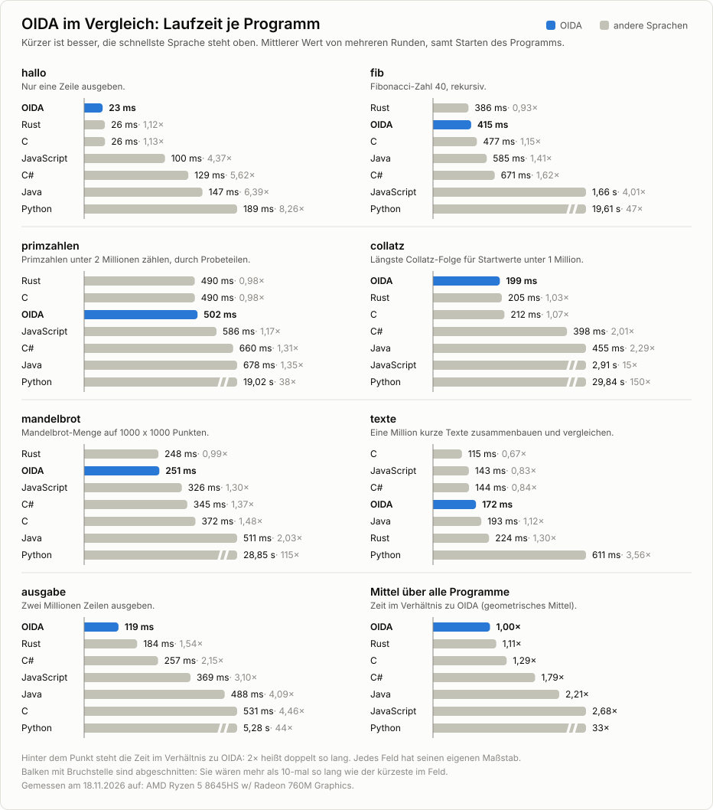

# OIDA

Eine Programmiersprache im österreichischen Dialekt, die zu echtem Maschinencode übersetzt wird.
Jede Anweisung hört mit `OIDA` auf.

```
# Fakultät, rekursiv gerechnet

FUNKTIAUN fakultaet(n ZOI) GIBT ZRUCK ZOI
    WENN n <= 1 DAUN
        GIB ZRUCK 1 OIDA
    PASST SCHO
    GIB ZRUCK n * fakultaet(n - 1) OIDA
PASST SCHO

SOG AU i = 1 OIDA
SOLONG i <= 10 TUA
    SCHREIB(KETTN(i) + "! =", fakultaet(i)) OIDA
    i = i + 1 OIDA
PASST SCHO
```

```
> oida beispiele\fakultaet.oida
Passt! beispiele\fakultaet.exe is fertig.
> beispiele\fakultaet.exe
1! = 1
2! = 2
...
10! = 3628800
```

Der Compiler heißt `oida`, ist in Rust geschrieben und erzeugt über LLVM eine normale Windows-`.exe`
(rund 300 KB, läuft ohne zusätzliche DLLs). OIDA ist die große Schwester von
[OIDA-SQL](https://github.com/lelewithheart/oida-sql).

**Stand: v0.4.** Zahlen, Texte, Strukturen, Listen, Klassen mit Vererbung, Schleifen, Funktionen,
Eingabe und Ausgabe sind da. Wohin es geht, steht unten im [Fahrplan](#fahrplan).
Für VS Code gibt es eine [Erweiterung](#in-vs-code-programmieren).
Derzeit nur für Windows (64 Bit).


## Was man braucht

Zwei Dinge, kein Visual Studio:

1. **Rust** mit der Toolchain `x86_64-pc-windows-gnullvm`
2. **llvm-mingw** (bringt `clang` mit, das aus dem LLVM-Code die `.exe` macht)

Einrichten:

```
winget install Rustlang.Rustup
rustup default stable-x86_64-pc-windows-gnullvm
```

Dann von <https://github.com/mstorsjo/llvm-mingw/releases> die Datei
`llvm-mingw-...-ucrt-x86_64.zip` herunterladen und nach
`%LOCALAPPDATA%\Programs\llvm-mingw` entpacken (so, dass dort der Ordner `bin` liegt).
Dort sucht `oida` von selbst nach `clang`.

Damit auch Rust ohne Visual Studio linken kann, kommt in die Datei `%USERPROFILE%\.cargo\config.toml`
(den Pfad an den eigenen Benutzernamen anpassen):

```toml
[target.x86_64-pc-windows-gnullvm]
linker = "C:/Users/DEINNAME/AppData/Local/Programs/llvm-mingw/bin/x86_64-w64-mingw32-clang.exe"
```

Liegt llvm-mingw woanders, entweder den `bin`-Ordner in den `PATH` geben oder die
Umgebungsvariable `OIDA_CLANG` auf die `clang.exe` setzen.


## Bauen

Im Projektordner:

```
cargo build --release
```

Danach liegt der Compiler in `target\release\oida.exe`. Die Laufzeitbibliothek wird dabei
mitgebaut und steckt in der `oida.exe` drin; man braucht also nur diese eine Datei
(plus llvm-mingw).

Die Tests:

```
cargo test
```


## Ein Programm übersetzen

```
target\release\oida beispiele\fizzbuzz.oida
beispiele\fizzbuzz.exe
```

Oder in einem Schritt übersetzen und gleich starten:

```
target\release\oida beispiele\fizzbuzz.oida --renn
```

| Option                  | Bedeutung                                                    |
|-------------------------|--------------------------------------------------------------|
| `-o <datei.exe>`        | so soll das Programm heißen (sonst wie die `.oida`-Datei)    |
| `--renn`                | das Programm nach dem Übersetzen gleich starten              |
| `--ir`                  | das LLVM-IR als `.ll`-Datei daneben speichern (zum Anschauen)|
| `--ohne-optimierung`    | schneller übersetzen, dafür ein langsameres Programm         |
| `--woerterbuch <datei>` | dieses Wörterbuch verwenden                                  |
| `--woerter`             | die Wörter der Sprache anzeigen                              |
| `--hilfe`, `--version`  |                                                              |

`.oida`-Dateien müssen als UTF-8 gespeichert sein.


## In VS Code programmieren

Im Ordner [`vscode`](vscode) liegt eine Erweiterung für VS Code. Einmal `vscode/installieren.bat`
doppelklicken, das baut sie und installiert sie. Danach in VS Code eine `.oida`-Datei aufmachen:

- Die Wörter sind eingefärbt, Fehler werden schon beim Tippen rot unterstrichen.
- **F5** (oder der Pfeil rechts oben) übersetzt das Programm und lässt es unten im Terminal laufen.
- **Strg+Umschalt+B** legt die `.exe` neben die Datei.
- Beim Tippen kommen Vorschläge für die Wörter der Sprache, dazu Schnipsel wie `wenn` und `solong`.

Die Erweiterung fragt für alles den Compiler, sie richtet sich also nach dem Wörterbuch.
Mehr dazu in [`vscode/README.md`](vscode/README.md).


## Die Sprache (v0.4)

### Typen

| Typ        | Bedeutung             | Beispiel             |
|------------|-----------------------|----------------------|
| `ZOI`      | ganze Zahl, 64 Bit    | `17`, `-3`           |
| `KOMMAZOI` | Kommazahl, 64 Bit     | `3.14` (mit Punkt)   |
| `JONA`     | Wahrheitswert         | `WOAHR`, `FOISCH`    |
| `KETTN`    | Text                  | `"Servas"`, `'Oida'` |

Dazu kommen eigene [Strukturen](#strukturen) und [Listen](#listen) (`LISTN VON ZOI`).

Die Typen sind fest, aber man muss sie fast nie hinschreiben: Der Compiler erkennt sie am Wert.

### Variablen

```
SOG AU alter = 17 OIDA            # alter ist eine ZOI
SOG AU name = "Franz" OIDA        # name ist eine KETTN
SOG AU schnitt KOMMAZOI = 2 OIDA  # Typ dazuschreiben geht auch: aus 2 wird 2.0
alter = alter + 1 OIDA
```

Eine Variable behält ihren Typ. `alter = "siebzehn" OIDA` ist ein Fehler.
Eine Variable gilt nur in dem Block (`WENN`, `SOLONG`, Funktion), in dem sie angesagt wurde.

### Rechnen und Vergleichen

- Rechnen: `+  -  *  /  %` (Rest). Trifft eine `ZOI` auf eine `KOMMAZOI`, wird mit Kommazahlen gerechnet.
  `7 / 2` ist `3` (ganze Zahlen), `7 / 2.0` ist `3.5`.
- Texte zusammenhängen: `"Servas " + name`
- Vergleichen: `=` oder `==`, `!=` oder `<>`, `<`, `<=`, `>`, `>=`
- Verknüpfen: `UND`, `ODA`, `NED`. Die rechte Seite wird nur ausgerechnet, wenn sie gebraucht wird.
- Umwandeln: `ZOI(...)`, `KOMMAZOI(...)`, `KETTN(...)`, zum Beispiel `"I bin " + KETTN(alter)`
  oder `ZOI("17") + 1`.
- Rechnen und gleich zuweisen: `x += 1`, ebenso `-=`, `*=`, `/=`, `%=`. Bei Texten hängt `+=` an.

Rangfolge von schwach zu stark: `ODA`, `UND`, `NED`, Vergleiche, `+ -`, `* / %`, Minus als Vorzeichen.
Klammern gehen immer.

### Verzweigung

```
WENN alter >= 18 DAUN
    SCHREIB("erwachsen") OIDA
SUNST WENN alter >= 14 DAUN
    SCHREIB("mündig") OIDA
SUNST
    SCHREIB("Kind") OIDA
PASST SCHO
```

`SUNST` und `SUNST WENN` sind freiwillig. Nach `PASST SCHO` darf ein `OIDA` stehen, muss aber nicht.

### Schleifen

Solange eine Bedingung gilt:

```
SOG AU i = 1 OIDA
SOLONG i <= 10 TUA
    SCHREIB(i) OIDA
    i += 1 OIDA
PASST SCHO
```

Zählen von einer Zahl bis zu einer anderen (beide gehören dazu):

```
FIA i VON 1 BIS 10 TUA
    SCHREIB(i) OIDA
PASST SCHO

FIA i VON 10 BIS 0 SCHRITT -2 TUA      # 10, 8, 6, 4, 2, 0
    SCHREIB(i) OIDA
PASST SCHO
```

Die Zählvariable gilt nur in der Schleife. `VON`, `BIS` und `SCHRITT` werden einmal am Anfang
ausgerechnet und müssen ganze Zahlen sein.

Mit `HAU OB` verlässt man die innerste Schleife, mit `WEIDA` geht es gleich zum nächsten Durchlauf:

```
SOLONG WOAHR TUA
    SOG AU eingabe = LIES("Zoi (leer zum Aufhören): ") OIDA
    WENN eingabe = "" DAUN
        HAU OB OIDA
    PASST SCHO
    WENN ZOI(eingabe) < 0 DAUN
        WEIDA OIDA
    PASST SCHO
    SCHREIB(WURZL(ZOI(eingabe))) OIDA
PASST SCHO
```

### Funktionen

```
FUNKTIAUN schnitt(a ZOI, b ZOI) GIBT ZRUCK KOMMAZOI
    GIB ZRUCK KOMMAZOI(a + b) / 2 OIDA
PASST SCHO

FUNKTIAUN gruess(wen KETTN)          # ohne GIBT ZRUCK: gibt nichts zurück
    SCHREIB("Servas " + wen + "!") OIDA
PASST SCHO

gruess("Resi") OIDA
SCHREIB(schnitt(1, 2)) OIDA
```

Bei den Parametern steht erst der Name, dann der Typ. Funktionen stehen ganz außen (nicht in
anderen Blöcken), die Reihenfolge ist egal, und sie dürfen sich selbst aufrufen.
Alles, was außerhalb von Funktionen steht, ist das Hauptprogramm. Funktionen sehen die
Variablen des Hauptprogramms nicht; was sie brauchen, bekommen sie als Parameter.

### Strukturen

Eine Struktur fasst mehrere Werte unter einem Namen zusammen:

```
STRUKTUR Punkt
    x KOMMAZOI
    y KOMMAZOI
PASST SCHO

SOG AU p = Punkt(1.5, 2) OIDA     # die Felder der Reihe nach
p.x += 10 OIDA
SCHREIB(p.x, p) OIDA              # 11.5 Punkt(11.5, 2.0)
```

- Eine Struktur ist ein **Wert**, der direkt in der Variable liegt. Zuweisen heißt kopieren:
  Nach `SOG AU q = p OIDA` sind `p` und `q` unabhängig. Auch eine Funktion bekommt eine Kopie.
- Felder können alles sein: Zahlen, Texte, andere Strukturen, Listen. Nur sich selbst kann eine
  Struktur nicht enthalten (über eine Liste geht es).
- Strukturen stehen ganz außen wie Funktionen, die Reihenfolge ist egal.

### Klassen

Eine Klasse hat Felder wie eine Struktur und dazu **Methoden**: Funktionen, die zu ihr gehören.

```
KLASSE Wesen
    name KETTN
    lebn ZOI = 100                # mit Wert: muss man beim Anlegen nicht angeben

    FUNKTIAUN sog() GIBT ZRUCK KETTN
        GIB ZRUCK "I bin " + SÖWA.name OIDA
    PASST SCHO

    FUNKTIAUN kriag(schaden ZOI)
        SÖWA.lebn -= schaden OIDA
    PASST SCHO
PASST SCHO

SOG AU hansi = Wesen("Hansi") OIDA    # die Felder ohne Wert, der Reihe nach
hansi.kriag(30) OIDA
SCHREIB(hansi.sog(), hansi.lebn) OIDA # I bin Hansi 70
```

- In einer Methode ist `SÖWA` (auch: `MEI`) das Objekt, an dem sie aufgerufen wurde. Felder und
  andere Methoden erreicht man nur darüber: `SÖWA.lebn`, `SÖWA.sog()`.
- Ein Objekt ist ein **Verweis**, anders als eine Struktur: Nach `SOG AU a = hansi OIDA` meinen `a`
  und `hansi` dasselbe Wesen, und eine Funktion, die ein Objekt bekommt, ändert das Original.
  `a == hansi` fragt, ob es dasselbe Objekt ist.
- Klassen stehen ganz außen, die Reihenfolge ist egal.

**Erben.** Eine Klasse kann von einer anderen erben. Sie hat dann deren Felder und Methoden, kann
eigene dazugeben und geerbte Methoden durch eine eigene Fassung ersetzen:

```
KLASSE Gegner ERBT VON Wesen
    staerke ZOI

    FUNKTIAUN sog() GIBT ZRUCK KETTN              # ersetzt sog() von Wesen
        GIB ZRUCK "Grr! " + DE OIDN.sog() OIDA    # DE OIDN: die Fassung der Elternklasse
    PASST SCHO
PASST SCHO

SOG AU sepp = Gegner("Sepp", 30) OIDA             # erst die geerbten Felder, dann die eigenen
SOG AU olle LISTN VON Wesen = [hansi, sepp] OIDA
FIA JEDE w IN olle TUA
    SCHREIB(w.sog()) OIDA                         # I bin Hansi / Grr! I bin Sepp
PASST SCHO
```

- Wo ein `Wesen` verlangt ist, passt auch ein `Gegner` (in einer Variable, als Parameter, in einer
  Liste). Umgekehrt nicht.
- Welche Fassung einer Methode läuft, richtet sich danach, was das Objekt wirklich ist, nicht nach
  dem Typ der Variable: `w.sog()` ruft bei einem Gegner die Fassung von `Gegner`.
- Eine ersetzte Methode muss dieselben Parameter und denselben Rückgabetyp haben wie die geerbte.
- Über eine Variable vom Typ `Wesen` erreicht man nur, was jedes Wesen hat (`w.staerke` geht nicht).
- `SCHREIB(sepp)` gibt `Gegner("Sepp", 100, 30)` aus.
- Um den Speicher kümmert sich OIDA: Ein Objekt wird freigegeben, sobald es niemand mehr braucht.
  Eine Ausnahme gibt es noch: Zeigen zwei Objekte gegenseitig aufeinander, bleiben beide bis zum
  Ende des Programms liegen.

Ein größeres Beispiel steht in [`beispiele/arena.oida`](beispiele/arena.oida).

**Struktur oder Klasse?** Eine Struktur für kleine Werte, die man kopiert (ein Punkt, eine Farbe);
eine Klasse für Dinge, die es einmal gibt und die sich ändern (ein Spieler, ein Gegner), und
überall, wo man erben will.

### Listen

```
SOG AU zahlen = [3, 1, 4] OIDA                  # eine LISTN VON ZOI
SOG AU namen LISTN VON KETTN = [] OIDA          # leer: den Typ dazusagen

HAU EINE(zahlen, 5) OIDA                        # hinten anhängen
zahlen[0] = 30 OIDA                             # gezählt wird ab 0
HAU AUSSE(zahlen, 1) OIDA                       # die Stelle 1 herausnehmen
SCHREIB(zahlen, LÄNGN(zahlen), zahlen[0]) OIDA  # [30, 4, 5] 3 30

FIA JEDE z IN zahlen TUA
    SCHREIB(z) OIDA
PASST SCHO
```

- In einer Liste haben alle Elemente denselben Typ. Der Typ heißt `LISTN VON <typ>`, zum Beispiel
  `LISTN VON Punkt` oder `LISTN VON LISTN VON ZOI`.
- Eine Liste ist ein **Verweis**: Nach `SOG AU b = a OIDA` meinen `a` und `b` dieselbe Liste, und
  eine Funktion, die eine Liste bekommt, ändert das Original.
- Strukturen liegen direkt in der Liste, ohne Umweg. `punkte[0].x = 5 OIDA` ändert das Element.
- In `FIA JEDE` ist die Variable eine Kopie des Elements. Wer Elemente ändern will, zählt mit
  `FIA i VON 0 BIS LÄNGN(liste) - 1` und schreibt `liste[i]`.
- Greift man auf eine Stelle zu, die es nicht gibt, bricht das Programm mit einer Meldung ab.
- Um den Speicher kümmert sich OIDA: Eine Liste wird freigegeben, sobald sie niemand mehr braucht.

### Ausgabe

```
SCHREIB("Summe:", 5050, 3.5, WOAHR) OIDA    # Summe: 5050 3.5 WOAHR
SCHREIB([1, 2], Punkt(1, 2)) OIDA           # [1, 2] Punkt(1.0, 2.0)
```

`SCHREIB` nimmt beliebig viele Werte, schreibt sie mit Leerzeichen dazwischen und macht eine neue Zeile.
Listen und Strukturen werden so ausgegeben, wie man sie hinschreibt.

### Eingabe

```
SOG AU name = LIES("Wia haaßt du? ") OIDA    # zeigt die Frage und wartet auf eine Zeile
SOG AU zeile = LIES() OIDA                   # ohne Frage
```

`LIES` gibt immer einen Text zurück, ohne den Zeilenumbruch. Für eine Zahl: `ZOI(LIES("Oida, wia oid? "))`.
Ist die Eingabe zu Ende, kommt ein leerer Text.

### Eingebaute Funktionen

Für Texte (gezählt wird ab 0, in Zeichen):

| Funktion                       | Ergebnis                                              | Beispiel                              |
|--------------------------------|-------------------------------------------------------|---------------------------------------|
| `LÄNGN(text)`                  | Anzahl der Zeichen                                    | `LÄNGN("Grüß di")` ist `7`            |
| `STICKL(text, von)`            | das Stück ab der Stelle `von` bis zum Ende            | `STICKL("Servas", 3)` ist `"vas"`     |
| `STICKL(text, von, anzahl)`    | `anzahl` Zeichen ab der Stelle `von`                  | `STICKL("Servas", 0, 3)` ist `"Ser"`  |
| `SUACH(text, gesucht)`         | Stelle des ersten Treffers, oder `-1`                 | `SUACH("Servas", "v")` ist `3`        |
| `SCHREI(text)`                 | in Großbuchstaben                                     | `SCHREI("oida")` ist `"OIDA"`         |
| `FLÜSTER(text)`                | in Kleinbuchstaben                                    | `FLÜSTER("OIDA")` ist `"oida"`        |
| `STUTZ(text)`                  | ohne Leerraum am Anfang und am Ende                   | `STUTZ("  jo  ")` ist `"jo"`          |
| `ERSETZ(text, alt, neu)`       | jedes `alt` durch `neu` ersetzt                       | `ERSETZ("aba", "a", "o")` ist `"obo"` |

Für Listen:

| Funktion                   | Was sie tut                                        |
|----------------------------|----------------------------------------------------|
| `LÄNGN(liste)`             | Anzahl der Elemente                                |
| `HAU EINE(liste, wert)`    | hängt den Wert hinten an (auch: `DAZUA`)           |
| `HAU AUSSE(liste, stelle)` | nimmt das Element an der Stelle heraus             |

Zum Rechnen (wo eine `KOMMAZOI` verlangt ist, geht auch eine `ZOI`):

| Funktion                         | Ergebnis                                                  |
|----------------------------------|-----------------------------------------------------------|
| `WURZL(x)`                       | Wurzel, als `KOMMAZOI`                                    |
| `HOCH(x, y)`                     | x hoch y, als `KOMMAZOI`                                  |
| `BETROG(x)`                      | Betrag (ohne Vorzeichen), Typ wie `x`                     |
| `KLANSTA(a, b)`, `GRÖSSTA(a, b)` | die kleinere bzw. größere von zwei Zahlen                 |
| `OBRUNDN(x)`, `AUFRUNDN(x)`      | ab- bzw. aufgerundet, als `KOMMAZOI`                      |
| `RUNDN(x)`                       | gerundet (ab ,5 weg von der Null), als `KOMMAZOI`         |
| `SINUS(x)`, `KOSINUS(x)`         | Winkel im Bogenmaß                                        |
| `WINKL(y, x)`                    | der Winkel zum Punkt (x, y), im Bogenmaß                  |
| `E_HOCH(x)`                      | e hoch x                                                  |
| `PI`                             | die Kreiszahl (ohne Klammern)                             |
| `ZUFOI()`                        | zufällige `KOMMAZOI` von 0 bis unter 1                    |
| `ZUFOI(a, b)`                    | zufällige `ZOI` von `a` bis `b` (beide möglich)           |
| `SOMEN(n)`                       | Startwert für den Zufall: danach kommt immer dieselbe Folge |

Die gerundeten Werte sind Kommazahlen; für eine ganze Zahl nimmt man `ZOI(RUNDN(x))`.

Die Namen dieser Funktionen gelten nur mit Klammer. Eine Variable darf also `winkl` oder `hoch` heißen.

Greift man bei `STICKL` über den Text hinaus, bricht das Programm mit einer Meldung ab.

### Kommentare

```
# bis zum Ende der Zeile
/* über
   mehrere Zeilen */
```

### Namen

Namen bestehen aus Buchstaben (auch ä, ö, ü, ß), Ziffern und `_`. Groß und klein wird bei Namen
unterschieden (`alter` ist nicht `Alter`), bei den Wörtern der Sprache nicht (`wenn` = `WENN`).
Ein Wort der Sprache kann kein Name sein, auch kleingeschrieben nicht (`klasse`, `schritt`);
nur direkt nach einem Punkt geht jeder Name (`ding.schritt`).


## Die Wörter ändern

Alle Wörter der Sprache stehen in [`woerterbuch.txt`](woerterbuch.txt), im selben Format wie bei OIDA-SQL:

```
IF        = WENN, WAUN
DECLARE   = SOG AU, DEKLARIER
END       = PASST SCHO
```

Links steht das feste Wort, das der Compiler kennt, rechts stehen deine Wörter. Mehrere Varianten
trennt ein Beistrich, ein Eintrag darf aus mehreren Wörtern bestehen (dann gewinnt der längste
Treffer: `STIMMT NED` ist `FOISCH`, `STIMMT` allein ist `WOAHR`). Auch das `OIDA` am Ende kann man umtaufen.

So geht's:

1. `woerterbuch.txt` im Projektordner ändern und speichern (als UTF-8).
2. Fertig. Neu bauen ist nicht nötig: `oida` sucht die Datei neben der `oida.exe` und bis zu zwei
   Ordner darüber, findet also von `target\release\oida.exe` aus die Datei im Projektordner.

Mit `oida --woerter` sieht man, welches Wörterbuch gerade gilt und welche Wörter drinstehen.

Wer die `oida.exe` woanders hinkopiert, legt die `woerterbuch.txt` daneben. Sonst gilt das
Wörterbuch, das beim Bauen in die `oida.exe` eingebaut wurde. Für einzelne Aufrufe gibt es
`--woerterbuch <datei>` und die Umgebungsvariable `OIDA_WOERTERBUCH`.

Achtung: Die Beispiele und die Tests sind mit den Standard-Wörtern geschrieben. Wer `WENN`
umtauft, muss sie dort auch umtaufen.


## Fehlermeldungen

Der Compiler sagt, wo es hakt (Datei, Zeile, Spalte) und zeigt die Stelle:

```
beispiel.oida:3:22: Heast, wo is des OIDA?
 3 | SOG AU name = "Franz"
   |                      ^

Na, des wird nix: 1 Fehler.
```

Ein paar andere:

```
'alter' is a ZOI, do kaunst ka KETTN einetuan.
'sume' kenn i ned. Host des mit SOG AU augsogt?
A KETTN + a ZOI? Des geht si ned aus. Nimm KETTN(...) zum Umwandln.
Des haaßt WENN, ned IF!
An Strichpunkt brauchst do ned. Bei uns haaßt des OIDA.
```

Fehler bei den Typen werden alle auf einmal gemeldet, sonst hört der Compiler beim ersten auf.
Beim Laufen bricht das Programm mit einer Meldung ab, wenn durch 0 geteilt wird oder
`ZOI("...")` keine Zahl bekommt:

```
Heast! Zeile 3: Durch nix kaun ma ned teilen.
```


## Wie schnell ist das?

So schnell wie C und Rust, und ein Programm braucht zum Laufen rund 5 MB. Gemessen an neun
Programmen gegen C, Rust, C#, Java, JavaScript und Python:



Die Programme kommen mit dem aus, was OIDA schon kann; was der Vergleich zeigt und was nicht,
steht samt Messweise und Speicher-Grafik in [`leistung/`](leistung/README.md).


## Aufbau

```
woerterbuch.txt        die Wörter der Sprache
beispiele/             Beispielprogramme, jeweils mit der erwarteten Ausgabe (.erwartet)
uebersetzer/           der Compiler (Rust), ergibt oida.exe
  src/woerterbuch.rs     Wörterbuch lesen, längster Treffer gewinnt
  src/lexer.rs           Quelltext -> Tokens
  src/parser.rs          Tokens -> Syntaxbaum (ast.rs)
  src/typen.rs           Typprüfung mit Typerkennung
  src/irgen.rs           Syntaxbaum -> LLVM-IR als Text
  src/treiber.rs         ruft clang auf, linkt die Laufzeit dazu
  src/fehler.rs          Fehlermeldungen mit Zeile und Spalte
  src/editor.rs          Schnittstelle für Editoren (oida --editor)
  src/main.rs            der Befehl oida
  build.rs               baut die Laufzeit und packt sie in die oida.exe
  tests/                 Tests von Anfang bis Ende (.oida -> .exe -> Ausgabe)
laufzeit/              Laufzeitbibliothek (Rust), wird in jedes Programm gelinkt:
                       Ausgabe, Texte, Listen und Objekte samt Freigeben, Umwandlungen,
                       Fehler beim Laufen
vscode/                Erweiterung für VS Code
leistung/              Leistungsvergleich mit anderen Sprachen
```

Der Compiler schreibt LLVM-IR als Text und lässt `clang` den Rest machen (Optimieren,
Maschinencode, Linken). Mit `--ir` kann man sich das IR anschauen.


## Was OIDA noch nicht kann

- Einen fehlenden Wert ("kein Objekt") gibt es noch nicht; ein Feld mit einer Klasse als Typ
  braucht immer ein Objekt. Darum gehen verkettete Dinge (ein Knoten, der auf den nächsten zeigt)
  vorerst nur über Listen.
- Aus einem `Wesen` wieder einen `Gegner` machen (fragen, was es wirklich ist) geht noch nicht.
- Objekte, die im Kreis aufeinander zeigen, werden erst am Ende des Programms freigegeben.
- Strukturen und Listen kann man nicht mit `=` vergleichen.
- Listen kann man nicht sortieren oder durchsuchen lassen; das schreibt man vorerst selbst.
- Keine Dateien, kein Fenster, keine Grafik.
- Fehler beim Laufen (etwa `ZOI("abc")`) brechen das Programm ab; abfangen kann man sie noch nicht.
- Ganze Zahlen laufen bei mehr als 64 Bit still über.
- Die Meldungen beim Laufen (`Durch nix kaun ma ned teilen`) richten sich nicht nach dem Wörterbuch.
- Nur Windows, 64 Bit.


## Fahrplan

Das Ziel: ein ganzes Programm in OIDA schreiben können. Der Maßstab dafür ist ein Spiel mit
eigenem Fenster (ein Survivor-Roguelite, das es bisher als Browserspiel in JavaScript gibt),
nachgebaut als natives OIDA-Programm. OIDA soll dabei so etwas wie ein besseres C# werden:
Klassen, Generics und Funktionen als Werte, aber ohne Abstürze durch `null`, mit Strukturen als
direkten Werten, mit Fehlern ohne Exceptions und weiterhin als kleine `.exe`, die sofort startet.

| Schritt | Was dazukommt | Stand |
|---|---|---|
| 0 | Grundgerüst: Typen, Variablen, `WENN`, `SOLONG`, Funktionen, `SCHREIB`; Texte werden freigegeben | fertig |
| 1 | Zählschleife, `HAU OB`, `WEIDA`, `+=`, Eingabe, Text- und Rechenfunktionen, Zufall | fertig |
| 2 | Strukturen als direkte Werte und Listen, `FIA JEDE` | fertig |
| 3 | Klassen mit Feldern, Methoden und Vererbung | fertig |
| 4 | Fehlende Werte nur, wo der Typ es erlaubt (`NIX`), und Fehler im Rückgabetyp statt Exceptions | offen |
| 5 | Generics für eigene Typen, Funktionen als Werte, ein Wörterbuch-Typ | offen |
| 6 | Programme aus mehreren Dateien, Standardbibliothek in OIDA | offen |
| 7 | Fenster, Grafik, Tasten, Ton und Dateien, direkt über Windows | offen |
| 8 | Das Spiel nachbauen | offen |
| 9 | Der `oidasql(...)`-Block: OIDA-SQL direkt in der Sprache, samt Anbindung an MySQL | offen |

Für VS Code gibt es Einfärben, Fehler, Vorschläge und Starten schon (Ordner `vscode`). Offen sind
dort Springen zur Definition, Umbenennen und ein Debugger.
