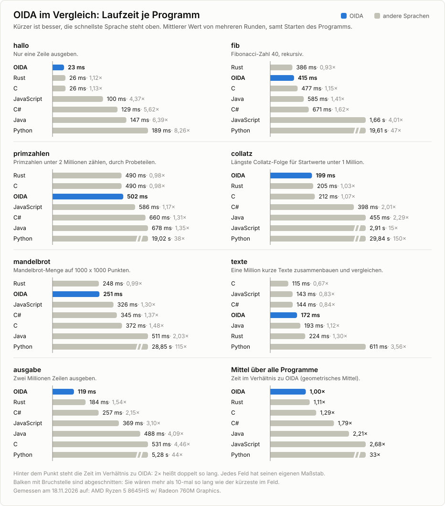
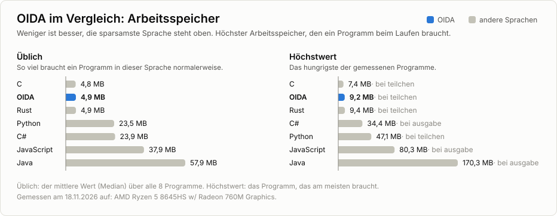

# Leistungsvergleich

Erzeugt mit `cargo run --release -p oida-messen` am 2026-11-18. Nicht von Hand ändern.

Rechner: AMD Ryzen 5 8645HS w/ Radeon 760M Graphics, 14 GB Arbeitsspeicher, Microsoft Windows 11 Pro

| Sprache | Art | Version |
|---|---|---|
| OIDA | übersetzt (LLVM) | oida 0.4.0 |
| C | übersetzt (LLVM, clang -O2) | clang version 23.1.5 |
| Rust | übersetzt (LLVM, opt-level 3) | rustc 1.100.0 (0ef1bc386 2026-11-09) |
| C# | Bytecode + JIT (.NET) | .NET SDK 10.0.403 |
| Java | Bytecode + JIT | openjdk version "25.0.4.1" 2026-08-18 |
| JavaScript | JIT (Node) | v26.13.0 |
| Python | Interpreter | Python 3.13.14 |

## Überblick: Zeit

Kleiner ist besser. Der mittlere Wert (Median) von mehreren Runden, samt Starten des Programms.

| Programm | OIDA | C | Rust | C# | Java | JavaScript | Python |
|---|---:|---:|---:|---:|---:|---:|---:|
| hallo | 26 ms | 23 ms | 22 ms | 118 ms | 119 ms | 102 ms | 187 ms |
| fib | 419 ms | 485 ms | 392 ms | 716 ms | 734 ms | 1,81 s | 21,53 s |
| primzahlen | 498 ms | 499 ms | 502 ms | 669 ms | 681 ms | 631 ms | 20,00 s |
| collatz | 203 ms | 199 ms | 207 ms | 394 ms | 451 ms | 2,95 s | 30,73 s |
| mandelbrot | 264 ms | 395 ms | 256 ms | 350 ms | 368 ms | 324 ms | 30,90 s |
| teilchen | 110 ms | 107 ms | 86 ms | 235 ms | 302 ms | 283 ms | 13,18 s |
| objekte | 239 ms | 210 ms | 199 ms | 328 ms | 638 ms | 285 ms | 13,50 s |
| texte | 172 ms | 122 ms | 235 ms | 153 ms | 184 ms | 143 ms | 624 ms |
| ausgabe | 118 ms | 518 ms | 198 ms | 283 ms | 462 ms | 391 ms | 5,37 s |

## Überblick: Zeit im Verhältnis zu OIDA

1,00× heißt gleich schnell wie OIDA, 2× heißt doppelt so lang, 0,5× halb so lang. Die letzte Zeile ist das geometrische Mittel über alle Programme.

| Programm | OIDA | C | Rust | C# | Java | JavaScript | Python |
|---|---:|---:|---:|---:|---:|---:|---:|
| hallo | 1,00× | 0,91× | 0,87× | 4,62× | 4,67× | 4,00× | 7,32× |
| fib | 1,00× | 1,16× | 0,94× | 1,71× | 1,75× | 4,33× | 51× |
| primzahlen | 1,00× | 1,00× | 1,01× | 1,34× | 1,37× | 1,27× | 40× |
| collatz | 1,00× | 0,98× | 1,02× | 1,94× | 2,22× | 15× | 152× |
| mandelbrot | 1,00× | 1,49× | 0,97× | 1,32× | 1,39× | 1,23× | 117× |
| teilchen | 1,00× | 0,97× | 0,79× | 2,13× | 2,75× | 2,57× | 120× |
| objekte | 1,00× | 0,88× | 0,83× | 1,38× | 2,67× | 1,19× | 57× |
| texte | 1,00× | 0,71× | 1,37× | 0,89× | 1,07× | 0,83× | 3,64× |
| ausgabe | 1,00× | 4,41× | 1,69× | 2,40× | 3,93× | 3,32× | 46× |
| **Mittel** | **1,00×** | **1,17×** | **1,02×** | **1,77×** | **2,17×** | **2,46×** | **41×** |

## Überblick: Speicher

Der höchste Arbeitsspeicher, den das Programm gebraucht hat. Kleiner ist besser.

| Programm | OIDA | C | Rust | C# | Java | JavaScript | Python |
|---|---:|---:|---:|---:|---:|---:|---:|
| hallo | 4,9 MB | 4,8 MB | 4,9 MB | 23,5 MB | 56,7 MB | 34,6 MB | 23,5 MB |
| fib | 4,9 MB | 4,8 MB | 4,9 MB | 23,5 MB | 57,1 MB | 36,3 MB | 23,4 MB |
| primzahlen | 4,9 MB | 4,8 MB | 4,9 MB | 23,5 MB | 57,4 MB | 37,2 MB | 23,5 MB |
| collatz | 4,9 MB | 4,8 MB | 4,9 MB | 24,4 MB | 57,9 MB | 37,4 MB | 22,8 MB |
| mandelbrot | 4,9 MB | 4,8 MB | 4,9 MB | 23,6 MB | 57,9 MB | 39,2 MB | 23,4 MB |
| teilchen | 9,2 MB | 7,4 MB | 9,5 MB | 30,4 MB | 64,2 MB | 82,1 MB | 47,2 MB |
| objekte | 10,4 MB | 9,8 MB | 9,8 MB | 29,7 MB | 63,8 MB | 62,8 MB | 38,5 MB |
| texte | 4,9 MB | 4,8 MB | 5,0 MB | 33,5 MB | 97,0 MB | 45,1 MB | 23,5 MB |
| ausgabe | 5,0 MB | 4,8 MB | 4,9 MB | 34,5 MB | 127,1 MB | 80,9 MB | 25,0 MB |

## Die Programme im Einzelnen

### hallo

Nur eine Zeile ausgeben. Misst, wie lange ein Programm zum Starten braucht.

| Sprache | Zeit | zu OIDA | Runden | Speicher | Bauen | Größe |
|---|---:|---:|---:|---:|---:|---:|
| OIDA | 26 ms | 1,00× | 7 | 4,9 MB | 496 ms | 294 KB |
| C | 23 ms | 0,91× | 7 | 4,8 MB | 517 ms | 60 KB |
| Rust | 22 ms | 0,87× | 7 | 4,9 MB | 991 ms | 412 KB |
| C# | 118 ms | 4,62× | 7 | 23,5 MB | 1,33 s | 4 KB |
| Java | 119 ms | 4,67× | 7 | 56,7 MB | 848 ms | 0 KB |
| JavaScript | 102 ms | 4,00× | 7 | 34,6 MB | – | – |
| Python | 187 ms | 7,32× | 7 | 23,5 MB | – | – |

### fib

Fibonacci-Zahl 40, rekursiv. Misst Funktionsaufrufe (rund 330 Millionen).

| Sprache | Zeit | zu OIDA | Runden | Speicher | Bauen | Größe |
|---|---:|---:|---:|---:|---:|---:|
| OIDA | 419 ms | 1,00× | 7 | 4,9 MB | 400 ms | 294 KB |
| C | 485 ms | 1,16× | 7 | 4,8 MB | 405 ms | 61 KB |
| Rust | 392 ms | 0,94× | 7 | 4,9 MB | 661 ms | 414 KB |
| C# | 716 ms | 1,71× | 7 | 23,5 MB | 1,04 s | 4 KB |
| Java | 734 ms | 1,75× | 7 | 57,1 MB | 1,12 s | 1 KB |
| JavaScript | 1,81 s | 4,33× | 5 | 36,3 MB | – | – |
| Python | 21,53 s | 51× | 1 | 23,4 MB | – | – |

### primzahlen

Primzahlen unter 2 Millionen zählen, durch Probeteilen. Misst Schleifen und Teilen mit Rest.

| Sprache | Zeit | zu OIDA | Runden | Speicher | Bauen | Größe |
|---|---:|---:|---:|---:|---:|---:|
| OIDA | 498 ms | 1,00× | 7 | 4,9 MB | 803 ms | 294 KB |
| C | 499 ms | 1,00× | 7 | 4,8 MB | 474 ms | 61 KB |
| Rust | 502 ms | 1,01× | 7 | 4,9 MB | 1,20 s | 414 KB |
| C# | 669 ms | 1,34× | 7 | 23,5 MB | 1,12 s | 4 KB |
| Java | 681 ms | 1,37× | 7 | 57,4 MB | 859 ms | 1 KB |
| JavaScript | 631 ms | 1,27× | 7 | 37,2 MB | – | – |
| Python | 20,00 s | 40× | 3 | 23,5 MB | – | – |

### collatz

Längste Collatz-Folge für Startwerte unter 1 Million. Misst Schleifen, Verzweigungen und Rechnen mit ganzen Zahlen.

| Sprache | Zeit | zu OIDA | Runden | Speicher | Bauen | Größe |
|---|---:|---:|---:|---:|---:|---:|
| OIDA | 203 ms | 1,00× | 7 | 4,9 MB | 660 ms | 294 KB |
| C | 199 ms | 0,98× | 7 | 4,8 MB | 489 ms | 61 KB |
| Rust | 207 ms | 1,02× | 7 | 4,9 MB | 1,18 s | 414 KB |
| C# | 394 ms | 1,94× | 7 | 24,4 MB | 1,17 s | 4 KB |
| Java | 451 ms | 2,22× | 7 | 57,9 MB | 808 ms | 1 KB |
| JavaScript | 2,95 s | 15× | 5 | 37,4 MB | – | – |
| Python | 30,73 s | 152× | 1 | 22,8 MB | – | – |

### mandelbrot

Mandelbrot-Menge auf 1000 x 1000 Punkten. Höchstens 300 Schritte je Punkt; misst Rechnen mit Kommazahlen.

| Sprache | Zeit | zu OIDA | Runden | Speicher | Bauen | Größe |
|---|---:|---:|---:|---:|---:|---:|
| OIDA | 264 ms | 1,00× | 7 | 4,9 MB | 835 ms | 294 KB |
| C | 395 ms | 1,49× | 7 | 4,8 MB | 819 ms | 62 KB |
| Rust | 256 ms | 0,97× | 7 | 4,9 MB | 1,30 s | 414 KB |
| C# | 350 ms | 1,32× | 7 | 23,6 MB | 1,05 s | 4 KB |
| Java | 368 ms | 1,39× | 7 | 57,9 MB | 857 ms | 1 KB |
| JavaScript | 324 ms | 1,23× | 7 | 39,2 MB | – | – |
| Python | 30,90 s | 117× | 1 | 23,4 MB | – | – |

### teilchen

Hunderttausend Teilchen in einer Liste, 300 Runden lang bewegt. Misst Listen von Strukturen.

| Sprache | Zeit | zu OIDA | Runden | Speicher | Bauen | Größe |
|---|---:|---:|---:|---:|---:|---:|
| OIDA | 110 ms | 1,00× | 7 | 9,2 MB | 714 ms | 300 KB |
| C | 107 ms | 0,97× | 7 | 7,4 MB | 482 ms | 62 KB |
| Rust | 86 ms | 0,79× | 7 | 9,5 MB | 1,01 s | 414 KB |
| C# | 235 ms | 2,13× | 7 | 30,4 MB | 1,12 s | 4 KB |
| Java | 302 ms | 2,75× | 7 | 64,2 MB | 956 ms | 1 KB |
| JavaScript | 283 ms | 2,57× | 7 | 82,1 MB | – | – |
| Python | 13,18 s | 120× | 3 | 47,2 MB | – | – |

### objekte

Hunderttausend Objekte aus drei Klassen, 200 Runden lang bewegt. Misst Klassen und überschriebene Methoden.

| Sprache | Zeit | zu OIDA | Runden | Speicher | Bauen | Größe |
|---|---:|---:|---:|---:|---:|---:|
| OIDA | 239 ms | 1,00× | 7 | 10,4 MB | 792 ms | 302 KB |
| C | 210 ms | 0,88× | 7 | 9,8 MB | 424 ms | 62 KB |
| Rust | 199 ms | 0,83× | 7 | 9,8 MB | 946 ms | 417 KB |
| C# | 328 ms | 1,38× | 7 | 29,7 MB | 1,00 s | 5 KB |
| Java | 638 ms | 2,67× | 7 | 63,8 MB | 912 ms | 3 KB |
| JavaScript | 285 ms | 1,19× | 7 | 62,8 MB | – | – |
| Python | 13,50 s | 57× | 3 | 38,5 MB | – | – |

### texte

Eine Million kurze Texte zusammenbauen und vergleichen. Misst Texte und den Speicher dafür.

| Sprache | Zeit | zu OIDA | Runden | Speicher | Bauen | Größe |
|---|---:|---:|---:|---:|---:|---:|
| OIDA | 172 ms | 1,00× | 7 | 4,9 MB | 405 ms | 298 KB |
| C | 122 ms | 0,71× | 7 | 4,8 MB | 404 ms | 63 KB |
| Rust | 235 ms | 1,37× | 7 | 5,0 MB | 714 ms | 416 KB |
| C# | 153 ms | 0,89× | 7 | 33,5 MB | 1,44 s | 4 KB |
| Java | 184 ms | 1,07× | 7 | 97,0 MB | 832 ms | 1 KB |
| JavaScript | 143 ms | 0,83× | 7 | 45,1 MB | – | – |
| Python | 624 ms | 3,64× | 7 | 23,5 MB | – | – |

### ausgabe

Zwei Millionen Zeilen ausgeben. Misst die Ausgabe.

| Sprache | Zeit | zu OIDA | Runden | Speicher | Bauen | Größe |
|---|---:|---:|---:|---:|---:|---:|
| OIDA | 118 ms | 1,00× | 7 | 5,0 MB | 413 ms | 294 KB |
| C | 518 ms | 4,41× | 7 | 4,8 MB | 368 ms | 61 KB |
| Rust | 198 ms | 1,69× | 7 | 4,9 MB | 778 ms | 420 KB |
| C# | 283 ms | 2,40× | 7 | 34,5 MB | 1,06 s | 4 KB |
| Java | 462 ms | 3,93× | 7 | 127,1 MB | 841 ms | 1 KB |
| JavaScript | 391 ms | 3,32× | 7 | 80,9 MB | – | – |
| Python | 5,37 s | 46× | 3 | 25,0 MB | – | – |

