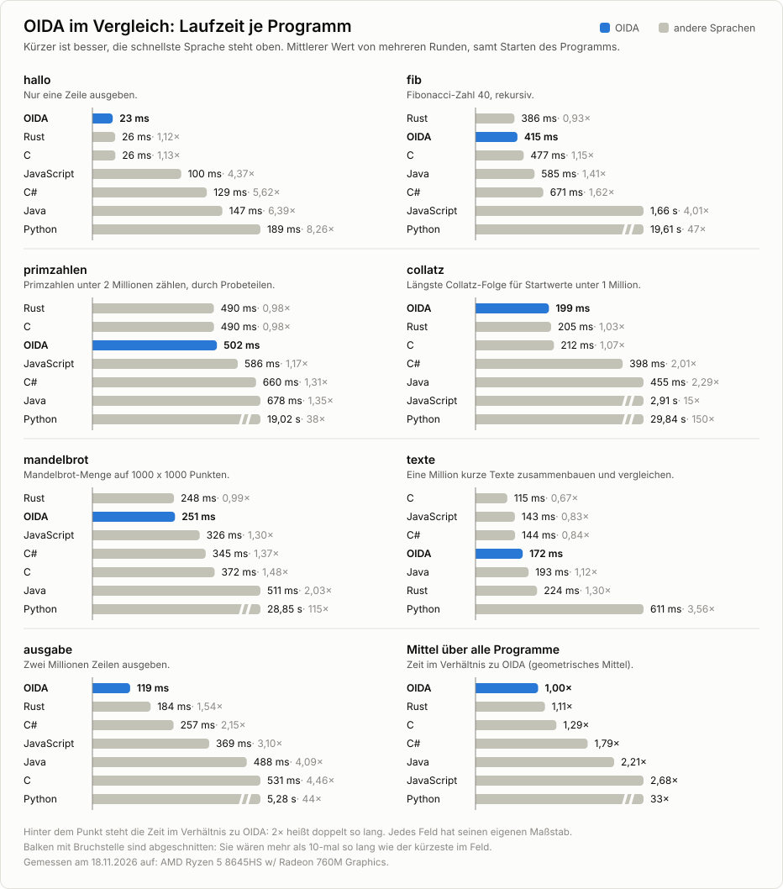
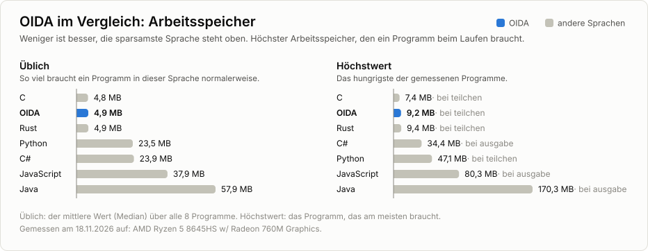

# Leistungsvergleich

Wie schnell ist OIDA im Vergleich zu anderen Sprachen? Hier liegen dieselben sieben Programme
in OIDA, C, Rust, C#, Java, JavaScript und Python, dazu ein Werkzeug, das sie baut, laufen lässt und misst.





Alle Zahlen als Tabellen stehen in [ERGEBNIS.md](ERGEBNIS.md), die rohen Messwerte in [ergebnis.csv](ergebnis.csv).

## Messen

Im Projektordner:

```
cargo build --release
cargo run --release -p oida-messen
```

Das dauert rund sieben Minuten (Python braucht am längsten) und schreibt `ERGEBNIS.md`,
`ergebnis.csv` und die beiden Grafiken neu. Währenddessen den Rechner in Ruhe lassen und das
Netzteil anstecken, sonst schwanken die Zeiten.

```
cargo run --release -p oida-messen -- fib collatz     nur diese Programme
cargo run --release -p oida-messen -- --ohne python   eine Sprache auslassen
cargo run --release -p oida-messen -- --nur-grafik    nicht messen, nur die Grafiken neu zeichnen
```

Sprachen, die am Rechner fehlen, werden ausgelassen. Gebraucht werden:

| Sprache    | Was da sein muss                                                            |
|------------|-----------------------------------------------------------------------------|
| C          | `clang` (aus llvm-mingw)                                                    |
| Rust       | `rustc`                                                                     |
| C#         | das .NET-SDK (`dotnet`); der Compiler wird direkt aufgerufen, ohne Projekt und ohne Netz |
| Java       | `javac` und `java` (im PATH, über `JAVA_HOME` oder das Java von DataGrip)   |
| JavaScript | `node`                                                                      |
| Python     | `python`                                                                    |

## Die Programme

| Programm     | Was es tut                                              | Was es misst                         |
|--------------|---------------------------------------------------------|--------------------------------------|
| `hallo`      | eine Zeile ausgeben                                     | wie lange das Starten dauert         |
| `fib`        | Fibonacci-Zahl 40, rekursiv                             | Funktionsaufrufe                     |
| `primzahlen` | Primzahlen unter 2 Millionen zählen (Probeteilen)       | Schleifen, Teilen mit Rest           |
| `collatz`    | längste Collatz-Folge unter 1 Million                   | Schleifen, Verzweigungen, ganze Zahlen |
| `mandelbrot` | Mandelbrot-Menge auf 1000 x 1000 Punkten                | Rechnen mit Kommazahlen              |
| `texte`      | eine Million kurze Texte bauen und vergleichen          | Texte und ihr Speicher               |
| `ausgabe`    | zwei Millionen Zeilen ausgeben                          | die Ausgabe                          |

Sie liegen in `programme/<name>/`, eines je Sprache.

## Wie gemessen wird

- **Zeit:** vom Starten bis zum Ende des Programms, also samt Hochfahren von .NET, Java, Node oder Python.
  Jedes Programm läuft mehrmals (schnelle 7-mal, sehr langsame nur einmal), es zählt der mittlere
  Wert (Median). So verfälscht ein einzelner Ausreißer nach oben oder unten nichts.
- **Speicher:** der höchste Arbeitsspeicher, den der Prozess gebraucht hat (fragt Windows).
- **Bauen und Größe:** wie lange das Übersetzen dauert und wie groß das Ergebnis wird.
- **Richtigkeit:** Jede Sprache muss dieselbe Ausgabe liefern (die `.erwartet`-Datei, bei `ausgabe`
  das, was OIDA ausgibt). Sonst zählt die Messung nicht.

Damit es fair bleibt:

- Überall derselbe Rechenweg, so geschrieben, wie man es in der Sprache üblicherweise schreibt.
  Keine Tricks, keine Sonderbibliotheken.
- Ganze Zahlen haben überall 64 Bit (JavaScript nimmt seine normalen Zahlen, Python seine beliebig großen).
- C wird mit `clang -O2` gebaut, Rust mit `opt-level=3` (wie `cargo build --release`), C# mit
  `-optimize+`, OIDA wie immer.
- Bei `ausgabe` verwenden Rust, C#, Java und JavaScript einen Puffer, weil man das dort bei viel Ausgabe so macht.

## Was die Zahlen sagen

Stand der Messung vom 18.11.2026 (Ryzen 5 8645HS, Windows 11). Die genauen Werte ändern sich
von Lauf zu Lauf um ein paar Prozent.

**Beim Rechnen ist OIDA so schnell wie C und Rust.** Bei `fib`, `primzahlen`, `collatz` und
`mandelbrot` liegen OIDA und Rust innerhalb von 7 %. Das ist keine Überraschung: Alle drei
lassen LLVM den Maschinencode erzeugen, und die Typen stehen in OIDA beim Übersetzen fest.
C# braucht 1,3- bis 2-mal so lang, Java 1,4- bis 2,3-mal, JavaScript 1,2- bis 15-mal,
Python 38- bis 150-mal.

**Starten und Speicher:** Ein OIDA-Programm startet in 23 ms und braucht 5 MB, wie C und Rust.
C# braucht 129 ms und 24 MB, Java 147 ms und 57 MB, Node 100 ms und 35 MB, Python 189 ms und
23 MB, bevor überhaupt etwas gerechnet ist.

**Texte:** 172 ms und 5 MB. Das ist schneller als Rust und Java, etwa gleichauf mit C# und
JavaScript, und langsamer als C (115 ms), das hier ohne Heap auskommt.

**Ausgabe:** 119 ms, am schnellsten von allen. `SCHREIB` schreibt Zahlen direkt in einen Puffer.

**Im Mittel über alle sieben Programme** (geometrisches Mittel, OIDA = 1): Rust 1,11, C 1,29,
C# 1,79, Java 2,21, JavaScript 2,68, Python 33.

### Was die Optimierung gebracht hat

Die erste Messung hatte zwei Schwächen gezeigt, die danach behoben wurden:

| Programm  | vorher                  | nachher           | Was geändert wurde                                   |
|-----------|-------------------------|-------------------|------------------------------------------------------|
| `texte`   | 230 bis 390 ms, 111 MB  | 172 ms, 5 MB      | Texte werden freigegeben, sobald sie niemand mehr braucht (Referenzzählung); `a + b + c` entsteht in einem Schritt |
| `ausgabe` | 365 ms                  | 119 ms            | Ausgabe ohne Sperre, Zahlen direkt in den Puffer     |

### Was man nicht falsch lesen soll

- **OIDA ist nicht schneller als C.** Dass C im Mittel hinter OIDA liegt, kommt von zwei Stellen,
  die nichts mit der Sprache zu tun haben: Bei `ausgabe` ist `printf` langsam (mit einem eigenen
  Puffer wäre C mindestens so schnell wie OIDA), und bei `mandelbrot` bremst eine Voreinstellung
  von clang (mit `-ffp-contract=off` ist das C-Programm genauso schnell, nachgemessen).
- **OIDA wurde auf genau diese Programme hin verbessert.** Die Optimierungen an Texten und
  Ausgabe kamen, nachdem dieser Vergleich die Schwächen gezeigt hatte. Die Programme der anderen
  Sprachen sind normal geschrieben und nicht nachgeschärft. Der Vergleich ist also für OIDA
  eher freundlich.
- **Kleine Unterschiede sind Zufall.** Bis etwa 15 % zwischen OIDA, C und Rust hängen von
  Kleinigkeiten im erzeugten Code ab. Bei `fib` lief das OIDA-Programm in einem Messlauf sogar
  einmal in 260 ms statt 410 ms, ohne dass sich etwas geändert hatte.
- **Die Sprachen sind nicht gleich weit.** Die Programme hier kommen mit Zahlen, Texten,
  Schleifen und Funktionen aus, weil OIDA v0.1 nicht mehr kann.

## Was der Vergleich nicht zeigt

Geschwindigkeit ist nur ein Teil davon, wie gut eine Sprache ist. Nicht gemessen ist alles,
was OIDA noch fehlt: Listen, Strukturen, Dateien, Eingabe, mehrere Kerne, eine
Standardbibliothek. Die üblichen Vergleichsprogramme (Sortieren, Matrizen, Bäume) lassen
sich in OIDA v0.1 gar nicht schreiben. Ehrlich zusammengefasst: Was OIDA kann, kann es so
schnell wie C und Rust. Es kann nur noch wenig.

Spannend wird der Vergleich wieder, wenn Listen und Strukturen da sind: Dann zeigt sich, was
die Referenzzählung bei größeren Datenmengen kostet.
